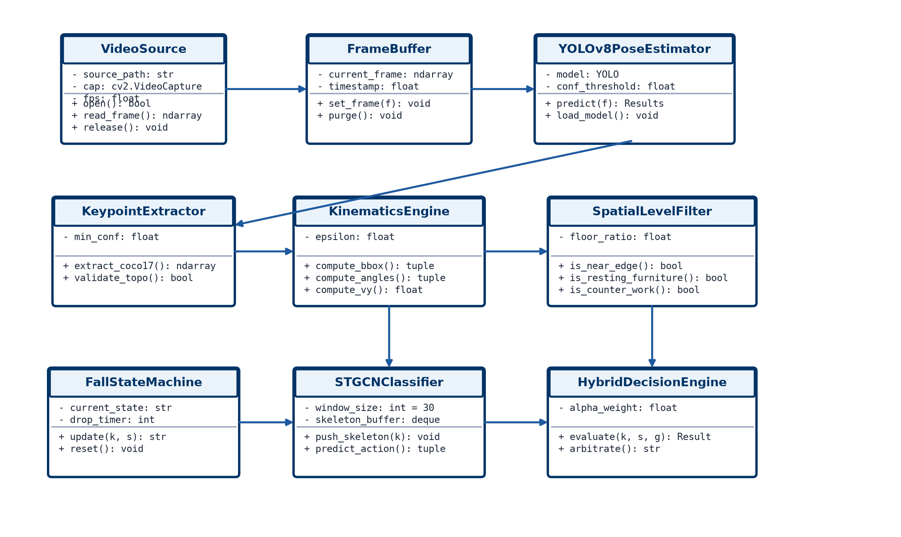
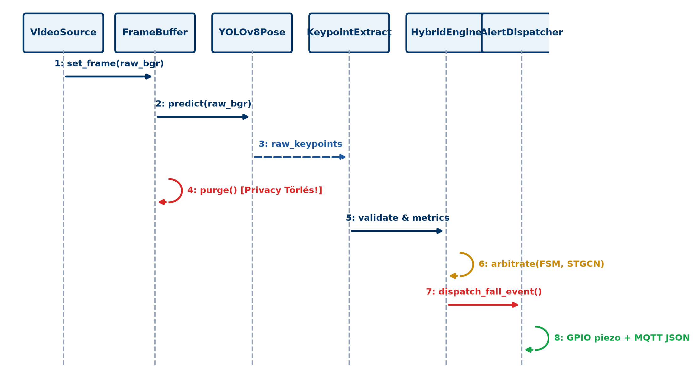
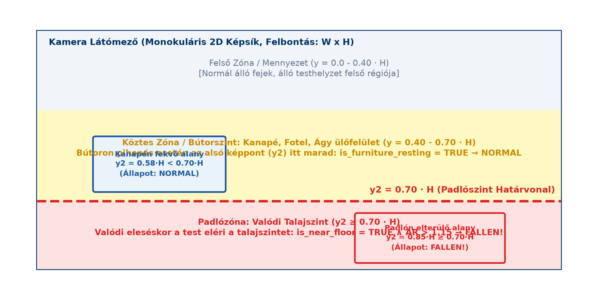

# Mellékletek a „Gráf alapú modellek detektálása vizuális információn, különös tekintettel a viselkedéselemzésre” című kutatási tervhez

A kutatási terv (v6) fő szövegéből kihagyott részletek. Az ábraszámozás a mellékletben A–E betűjelű.

## A. Kinematikai jellemzők és küszöbhierarchia (a fő szöveg 2.2 szakaszából)

A kinyert kulcspontokból származtatott differenciális és szögjellemzők képezik az állapotgép közvetlen bemenetét:

Befoglaló téglalap képaránya (AR = W / H): Felegyenesedett testtartásnál AR ≈ 0.25–0.55, padlón fekvő helyzetben AR > 1.0.

Frontális dőlésszög (θ_roll): A vállak és csípők felezőpontjaiból számított gerincvektor elfordulása a képsíkban a függőlegeshez képest.

Szagittális dőlésszög (θ_pitch): A kamera felé történő dőlés becslése a törzs magassági arányának perspektivikus rövidüléséből: θ_pitch = max(0.0°, min(80.0°, ((0.16 - torso_ratio) / 0.12) · 60.0°)).

Tömegközéppont vertikális sebessége (v_y): A csípőpontok süllyedési üteme normalizálva a testmérettel és időlépéssel. A pontos képletet a 3.4. szakasz adja (v_y = (Δy / ref_size) / Δt).

A.1. táblázat: A kinematikai állapotgép és szűrők szintezett paraméterhierarchiája.

| Paraméter | Célérték / Küszöb | Mértékegység | Állapotgépes szerep és mérnöki indoklás |
|---|---|---|---|
| v_y,drop | > 0.45 | s⁻¹ | Kritikus zuhanás (Drop detected): Extrém gyors vertikális zuhanási fázis, elindítja a memóriát. |
| v_y,fast | > 0.35 | s⁻¹ | Gyors esési tranziens: Megerősíti az aktív dőlési mozgást zuhanó fázisban (FALLING állapot). |
| v_y,warn | > 0.22 | s⁻¹ | Előzetes figyelmeztetés: Alacsonyabb sebességküszöb mérsékelt dőlés (θ > 38°) esetén. |
| v_y,rest | /v_y/ < 0.28 | s⁻¹ | Mozgási stabilizáció: Nyugalmi ablak bútoron történő ülés/fekvés során a mozgás megszűnésének igazolására. |
| v_y,counter | < 0.25 | s⁻¹ | Konyhapult plafon: Maximális vertikális mozgásingadozás felállás/munka közben (téves riasztás szűrése). |
| AR_floor | > 1.25 | dimenziótlan | Padlószinti fekvés: Szigorú fekvő testhelyzet küszöb a talajzónában elterülő személyekre (a kódban: AR > 1,25 ∧ θ_torso > 45° ∧ padló közelében). |
| AR_rest | > 0.95 | dimenziótlan | Bútorszinti pihenés: Enyhített képarány-küszöb a kanapén/ágyon való féloldalas elnyúlás kezelésére. |
| θ_fall | > 45.0° | fok (°) | Esési dőlésszög: Határérték, amely felett a gerinc horizontálisnak tekintendő. |
| θ_rest | > 28.0° | fok (°) | Pihenési dőlésszög: Enyhébb szögküszöb ülő vagy félig dőlt bútorpozíció detektálására. |
| y_2,floor | ≥ 0.70 · H_frame | normalizált magasság | Padlózóna heurisztika: Feltételezi, hogy a padló a kép alsó 30%-ában van (kameraállás-függő). |
| T_mem | 1,5 s | idő-alapú (FPS-független) | Zuhanási előzménymemória: ha a célpont a zuhanás (DROP_DETECTED) után ennyi időn belül eltűnik, a rendszer azonnal FALLEN állapotba lép (a kódban: curr_time − drop_time ≤ 1,5 s). |
| N_inst | 3 képkocka | ≈ 0.12 s (25 FPS) | Instabilitás-hiszterézis: legalább 3 egymást követő instabil képkocka kell a WARNING (UNSTABLE) állapothoz. A kódban az unstable_counter minden instabil képkockánál nő, egyébként eggyel csökken (legalább 0-ig), és a WARNING-hoz ≥ 3 szükséges; a belépési szűrő (is_entering) a képszélen lévő alakra a track_frames < 12 feltételt használja. Ez a két feltétel képkockaszám-alapú, ezért függ a képkockasebességtől (25 FPS-en 3 képkocka = 0,12 s, 12 képkocka = 0,48 s), a sebesség- és időkorlátok (v_y, T_mem, 0,8 s) viszont másodperc-alapúak. |
| N_belép | 12 képkocka | ≈ 0.48 s (25 FPS) | Ajtón belépési szélszűrő: a követés első 12 képkockáján (track_frames < 12) a képszélhez érő (x_1 ≤ 15 px ∨ x_2 ≥ W−15 px ∨ y_1 ≤ 10 px) csonkolt sziluett nem vált ki riasztást. |

A vertikális zuhanási sebesség: v_y(t) = (y_CoM(t) − y_CoM(t − Δt)) / (ref_size · Δt). Az y_CoM a két csípőpont felezőpontja (konfidencia > 0,35), ennek hiányában a két vállpont felezőpontja, végső esetben a befoglaló téglalap középpontja; ref_size = max(w_box, h_box, 50 px) a skálainvariáns normalizáláshoz; Δt a legfeljebb 0,5 s-os csúszó időablak legrégebbi mintájától számított időkülönbség (Δt ≥ 0,08 s). A v_y mértékegysége testméret/másodperc (s⁻¹), lefelé zuhanáskor v_y > 0. A kódban a WARNING feltétele: θ_torso > 40° ∨ (θ_torso > 30° ∧ (v_y > 0,22 ∨ magasságarány < 0,75)) ∨ v_y > 0,35; a 38°-os érték a dinamikus becsapódási ág (v_y > 0,35 ∧ θ_torso > 38°) küszöbe, ezért a táblázat θ_warn = 38° jelölése pontosítandó.

A küszöbidőket másodpercben célszerű definiálni (pl. T_mem = 1,5 s), a képkockaszámot az aktuális képkockasebességből származtatni. Ez azért szükséges, mert az URFD és a Le2i felvételek eltérő képkockasebességgel készültek, és a beágyazott futtatás képkockasebessége is eltér a fejlesztői gépétől.

## B. Részletes UML-tervek (a fő szöveg 3.3 szakaszából)

A rendszer objektumorientált osztálydekompozíciója szigorúan elválasztja a képi forrást (VideoSource, FrameBuffer), a pózbecslést (YOLOv8PoseEstimator, KeypointExtractor), a geometriai számításokat (KinematicsEngine, SpatialLevelFilter), a döntéshozatalt (FallStateMachine, STGCNClassifier, HybridDecisionEngine) és a kimenetet (AlertDispatcher, GUIController).



B.1. ábra: A teljes esésdetektáló szoftverrendszer moduláris UML osztálydiagramja.

A képkocka beolvasásától a kulcspontok kinyerésén, az adatvédelmi törlésen és a kinematikai arbitráción át a riasztásig terjedő végrehajtási szekvenciát a B.2. ábra szemlélteti.



B.2. ábra: A képkocka-feldolgozás és a helyi képmegsemmisítés UML szekvenciadiagramja.

## C. Peremesetek pontos feltételei és a szintmodell (a fő szöveg 4.1–4.3 szakaszából)

A kód: src/simple_fall_detector.py.

**4.1 Peremeset 1: kép szélén belépő személyek**

touches_edge = (x_1 ≤ 15) ∨ (x_2 ≥ W_frame - 15) ∨ (y_1 ≤ 10)

is_entering = touches_edge ∧ (track_frames < 12)

**4.2 Peremeset 2: konyhapult / asztal**

A konyhapult- és asztalvédelmi szűrő (is_counter_leaning) logikai feltétele:

is_counter_leaning = (y_2 < 0.72 · H_frame) ∧ (v_y < 0.25) ∧ (drop_timer is None) ∧ (not has_legs)

**4.3 Peremeset 3: kanapé / szintmodell**

is_near_floor = (y_2 ≥ 0.70 · H_frame)

is_furniture_resting = (y_2 < 0.70 · H_frame) ∧ (|v_y| < 0.28) ∧ (θ_torso > 28° ∨ AR > 0.95 ∨ is_seated)



C.1. ábra: A térbeli magassági szintmodell geometriai zónái a monokuláris képsíkon (kanapé pihenés vs. padlóra zuhanás).

## D. Benchmark-megjelenítő GUI (a fő szöveg 5.4 szakaszából)

5.4.1 A kezelőfelület főbb képességei

1. Dinamikus videóvezérlés: Lehetőséget biztosít tetszőleges tesztvideó betöltésére, léptetésére, megállítására, valamint dinamikus lejátszási sebességszorzó alkalmazására (1,0x valós idő, 1,5x gyorsítás, 2,0x gyorsított audit).

2. Képarány-megőrző dinamikus felskálázás: A különböző képarányú és felbontású benchmark videókat (pl. 640 × 480, 720 × 576) torzításmentesen, fekete kitöltősávokkal (letterboxing) skálázza fel az egységes 1200 × 920 képpontos megjelenítő vászonra.

3. Valós idejű telemetriai HUD (Heads-Up Display): A képernyő felső és alsó információs sávjában színkódolással kirajzolja az aktuális képkockaszámot, a videóidőt, az állapotgép fázisát (NORMAL, UNSTABLE, FALLING, FALLEN), a mért fizikai paramétereket (AR, θ_torso, v_y) és a detektált anatómiai csontvázat.

## E. Beágyazott megvalósítás részletei (a fő szöveg 6.1, 6.3.2–6.4 szakaszaiból)

### E.1 A peremhálózati feldolgozás motivációja

1. Adatvédelmi és etikai aggályok: A privát életterekből származó folyamatos videostream felhőbe történő továbbítása súlyos megfigyelési érzetet kelt a gondozottakban, és elfogadhatatlan adatvédelmi (GDPR) kockázatot hordoz egy esetleges hálózati incidens esetén.

2. Hálózati sávszélesség és rendelkezésre állás: A lakossági Wi-Fi kapcsolat minősége ingadozhat, egy átmeneti internetkimaradás esetén pedig a vészjelzés el sem jut a felhőbe, ami közvetlen életveszélyt idéz elő.

3. Üzemeltetési költség és skálázhatóság: Több száz vagy ezer háztartás párhuzamos videófolyamainak felhőalapú GPU-infrastruktúrán történő valós idejű feldolgozása aránytalanul magas és folyamatos szerverbérleti díjakkal jár.

### E.2 INT8 kvantálás

A konvolúciós hálózatok alapértelmezésben 32 bites lebegőpontos (FP32) formátumban tárolják a súlyokat. A poszt-tanítási INT8 kvantálás célja, hogy a 32 bites értékeket 8 bites egészekké alakítsa, 75%-os memóriamegtakarítást és számítási gyorsulást biztosítva:

q = round(x / S) + Z

x̂ = S · (q - Z)

ahol S a valós lebegőpontos skálázási tényező (scale factor), Z pedig a nullapont-eltolás (zero-point offset).

1. Szimmetrikus súlykvantálás: A hálózati rétegek súlymátrixai esetében a statikus értéktartomány jellemzően szimmetrikus a nulla körül, így a nullapont fixen rögzíthető (Z = 0), egyszerűsítve a hardveres szorzási láncot.

2. Aszimmetrikus aktivációkvantálás: Mivel a SiLU aktivációk nem szimmetrikusak, az aktivációknál nemzéró Z eltolást alkalmazunk, amelyet egy 200 reprezentatív képkockából álló kalibrációs mintahalmazon optimalizálunk Kullback–Leibler (KL) divergencia minimalizálásával.

### E.3 ARM NEON és futtatókörnyezetek

Az ARM Cortex-A processzormagok dedikált Advanced SIMD (NEON) egységgel rendelkeznek [15] (AArch64-en 32 db 128 bites vektorregiszter; AArch32-ben 16 db 128 bites vagy 32 db 64 bites):

Párhuzamos műveletvégzés: Egyetlen 128 bites NEON regiszterben egyszerre tizenhat darab 8 bites egész (INT8) adat fér el, párhuzamosítva a konvolúciókat.

Hardveres dot-product utasítások: A Raspberry Pi 5 ARMv8.2-A Cortex-A76 magja támogatja a hardveres SDOT és UDOT gépi utasításokat, amelyek négy párhuzamos 8 bites egész szorzatát egyetlen órajelciklus alatt adják hozzá egy 32 bites akkumulátorhoz.

A beágyazott operációs rendszeren (Raspberry Pi OS 64-bit) két célszerű futtatókörnyezet illesztését tervezzük:

1. ONNX Runtime (CPUExecutionProvider): Képes a PyTorch-ban exportált ONNX modellt futtatni, natív módon kiaknázva az ARM NEON és OpenMP többmagos szálkezelési lehetőségeit [9].

2. Tencent NCNN motor: Kifejezetten beágyazott ARM platformokra optimalizált, minimális memóriaigényű C++ keretrendszer közvetlen assembly-szintű NEON rutinokkal, kiküszöbölve a Python futtatókörnyezet többletterhelését.

### E.4 Tervezett céleszköz, vészjelző alrendszer, IoT-kommunikáció

6.4.1 A fizikai céleszköz felépítése

Központi egység: Raspberry Pi 5 mikroszámítógép aktív ventilátoros hűtőbordával, amely megakadályozza a processzormagok termikus órajel-visszaszabályozását (thermal throttling) tartós terhelés mellett is.

Kameramodul: Raspberry Pi Camera Module 3 nagylátószögű (120°) objektívvel és Sony IMX708 szenzorral, amely közvetlenül MIPI CSI-2 buszon DMA átvitellel tölti a képkockákat a memóriába minimális CPU-overhead mellett.

Tápellátás és szünetmentesítés: 5V / 5A USB-C PD hálózati tápegység, kiegészítve egy szünetmentes akkumulátormodullal (UPS HAT); a tényleges üzemidő mérendő.

6.4.2 Helyi hardveres vészjelző alrendszer (Fail-safe Actuator)

A rendszer megbízhatóságának kulcsa, hogy életmentő szituációban nem függhet a helyi Wi-Fi hálózat vagy az internetkapcsolat stabilitásától. Ezért a mikroszámítógép általános célú be-/kimeneti (GPIO) portjára közvetlen hardveres riasztási interfész kapcsolódik:

Helyi piezo sziréna: Egy tranzisztoros kapcsolófokozattal vezérelt, tervezett 85 dB hangnyomású helyi piezo hangjelző (sziréna), amely igazolt esés esetén azonnal akusztikus riasztást ad a szomszédok vagy hozzátartozók számára.

Kétszínű állapotjelző LED: Normál működés és követés esetén diszkrét zöld fény, vészhelyzet vagy instabilitás esetén villogó vörös jelzés.

Hálózatfüggetlen fail-safe: A GPIO tranzisztor meghajtása közvetlenül a hardveres könyvtáron keresztül történik, megkerülve a hálózati protokollláncot.

6.4.3 IoT telemetriai kommunikáció és üzenetstruktúra

Amennyiben rendelkezésre áll hálózati kapcsolat, a peremhálózati eszköz szabványos, kis sávszélesség-igényű MQTT protokollon keresztül kommunikál TLS 1.3 titkosított csatornán a helyi okosotthon-központtal (pl. Home Assistant) vagy a gondozási központtal.A továbbított telemetriai adatcsomag szigorúan strukturált JSON formátumú, amely nem tartalmaz sem képet, sem biometrikus adatot (Privacy-by-Design): Illusztratív példa; az értékek nem mérési eredmények.

```json
{ "device_id": "rpi5_room_sensor_01", "timestamp": 1716982455.420, "event_type": "FALL_DETECTED", "severity": "CRITICAL", "confidence": 0.94, "telemetry": { "torso_angle_deg": 78.4, "aspect_ratio": 1.45, "drop_velocity_vy": 0.62, "floor_contact": true, "immobility_duration_sec": 3.5 }, "heartbeat": { "system_fps": 22.4, "cpu_temp_celsius": 48.2, "uptime_sec": 84200 }}
```

Az MQTT architektúra lehetővé teszi, hogy egyetlen lakásban vagy intézményben több diszkrét szobai szenzorcsomópont csatlakozzon egyetlen központi diszpécserpanelhez anélkül, hogy a helyi hálózatot terhelő videófolyamok futnának a háttérben. A peremhálózati koncepció gyakorlati validációja és az INT8-ra kvantált hálózat Raspberry Pi 5 hardveren történő mérése a Szakdolgozat 2 kísérleti programjának szerves része.

## F. Pózbecslés: módszerek, architektúra, COCO-17 topológia (a fő szöveg 2.1 szakaszából)

2.1.1 A pózbecslő architektúrák evolúciója

A szakirodalomban a pózbecslési megközelítések alapvetően két fő csoportra oszthatók:

1. Felülről lefelé építkező (Top-down) módszerek: Első lépésben egy emberdetektáló modell behatárolja az egyéneket reprezentáló befoglaló téglalapokat (bounding box), majd egy specializált hálózat (pl. AlphaPose, HRNet) minden egyes kivágott területen külön megbecsüli a kulcspontok hőtérképeit (heatmaps). Bár pontosságuk kiemelkedő, számítási igényük lineárisan skálázódik a személyek számával.

2. Alulról felfelé építkező (Bottom-up) módszerek: A teljes képen egyszerre detektálják az összes létező kulcspontot, majd asszociációs mezők (pl. az OpenPose PAF mezői [12]) segítségével kapcsolják össze az egymáshoz tartozó ízületeket. Számítási idejük független a személyek számától, azonban a hőtérképek dekódolása jelentős processzorterhelést jelent.

A valós idejű, erőforrás-korlátos működés megvalósításához a legkorszerűbb egyfokozatú, horgonypont-mentes (Single-stage, Anchor-free) architektúrák kínálják az optimális kompromisszumot. Jelen kutatásban az Ultralytics által kifejlesztett YOLOv8-Pose architektúra [2] kerül alkalmazásra:

Gerinchálózat (Backbone): Módosított CSPDarknet, amely C2f blokkokat alkalmaz a gazdag kontextus kinyerésére alacsony számítási költség mellett.

Nyakrész (Neck): Továbbfejlesztett PANet (Path Aggregation Network), amely piramisszerűen ötvözi a többskálájú térbeli információkat.

Detektáló és regressziós fej (Head): Szétválasztott kimeneti rétegek, ahol a befoglaló téglalap osztályozása mellett egy közvetlen regressziós ág becsli meg a kulcspontok koordinátáit és láthatósági konfidenciáit.

2.1.2 A COCO-17 topológia és az OKS veszteségfüggvény

A modell a nemzetközileg standardizált MS COCO topológiát [14] követi, amely az emberi testet N = 17 diszkrét kulcsponttal írja le. Minden egyes személy pózreprezentációja egy K halmazként értelmezhető: K = { p_i = (x_i, y_i, c_i) }, ahol (x_i, y_i) a normalizált képi koordináták, c_i pedig a predikált konfidencia-érték.A kulcspont-regresszió tanítási folyamatának alapját az OKS (Object Keypoint Similarity) metrika képezi, amely a predikált és ground truth pontok távolságát normalizálja a személy skálafaktorával és az anatómiai szórási konstansokkal.

F.1. táblázat: A COCO-17 kulcspont-topológia anatómiai szerepe az eséselemzésben.

| Index (i) | Kulcspont megnevezése | Anatómiai régió | Szerepe és fontossága az eséselemzésben |
|---|---|---|---|
| 0 | Orr (Nose) | Fej | A hirtelen lefelé irányuló mozgástranziens (zuhanás) legfelső indikátora. |
| 1, 2 | Szemek (Left/Right Eye) | Fej | A fej térbeli orientációjának és forgatásának becslése. |
| 3, 4 | Fülek (Left/Right Ear) | Fej | A fej laterális billenésének és a fejtartás elvesztésének azonosítása. |
| 5, 6 | Vállak (Left/Right Shoulder) | Felsőtest | A gerincvektor felső rögzítési pontja; a vállszélesség a testméret referenciája. |
| 7, 8 | Könyökök (Left/Right Elbow) | Felső végtagok | Védekező reflexmozdulatok és kitámasztási kísérletek vizsgálata. |
| 9, 10 | Csuklók (Left/Right Wrist) | Felső végtagok | Talajjal való érintkezés, tompítás és magatehetetlenség elemzése. |
| 11, 12 | Csípők (Left/Right Hip) | Medence | A test tömegközéppontjának (CoM) és a gerincvektor alsó pontjának alapja. |
| 13, 14 | Térdek (Left/Right Knee) | Alsó végtagok | Térdhajlítás mérése, a leülés és leguggolás szétválasztása az eséstől. |
| 15, 16 | Bokák (Left/Right Ankle) | Alsó végtagok | A talajsík fizikai érintési zónája; a vízszintes kiterjedés ellenőrzése. |
