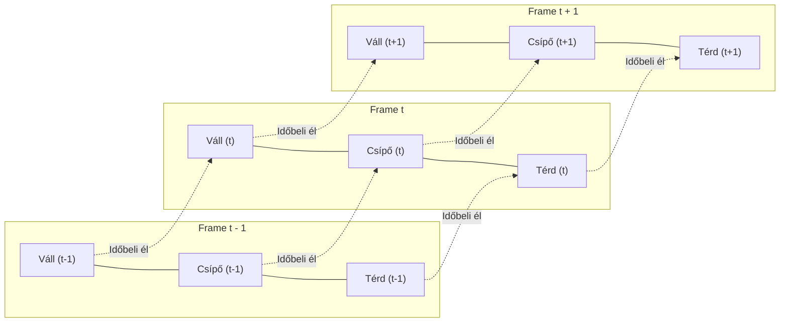
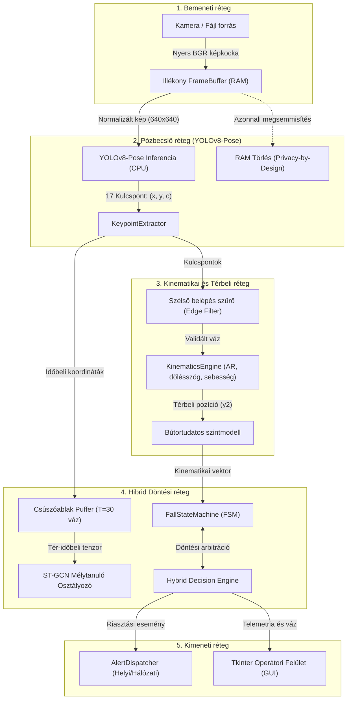
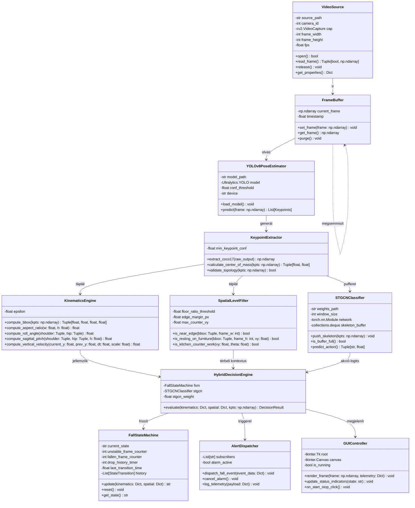
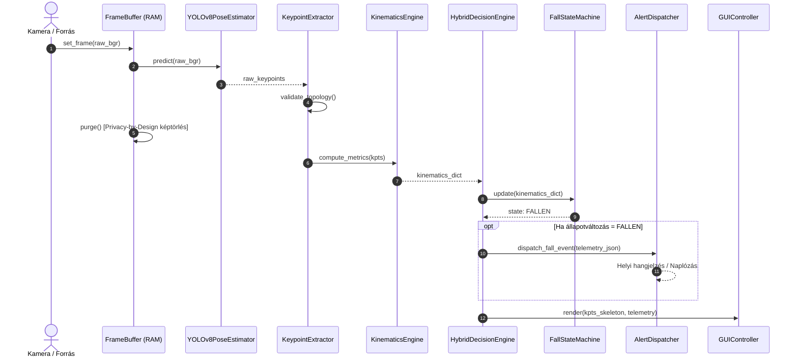
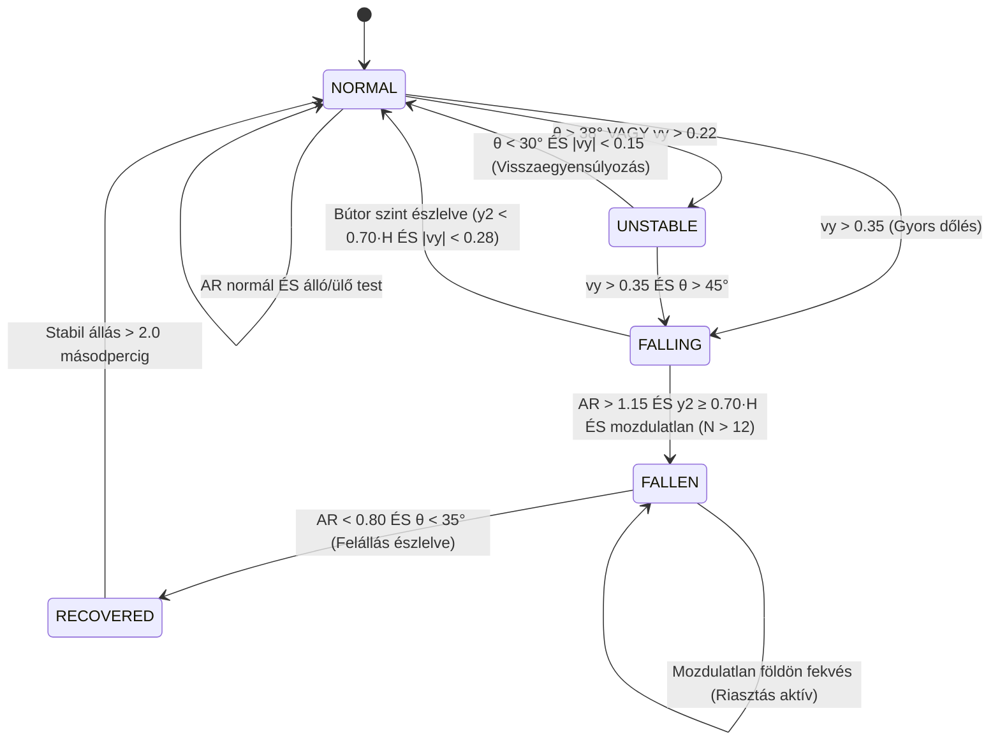

# Gráf alapú modellek detektálása vizuális információn, különös tekintettel a viselkedéselemzésre

**Alcím:** Valós idejű esésdetektálás 2D pózbecsléssel, kinematikai heurisztikákkal és tér-időbeli gráfkonvolúciós hálózatokkal (ST-GCN)  
**Típus:** Szakdolgozat 1 -- Kutatási és fejlesztési terv  
**Intézmény:** Széchenyi István Egyetem (SZE), Győr  
**Kar:** Gépészmérnöki, Informatikai és Villamosmérnöki Kar (GIVK)  
**Tanszék:** Informatika Tanszék  
**Képzés:** Mérnökinformatikus BSc  
**Készítette:** Szakdolgozó Hallgató  
**Készítés éve:** 2026  

---

## Kivonat / Absztrakt

A gépi látás és a viselkedéselemzés egyik legkritikusabb gyakorlati alkalmazási területe a váratlan emberi esések valós idejű, megbízható felismerése. A demográfiai öregedés következtében az egyedül élő idős emberek körében az elesések száma folyamatosan emelkedik, ahol a padlón töltött idő drasztikusan növeli a súlyos szövődmények kialakulásának kockázatát. Bár a piacon elérhetők hordható vészjelzők, a felhasználói feledékenység és az eszméletvesztés miatt megbízhatóságuk korlátozott. A felhőbe képeket továbbító biztonsági kamerák pedig komoly adatvédelmi és személyiségi jogi (GDPR) ellenállásba ütköznek a magánszférában.

Jelen szakdolgozati munka (Szakdolgozat 1 – Kutatási és fejlesztési terv) egy olyan autonóm, beépített adatvédelmet (*Privacy-by-Design*) célzó esésdetektáló rendszer tervezését és elméleti megalapozását mutatja be, amely monokuláris videofolyamból nyert vizuális információt elemez. A dolgozat címében szereplő gráf alapú modellezés az emberi testtartást leíró anatómiai kulcspontok térbeli és időbeli összefüggéseinek reprezentációjára utal. A tervezett rendszer feldolgozási lánca a modern mélytanulási pózbecslő modellt (YOLOv8-Pose) ötvözi geometriai-kinematikai mozgáselemzéssel és tér-időbeli gráfkonvolúciós hálózatokkal (ST-GCN). A rendszer alapelve, hogy a nyers videokockák a kulcspontok kinyerése után azonnal törlésre kerülnek a memóriából; a döntéshozatal kizárólag a 17 anatómiai kulcspont koordináta-hálózatán történik.

A kutatás első szakaszában feltárásra kerültek a valós otthoni környezetben tipikusan fellépő téves riasztási lehetőségek és peremesetek (például a képmező szélén belépő személyek csonkolt sziluettje, a konyhapult előtti munka vagy a kanapén való szándékos elterülés), amelyek kezelésére szabályalapú kinematikai szűrők kerültek kialakításra. Egy részletes telemetriai esettanulmány keretében bemutatásra kerül a segédeszközzel (járókerettel) történő eleséskor fellépő takarás problémája is, amely kísérletileg rámutat a tisztán 2D geometriai heurisztikák korlátaira, és indokolja az ST-GCN hálózatok szükségességét. A dolgozat áttekinti a prototípuson végzett eddigi feltáró tesztek tapasztalatait, részletesen elemzi a jelenlegi heurisztikák biztonsági korlátait és kameranézet-függőségét, valamint egy strukturált kutatási és kísérleti ütemtervet határoz meg a modell tanítására, a nyilvános adathalmazokon (URFD, Le2i) végzendő független validációra és a beágyazott futtatás megalapozására.

---

## 1. Bevezetés és a feladat kitűzése

### 1.1 Társadalmi és egészségügyi kontextus
A fejlett társadalmak egyik legjelentősebb civilizációs és szociális kihívása a lakosság korfájának folyamatos elöregedése. Az Európai Unió statisztikai hivatala (Eurostat) és a Központi Statisztikai Hivatal (KSH) demográfiai elemzései alapján 2050-re az európai lakosság közel 30%-a 65 év feletti lesz, miközben az egyedül élő idős emberek által fenntartott egyszemélyes háztartások aránya ugrásszerűen növekszik. 

Ebben a veszélyeztetett korosztályban az önálló életvitel elvesztésének és a súlyos egészségkárosodásoknak a vezető oka a váratlan elesés:
* Az Egészségügyi Világszervezet (WHO, 2021) adatai szerint a 65 év feletti lakosság 30–35%-a, míg a 80 év felettiek több mint 40%-a legalább egyszer elesik évente.
* Bár a közhiedelemmel ellentétben az eséseknek csupán mintegy 5–10%-a vezet közvetlen csonttöréshez, a kórházi traumatológiai ellátást igénylő combnyak- és medencetörések több mint 90%-a elesés következménye.
* Az elesések közvetlen orvosi ellátási költségei, valamint a tartós ápolási és rehabilitációs kiadások az Európai Unióban és az Egyesült Államokban is évi több tízmilliárd dolláros terhet rónak az egészségbiztosítási rendszerekre.

### 1.2 Az elhúzódó földön fekvés orvosi szövődményei és a beavatkozási időablak
A baleseti sebészetben és az intenzív terápiában jól ismert az R. Adams Cowley által leírt „arany óra” (*Golden Hour*) koncepciója, amely kimondja, hogy a súlyos traumát szenvedett páciensek túlélési esélyei drasztikusan lecsökkennek, ha a végleges orvosi ellátás nem kezdődik meg a sérülést követő első 60 percen belül. Az idősgyógyászati (geriátriai) szakirodalom egyértelműen bizonyítja, hogy az elesést követő klinikai kimenetelt döntően nem maga az esés mechanikai energiája, hanem a földön töltött idő hossza (*time-on-floor*) határozza meg:
1. **A gyors segítségnyújtás hatása:** Amennyiben az elesett személy az eseményt követő egy órán belül szakszerű segítséget kap, a tartós szövődmények és az intézményi elhelyezés kockázata minimálisra szorítható.
2. **Az elhúzódó fekvés (*long lie*) szövődményei:** Wild és munkatársai mérföldkőnek számító kutatásai (British Medical Journal, 1981), valamint Tinetti és kutatócsoportja (JAMA, 1993) kimutatták, hogy amennyiben egy idős ember egyedül esik el és több mint 1 órát mozdulatlanul a földön tölt, a halálozási ráta 6 hónapon belül meghaladja az 50%-ot – még abban az esetben is, ha közvetlen mechanikai törést nem szenvedett. Ennek hátterében a következő patofiziológiai folyamatok állnak:
   - *Hipotermia (kihűlés):* A hideg padlóburkolattal való közvetlen érintkezés még fűtött szobában is gyors hővesztéshez és veszélyes maghőmérséklet-csökkenéshez vezet.
   - *Rhabdomyolysis (izomelhalás):* A saját testsúly okozta tartós nyomás alatt a komprimált izomsejtek ischaemiás nekrózist szenvednek, aminek következtében nagymennyiségű mioglobin és kálium áramlik a véráramba, akut tubuláris nekrózist és veseelégtelenséget idézve elő.
   - *Dekubitusz és keringési elégtelenség:* A sokkos állapot és a mozdulatlanság órák alatt súlyos szöveti elhalást és keringési összeomlást okoz.

### 1.3 Meglévő technológiai megközelítések és korlátaik
Az elesések automatizált detektálására az elmúlt évtizedben számos mérnöki megoldás született, ezek azonban a gyakorlatban komoly korlátokba ütköznek:

| Megközelítés típusa | Tipikus megvalósítások | Főbb előnyök | Gyakorlati korlátok és hátrányok |
| :--- | :--- | :--- | :--- |
| **Hordható eszközök (Wearables)** | Gyorsulásmérős (IMU) okosórák, medálok, segélyhívó gombok | Olcsó, testen hordható, kültéren is működik | Felhasználói feledékenység (az idősek fürdéskor, alváskor leveszik). Eszméletvesztésnél a pánikgomb nem nyomható meg. |
| **Környezeti szenzorok** | Intelligens padlószőnyeg, Doppler-radar, akusztikus mikrofonhálózat | Nem kell viselni, nem sérti a képi magánszférát | Bonyolult és drága telepítés, szobánkénti kalibráció, nem nyújt részletes vizuális információt a mozgás típusáról. |
| **Hagyományos biztonsági kamerák** | Felhőbe streamelő beltéri IP kamerák, nyers képanalízis | Gazdag vizuális információ, nagy látószög | **Súlyos etikai és adatvédelmi (GDPR) ellenállás:** A magánélet legintimebb tereiben (hálószoba, fürdőszoba) a videostreaming elfogadhatatlan. |
| **Beépített adatvédelmű gépi látás (Jelen munka)** | Helyi pózbecslés (YOLOv8-Pose) + Gráf- és kinematikai analízis | Nincs hordható eszköz, a nyers képkockák azonnal megsemmisülnek, valós idejű | Komplex algoritmust és modellezést igényel a peremesetek, takarások és szándékos leülések kezelésére. |

### 1.4 A szakdolgozat célkitűzései és a tervezett rendszer áttekintése
A szakdolgozat átfogó mérnöki célkitűzése egy olyan autonóm, monokuláris kameraképre épülő esésdetektáló szoftverrendszer megtervezése és megvalósítása, amely képes a lakókörnyezetben bekövetkező hirtelen mozgásvesztéseket megbízhatóan felismerni, miközben maximálisan tiszteletben tartja a felhasználók személyiségi jogait és magánszféráját. 

A munka a következő főbb pillérekre épül:
1. **Beépített adatvédelem (Privacy-by-Design):** A nyers videokockák feldolgozása kizárólag a helyi számítási egység memóriájában történik. A 2D kulcspontok kinyerése után a képi információ azonnal törlésre kerül, így sem képi, sem videós adatfolyam nem hagyja el a helyi eszközt, és semmilyen vizuális tartalom nem kerül tartós tárolásra.
2. **Kétrétegű detektálási architektúra:**
   - *Elsődleges gyors kinematikai szűrő:* Egy valós idejű, szabályalapú állapotgép (FSM), amely a testtartás arányaiból, a gerincvektor dőlésszögéből és a súlypont vertikális sebességéből szűri a mindennapi életviteli tevékenységeket (ADL).
   - *Tér-időbeli gráfkonvolúciós hálózat (ST-GCN):* A csontváz-topológia időbeli dinamikáját modellező mélytanulási réteg beépítése, amely a takarások és összetett dinamikus átmenetek esetén is képes a mozgásmintázat helyes osztályozására.
3. **Robusztus peremeset-kezelés:** Olyan algoritmikus mechanizmusok kifejlesztése, amelyek megakadályozzák a valós háztartási környezetben tipikusan fellépő téves riasztásokat (például a képmező szélén belépő személyek csonkolt bounding boxai, a konyhapult előtti munka vagy a kanapén való szándékos elterülés).
4. **Erőforrás-hatékony futtatás:** A teljes feldolgozási lánc optimalizálása annak érdekében, hogy költséges, dedikált nagy teljesítményű GPU hardver nélkül, átlagos asztali számítógépen vagy laptop processzoron (CPU) is biztosítható legyen a valós idejű (folyamatos, legalább 25 FPS képkockasebességű) működés, valamint a jövőbeni beágyazott (pl. Raspberry Pi alapú) futtatás megalapozása.

### 1.5 Kutatási kérdések és hipotézisek
A kutatómunka és a tervezési folyamat irányítására a következő tudományos kutatási kérdések (*Research Questions - RQ*) és formális hipotézisek (*Hypotheses - H*) kerültek megfogalmazásra:

* **RQ1:** Képes-e a monokuláris 2D emberi pózbecslés mélységszenzor (RGB-D) nélkül, tisztán geometriai és kinematikai idősorok alapján megbízhatóan szétválasztani a mindennapi életviteli mozgásokat (ADL) a valódi esésektől?
  - **H1:** A normalizált bounding box képarány ($AR$), a gerincvektor dőlésszöge ($\theta_{\text{torso}}$) és a súlypont vertikális sebességének ($v_y$) együttes állapotgépes modellezésével a tipikus leülések és tárgyért hajolások szignifikánsan elkülöníthetők az esési tranziensektől.
* **RQ2:** Milyen mértékben torzítja a segédeszközök (pl. járókeret) általi részleges kitakarás a detektált kulcspontok folytonosságát, és kompenzálható-e ez a jelenség tisztán 2D geometriai szinten?
  - **H2:** A talajszinthez közeli fizikai takarások a kulcspontok hirtelen elvesztéséhez és az észlelt sziluett ugrásszerű zsugorodásához vezetnek, amely hagyományos heurisztikákkal csak esési előzménymemória bevonásával kezelhető, végső megoldása pedig a csontváz-gráf összefüggéseit tanuló tér-időbeli modellezést (ST-GCN) igényli.
* **RQ3:** Milyen feltételek mellett képes egy térbeli képsíki szintmodell megkülönböztetni a bútoron (ágyon, kanapén) történő pihenést a padlóra zuhanástól?
  - **H3:** Rögzített látószögű kameránál a padlózóna alsó képtartományának küszöbölése és a sebességcsillapodás szűri a kanapén való elterülést, azonban a távoli háttérben bekövetkező eséseknél hamis negatív döntést eredményezhet, ami a kamera geometriai kalibrációját vagy tanult térbeli reprezentációt tesz szükségessé.
* **RQ4:** Megvalósítható-e a teljes feldolgozási lánc (pózbecslés, geometriai elemzés, állapotgép és megjelenítés) valós időben ($\ge 25$ FPS képkockasebességgel) átlagos felhasználói számítógépen, dedikált nagy teljesítményű grafikus gyorsító (GPU) nélkül, tisztán CPU-n futtatva?
  - **H4:** A könnyített architektúrájú mélytanuló modellek (YOLOv8n-Pose / YOLOv8s-Pose) és a vektorizált kinematikai számítások ciklusideje optimalizált futtatókörnyezetben átlagos asztali számítógép processzorán 40 ms alatt tartható, biztosítva a 25 FPS feletti folyamatos feldolgozást.

---

## 2. Szakirodalmi áttekintés és elméleti háttér

A számítógépes látással és mélytanulással megvalósított emberi viselkedéselemzés és esésdetektálás az elmúlt évtizedben jelentős paradigmaváltáson ment keresztül. A korai, tisztán sziluett- és optikai áramlás (*optical flow*) alapú módszereket felváltották az anatómiai kulcspontokat becslő konvolúciós architektúrák, valamint az emberi vázat tér-időbeli gráfként reprezentáló mély hálózatok. Jelen fejezet bemutatja a tervezett rendszer elméleti és matematikai alapjait: a 2D mélytanulási pózbecslést, a származtatott kinematikai mozgásjellemzőket, a tér-időbeli gráfkonvolúciós hálózatok (ST-GCN) működését, az adatvédelmi (*Privacy-by-Design*) szempontok mérnöki realitását, valamint a kapcsolódó nemzetközi szakirodalom kritikai összehasonlítását.

### 2.1 Emberi pózbecslés mélytanulással

Az emberi testtartás képi rekonstrukciója (2D Human Pose Estimation) a számítógépes látás egyik legintenzívebben kutatott területe. A cél az emberi test anatómiailag releváns ízületeinek és végtagpontjainak képsíki lokalizációja egyetlen RGB képkocka alapján.

#### 2.1.1 A pózbecslő architektúrák evolúciója
A szakirodalomban a pózbecslési megközelítések alapvetően két fő csoportra oszthatók:
1. **Felülről lefelé építkező (Top-down) módszerek:** Első lépésben egy emberdetektáló modell (pl. Faster R-CNN) behatárolja az egyéneket reprezentáló befoglaló téglalapokat (*bounding box*), majd egy specializált hálózat (pl. AlphaPose, HRNet) minden egyes kivágott területen külön megbecsüli a kulcspontok hőtérképeit (*heatmaps*). Bár ezen modellek pontossága kiemelkedő, számítási igényük lineárisan skálázódik a képen látható személyek számával, ami jelentős késleltetést okoz.
2. **Alulról felfelé építkező (Bottom-up) módszerek:** A teljes képen egyszerre detektálják az összes létező kulcspontot, majd asszociációs mezők (pl. az OpenPose által bevezetett *Part Affinity Fields*, PAF) segítségével kapcsolják össze az egymáshoz tartozó ízületeket. Számítási idejük független a személyek számától, azonban a hőtérképek pixel-szintű dekódolása számításigényes utófeldolgozást (pl. Non-Maximum Suppression) igényel.

A valós idejű, erőforrás-korlátos működés megvalósításához a legkorszerűbb **egyfokozatú, horgonypont-mentes (Single-stage, Anchor-free)** architektúrák kínálják az optimális kompromisszumot. Jelen kutatásban az Ultralytics által kifejlesztett **YOLOv8-Pose** architektúra kerül alkalmazásra. A hálózat felépítése:
* **Gerinchálózat (Backbone):** Egy módosított CSPDarknet (Cross Stage Partial Network), amely C2f (Cross-Stage Partial with two convolutions) blokkokat alkalmaz a gazdag geometriai és szemantikai kontextus kinyerésére alacsony számítási költség mellett.
* **Nyakrész (Neck):** Egy továbbfejlesztett PANet (Path Aggregation Network), amely piramisszerűen ötvözi a többskálájú térbeli információkat.
* **Detektáló és regressziós fej (Head):** Szétválasztott (*decoupled*) kimeneti rétegek, ahol a befoglaló téglalap osztályozása és koordinátáinak becslése mellett egy közvetlen regressziós ág becsli meg a kulcspontok koordinátáit és láthatósági valószínűségeit.

#### 2.1.2 A COCO-17 topológia és az OKS veszteségfüggvény
A modell a nemzetközileg standardizált MS COCO topológiát követi, amely az emberi testet $N = 17$ diszkrét kulcsponttal írja le. Minden egyes személy pózreprezentációja egy $K$ halmazként értelmezhető:
$$K = \left\{ \mathbf{p}_i = (x_i, y_i, c_i) \right\}_{i=1}^{17}$$
ahol $(x_i, y_i) \in \mathbb{R}^2$ a kulcspont normalizált képsíki koordinátái, $c_i \in [0, 1]$ pedig a hálózat által predikált konfidencia-érték.

A kulcspont-regresszió tanítási folyamatának alapját az **OKS (Object Keypoint Similarity)** metrika képezi, amely a hagyományos IoU (Intersection over Union) elvét terjeszti ki pontszerű anatómiai jellemzőkre:
$$OKS = \frac{\sum_{i=1}^{17} \exp\left( - \frac{d_i^2}{2 s^2 \sigma_i^2} \right) \delta(v_i > 0)}{\sum_{i=1}^{17} \delta(v_i > 0)}$$
A képlet változói és paraméterei:
* $d_i = \|\mathbf{p}_i - \hat{\mathbf{p}}_i\|_2$: a becsült és a valós (*ground truth*) kulcspont euklideszi távolsága a képsíkon.
* $s$: a személy skálafaktora, amely megegyezik a befoglaló téglalap területének négyzetgyökével ($s = \sqrt{W \cdot H}$).
* $\sigma_i$: az $i$-edik anatómiai kulcspontra vonatkozó empirikus szórási konstans. A COCO adathalmazon végzett mérések alapján a stabilabb ízületekhez (pl. orr, szemek: $\sigma \approx 0{,}025-0{,}035$) szigorúbb büntetés társul, míg a nehezebben lokalizálható vagy nagyobb anatómiai mozgásszabadsággal bíró pontokhoz (pl. csípő, térd, boka: $\sigma \approx 0{,}087-0{,}107$) enyhébb normalizáció tartozik.
* $v_i$: láthatósági indikátor ($v_i = 0$: nincs annotálva, $v_i = 1$: takart, de annotált, $v_i = 2$: tisztán látható), $\delta(\cdot)$ pedig a Dirac-delta funkció analógja (feltételes szelekció).

Az esésdetektálás szempontjából a 17 kulcspont nem egyenértékű információhordozó. A 2.1. táblázat részletezi az egyes anatómiai pontok funkcionális szerepét a döntési logikában.

| Index ($i$) | Kulcspont megnevezése | Anatómiai régió | Szerepe és fontossága az eséselemzésben |
| :---: | :--- | :--- | :--- |
| **0** | Orr (*Nose*) | Fej | A hirtelen lefelé irányuló mozgástranziens (zuhanás) legfelső indikátora. |
| **1, 2** | Szemek (*Left/Right Eye*) | Fej | A fej térbeli orientációjának és forgatásának becslése. |
| **3, 4** | Fülek (*Left/Right Ear*) | Fej | A fej laterális billenésének és a fejtartás elvesztésének azonosítása. |
| **5, 6** | Vállak (*Left/Right Shoulder*) | Felsőtest | A gerincvektor felső rögzítési pontja; a vállszélesség a testméret referenciája. |
| **7, 8** | Könyökök (*Left/Right Elbow*) | Felső végtagok | Védekező reflexmozdulatok és kitámasztási kísérletek vizsgálata. |
| **9, 10** | Csuklók (*Left/Right Wrist*) | Felső végtagok | Talajjal való érintkezés, tompítás és magatehetetlenség elemzése. |
| **11, 12** | Csípők (*Left/Right Hip*) | Medence | **A test tömegközéppontjának (CoM) és a gerincvektor alsó pontjának alapja.** |
| **13, 14** | Térdek (*Left/Right Knee*) | Alsó végtagok | Térdhajlítás mérése, a leülés és leguggolás szétválasztása az eséstől. |
| **15, 16** | Bokák (*Left/Right Ankle*) | Alsó végtagok | A talajsík fizikai érintési zónája; a vízszintes kiterjedés ellenőrzése. |

### 2.2 Kinematikai mozgásjellemzők és paraméterhierarchia

Bár a kulcspontok önmagukban diszkrét térbeli koordináták, az emberi mozgás dinamikája a származtatott differenciális és szögjellemzők idősorában tükröződik. A robusztus döntéshozatal érdekében a következő skálainvariáns jellemzők kerülnek kiszámításra minden egyes $t$ időpillanatban.

#### 2.2.1 Befoglaló téglalap és képarány
A detektált kulcspontok kiterjedése alapján meghatározható a személyt körülvevő minimális befoglaló téglalap:
$$x_1 = \min_i(x_i), \quad x_2 = \max_i(x_i), \quad y_1 = \min_i(y_i), \quad y_2 = \max_i(y_i)$$
A numerikus stabilitás érdekében minimális szélességet és magasságot definiálva ($W = \max(1{,}0, x_2 - x_1)$, $H = \max(1{,}0, y_2 - y_1)$), a képarány ($AR$ – *Aspect Ratio*):
$$AR = \frac{W}{H}$$
Felegyenesedett emberi testtartásnál tipikusan $AR \in [0{,}25; 0{,}55]$, míg padlón fekvő testhelyzetben az arány megfordul, és $AR > 1{,}0$ értékre növekszik.

#### 2.2.2 A törzs dőlésszögei (Roll és Sagittal Pitch)
A test hossztengelyét a vállak és a csípők középpontját összekötő gerincvektor reprezentálja:
$$\mathbf{p}_{\text{váll}} = \frac{\mathbf{p}_5 + \mathbf{p}_6}{2}, \quad \mathbf{p}_{\text{csípő}} = \frac{\mathbf{p}_{11} + \mathbf{p}_{12}}{2}$$
1. **Frontális dőlésszög ($\theta_{\text{roll}}$):** A képsíkkal párhuzamos elfordulást az elmozduláskomponensek arktangense írja le:
$$\theta_{\text{roll}} = \arctan\left( \frac{|x_{\text{váll}} - x_{\text{csípő}}|}{|y_{\text{váll}} - y_{\text{csípő}}| + \epsilon} \right) \cdot \frac{180^\circ}{\pi}$$
ahol $\epsilon = 10^{-6}$ a zéróosztás elleni védelmet biztosítja.

2. **Szagittális dőlésszög ($\theta_{\text{pitch}}$):** Amennyiben az elesés a kamera optikai tengelyével párhuzamosan (a kamera felé vagy attól távolodva) következik be, a 2D képsíki gerincvektor nem dől el oldalirányban, hanem a perspektivikus rövidülés (*foreshortening*) miatt függőlegesen összezsugorodik. Ezt a jelenséget a relatív törzsmagasság-arány modellezi:
$$\text{torso\_ratio} = \frac{|y_{\text{váll}} - y_{\text{csípő}}|}{H}$$
Mivel álló helyzetben a törzs a teljes testmagasság mintegy 28–35%-át teszi ki ($\text{torso\_ratio} \approx 0{,}30$), a szagittális dőlés mértéke lineáris skálázással becsülhető. A túllövés és a negatív szögek elkerülése érdekében egy kettős levágást ($\max / \min$) alkalmazó formula került kialakításra:
$$\theta_{\text{pitch}} = \max\left( 0{,}0^\circ, \min\left( 80{,}0^\circ, \frac{0{,}16 - \text{torso\_ratio}}{0{,}12} \cdot 60{,}0^\circ \right) \right)$$
A képlet biztosítja, hogy felnőtt, egyenes testtartásnál ($\text{torso\_ratio} \ge 0{,}16$) a szög ne vehessen fel értelmetlen negatív értékeket, míg extrém rövidülésnél ($\text{torso\_ratio} \le 0{,}04$) se lépje túl a reális $80^\circ$-os határt.

A test teljes dőlésszöge a két komponens maximumaként adódik:
$$\theta_{\text{torso}} = \max(\theta_{\text{roll}}, \theta_{\text{pitch}})$$

#### 2.2.3 A tömegközéppont vertikális sebessége
A test tömegközéppontját a medencecsont stabil anatómiai helyzete miatt a csípőpontok felezőpontja reprezentálja: $\mathbf{p}_{\text{CoM}} = \mathbf{p}_{\text{csípő}}$. A normalizált vertikális sebesség ($v_y$):
$$v_y(t) = \frac{y_{\text{CoM}}(t) - y_{\text{CoM}}(t - \Delta t)}{\Delta t \cdot \text{ref\_size}}$$
ahol $\text{ref\_size} = \max(W, H, 50{,}0)$ képpont a test pillanatnyi képi skálája, $\Delta t$ pedig az időlépés másodpercben. Pozitív sebesség lefelé irányuló süllyedést jelent.

#### 2.2.4 Paraméterhierarchia és funkcionális szerep
Az állapotgépben alkalmazott döntési küszöbök nem önkényes értékek, hanem a mozgási fázisok fizikai sajátosságaihoz illesztett szintezett hierarchiát alkotnak. A 2.2. táblázat összefoglalja e paraméterek mérnöki szerepét és indoklását.

| Paraméter | Célérték / Küszöb | Fizikai mértékegység | Állapotgépes szerep és mérnöki indoklás |
| :--- | :---: | :---: | :--- |
| **$v_{y,\text{drop}}$** | $> 0{,}45$ | $\text{frame}^{-1}$ | **Kritikus zuhanás (Drop detected):** Extrém gyors vertikális zuhanási fázis, amely elindítja a zuhanási memóriát. |
| **$v_{y,\text{fast}}$** | $> 0{,}35$ | $\text{frame}^{-1}$ | **Gyors esési tranziens:** Megerősíti az aktív dőlési mozgást zuhanó fázisban ($FALLING$ állapot). |
| **$v_{y,\text{warn}}$** | $> 0{,}22$ | $\text{frame}^{-1}$ | **Előzetes figyelmeztetés:** Alacsonyabb sebességküszöb mérsékelt dőlés ($\theta > 38^\circ$) esetén. |
| **$v_{y,\text{rest}}$** | $\|v_y\| < 0{,}28$ | $\text{frame}^{-1}$ | **Mozgási stabilizáció:** Nyugalmi ablak bútoron történő fekvés/ülés során a mozgás megszűnésének igazolására. |
| **$v_{y,\text{counter}}$** | $< 0{,}25$ | $\text{frame}^{-1}$ | **Konyhapult plafon:** Maximális vertikális mozgásingadozás felállás/munka közben (téves riasztás szűrése). |
| **$AR_{\text{floor}}$** | $> 1{,}15$ | dimenziótlan | **Padlószinti fekvés:** Szigorú fekvő testhelyzet küszöb a talajzónában elterülő személyekre. |
| **$AR_{\text{rest}}$** | $> 0{,}95$ | dimenziótlan | **Bútorszinti pihenés:** Enyhített képarány-küszöb a kanapén/ágyon való féloldalas elnyúlás kezelésére. |
| **$\theta_{\text{fall}}$** | $> 45{,}0^\circ$ | fok ($^\circ$) | **Esési dőlésszög:** Határérték, amely felett a gerinc horizontálisnak tekintendő. |
| **$\theta_{\text{rest}}$** | $> 28{,}0^\circ$ | fok ($^\circ$) | **Pihenési dőlésszög:** Enyhébb szögküszöb ülő vagy félig dőlt bútorpozíció detektálására. |
| **$y_{2,\text{floor}}$** | $\ge 0{,}70 \cdot H_{\text{kép}}$ | normalizált képmagasság | **Padlózóna heurisztika:** Feltételezi, hogy a padló a kép alsó 30%-ában helyezkedik el (kameraállás-függő). |
| **$N_{\text{mem}}$** | $12$ képkocka | $\approx 0{,}48$ s (25 FPS) | **Zuhanási előzménymemória:** Időablak a zuhanás utáni takarások áthidalására. |

### 2.3 Tér-időbeli Gráfkonvolúciós Hálózatok (ST-GCN) elmélete

A 2.2. alfejezetben bemutatott szabályalapú kinematikai állapotgépek legnagyobb korlátja, hogy merev küszöbértékekre támaszkodnak, és a kulcspontok közötti gazdag térbeli és időbeli összefüggéseket izolált skaláris változókra (dőlésszög, sebesség) egyszerűsítik le. Ezzel szemben Yan és munkatársai mérföldkőnek számító munkája, a **Spatial Temporal Graph Convolutional Networks (ST-GCN)** [1], a teljes csontváz-idősornak a topológiai struktúráját tanulja meg közvetlenül.

#### 2.3.1 Tér-időbeli gráf reprezentáció
Az emberi testmozgást egy $G = (V, E)$ irányítatlan tér-időbeli gráfként reprezentáljuk, ahol a csúcsok halmaza:
$$V = \left\{ v_{ti} \mid t = 1, \dots, T; \; i = 1, \dots, N \right\}$$
Itt $T$ az elemzett időablak képkockáinak száma (pl. $T = 30$ vagy $60$), $N = 17$ a csontváz kulcspontjainak száma, $v_{ti}$ pedig a $t$-edik képkockában az $i$-edik ízület jellemzővektora ($x, y$ koordináták és $c$ konfidencia).

A gráf élkészlete ($E$) két, egymásra ortogonális összefüggést kódol:
1. **Intra-frame térbeli élek ($E_S$):** Egy adott $t$ képkockán belül az emberi test természetes biológiai ízületi kapcsolatait reprezentálják:
$$E_S = \left\{ (v_{ti}, v_{tj}) \mid (i, j) \in H \right\}$$
ahol $H$ a csontváz anatómiai kapcsolatainak halmaza (pl. csukló-könyök, váll-csípő).
2. **Inter-frame időbeli élek ($E_T$):** Az egymást követő időpillanatok azonos anatómiai kulcspontjait kötik össze:
$$E_T = \left\{ (v_{ti}, v_{(t+1)i}) \mid t = 1, \dots, T-1; \; i = 1, \dots, N \right\}$$
Ezáltal az egyes ízületek térbeli pályája és gyorsulása az időbeli éleken keresztül terjedhet.



#### 2.3.2 A térbeli gráfkonvolúciós operátor
A klasszikus 2D képi konvolúció szabályos rácsszerkezetet feltételez. Tetszőleges topológiájú gráfokon a szomszédsági relációkat egy általánosított gráfkonvolúciós operátor valósítja meg. Az $i$-edik csúcs kimeneti jellemzője a $t$ időpillanatban:
$$f_{\text{out}}(v_{ti}) = \sum_{v_{tj} \in B(v_{ti})} \frac{1}{Z_{ti}(v_{tj})} f_{\text{in}}(v_{tj}) \cdot \mathbf{w}\left(l_{ti}(v_{tj})\right)$$
ahol:
* $B(v_{ti}) = \{ v_{tj} \mid d_G(v_{ti}, v_{tj}) \le 1 \}$: a $v_{ti}$ csúcs 1-távolságú szomszédsági halmaza a térbeli vázon.
* $\mathbf{w}$: a tanulható súlyfüggvény, amely egy lineáris leképezést valósít meg a bemeneti csatornákból a kimeneti térbe.
* $Z_{ti}(v_{tj})$: normalizáló tényező, amely kiegyenlíti a különböző fokszámú csúcsok befolyását (megfelel a szomszédsági részgráf kardinalitásának).
* $l_{ti}(v_{tj}) \to \{0, 1, \dots, K_v - 1\}$: a partíciós leképező függvény, amely a szomszédos csúcsokat különböző diszkrét kategóriákba sorolja.

#### 2.3.3 Partíciós stratégiák
A gráfkonvolúció hatékonysága alapvetően a szomszédsági halmaz felosztási (particionálási) módjától függ:
1. **Egyszeres címkézés (Uni-labeling):** Minden szomszédos csúcs azonos súlymátrixot kap ($K_v = 1$). Ez a legegyszerűbb, de elveszíti az irányultsági információt.
2. **Távolsági felosztás (Distance partitioning):** Két csoportot képez: magát a gyökércsúcsot ($d=0$), valamint az 1 távolságra lévő szomszédokat ($d=1$).
3. **Térbeli konfigurációs partíció (Spatial configuration partitioning):** Három diszkrét alcsoportot határoz meg a test pillanatnyi súlypontjához képest:
   - *Gyökércsúcs:* maga a vizsgált ízület ($l=0$).
   - *Centripetális csomópontok:* azon szomszédos ízületek, amelyek közelebb helyezkednek el a test súlypontjához, mint a gyökércsúcs ($l=1$).
   - *Centrifugális csomópontok:* azon szomszédos ízületek, amelyek távolabb helyezkednek el a súlyponttól ($l=2$).

Mátrixos formában a réteg művelete a normalizált szomszédsági mátrixok és a tanulható súlyok szorzataként írható fel:
$$\mathbf{F}_{\text{out}} = \sum_{k=0}^{K_v - 1} \mathbf{\Lambda}_k^{-\frac{1}{2}} \left( \mathbf{A}_k \odot \mathbf{M}_k \right) \mathbf{\Lambda}_k^{-\frac{1}{2}} \mathbf{F}_{\text{in}} \mathbf{W}_k$$
ahol $\mathbf{A}_k$ a $k$-adik partícióhoz tartozó szomszédsági mátrix, $\mathbf{M}_k$ egy dinamikusan tanulható figyelem-maszk (*attention mask*), amely képes felerősíteni vagy elnyomni bizonyos ízületi kapcsolatok súlyát, $\mathbf{W}_k$ a tanulható konvolúciós súly, $\mathbf{\Lambda}_k$ pedig a fokszámmátrix.

Az időbeli dimenzió mentén a reprezentációt egy standard 1D temporális konvolúció ($K_t \times 1$ méretű időbeli kernellel) dolgozza fel.

### 2.4 Privacy-by-Design adatvédelem a mérnöki valóság tükrében

A lakókörnyezetben elhelyezett képi megfigyelő rendszerek elfogadottságának legfőbb gátja a magánszféra megsértésétől való félelem. Az Európai Unió Általános Adatvédelmi Rendelete (GDPR) [11] 9. cikke értelmében a biometrikus és egészségügyi adatok a személyes adatok különleges kategóriájába tartoznak, amelyek kezelése szigorú korlátozások alá esik. A jelen szakdolgozatban megtervezett architektúra alapelve a **Beépített adatvédelem (Privacy-by-Design, GDPR 25. cikk)**.

#### 2.4.1 A koncepcionális adatfolyam-védelem
A rendszer elvi felépítése biztosítja, hogy semmilyen képi adat ne kerüljön tartós rögzítésre vagy hálózati továbbításra:
1. **Lokális és illékony feldolgozás:** A monokuláris videokamera képei közvetlenül a helyi számítási egység operatív memóriájába (RAM) érkeznek egy illékony pufferbe.
2. **Azonnali képi megsemmisítés:** Amint a YOLOv8-Pose modell elvégzi az inferenciát és kiolvassa a 17 kulcspont $(x_i, y_i, c_i)$ lebegőpontos koordinátáit, a forrásképkocka memóriaterülete azonnal felszabadításra kerül.
3. **Koordináta-alapú döntési lánc:** A teljes döntési folyamat (mind a kinematikai FSM, mind az ST-GCN modell) kizárólag a normalizált koordináta-idősorokon fut le. Esemény bekövetkeztekor kizárólag szöveges telemetriai riasztási csomag (időbélyeg, esés típusa, megbízhatósági szint) kerül továbbításra (pl. helyi hálózaton keresztül).

#### 2.4.2 Mérnöki korlátok és biztonsági realitás Python futtatókörnyezetben
Bár a fenti modell elméletben garantálja az anonimitást, a kutatás keretében elvégzett szoftvermérnöki vizsgálat rámutatott arra, hogy egy magasszintű környezetben (pl. Python alatt futó prototípus) a „garantált törlés” állítása túlzó és pontatlan. A gyakorlatban a következő biztonsági és rendszerszintű kompromisszumokkal kell számolni:
* **Automatikus memóriakezelés és szemétgyűjtés (Garbage Collector):** A Python futtatókörnyezetben a változók felszabadítása (`del frame`) csupán a referenciaszámlálót csökkenti. A tényleges fizikai memóriaterület felülírását az operációs rendszer és a virtuális memóriakezelő végzi, így a képkockák maradványai a lapozófájlban (*swap*) vagy a RAM nem felülírt szektoraiban határozatlan ideig rekonstruálható állapotban maradhatnak.
* **Kulcspont-alapú puha-biometria (Soft-Biometrics):** Bár a kulcspontok nem tartalmaznak arcképet vagy textúrát, a modern kutatások kimutatták, hogy a járásdinamika (*gait analysis*), az ízületi arányok és a mozgási karakterisztika alapján a csontváz-idősorok is alkalmasak lehetnek egyének azonosítására vagy egészségügyi állapotuk (pl. Parkinson-kór, mozgásszervi aszimmetria) közvetett feltárására.
* **Végleges ipari architektúra követelménye:** A biztonsági kockázatok kiküszöbölésére a kereskedelmi/orvosi bevezetés során a szoftvert C++ vagy Rust nyelven szükséges újraimplementálni, ahol közvetlen hardveres memóriatörlési függvények (`memset_s`, `explicit_bzero`), titkosított RAM-bufferek és hardveresen izolált peremhálózati gyorsítók (pl. Edge TPU) garantálhatják a fizikai adatmegsemmisülést.

### 2.5 Kapcsolódó munkák és szakirodalmi összehasonlítás (Related Work)

Az esésdetektálás területén publikált megoldások az alkalmazott hardver és az algoritmus jellege alapján fejlődtek. A 2.3. táblázat rendszerezi a legfontosabb nemzetközi kutatási irányokat, és kontextusba helyezi a jelen szakdolgozat által képviselt műszaki utat.

#### 2.5.1 Sziluett- és optikai áramlás alapú rendszerek
A korai képi rendszerek (pl. Rougier és mtsai [8], Foroughi és mtsai [9]) háttérkivonással (*background subtraction*) nyerték ki az emberi sziluettet, és annak geometriai alakváltozását, valamint az optikai áramlás sebességvektorait elemezték. Ezek a módszerek számításilag rendkívül olcsók, de fényváltozásra, mozgó háttértárgyakra (pl. háziállatok, ventilátor, függöny) és a kamera előtti árnyékokra rendkívül érzékenyek, ami a mindennapi otthoni környezetben elfogadhatatlanul magas téves riasztási arányhoz vezet.

#### 2.5.2 Mélységszenzoros (RGB-D) rendszerek
A Microsoft Kinect megjelenésével széles körben elterjedtek a 3D pontfelhőt és mélységképet használó algoritmusok (pl. Kwolek és Kepski [3], URFD adatbázis). A 3D információ kiküszöböli a monokuláris kamerák perspektivikus torzítását és közvetlen metrikus távolságot biztosít a padlótól. Hátrányuk a hardver magas ára, az infravörös sugárzók korlátozott hatótávolsága és beltéri zavarérzékenysége (pl. napsütötte szobák), valamint a privát zónákban tapasztalható felhasználói idegenkedés.

#### 2.5.3 Többlépcsős 2D pózbecslés és osztályozók (SVM, LSTM)
A mélytanulás térnyerésével az OpenPose vagy AlphaPose által kinyert kulcspont-idősorokat hagyományos gépi tanulási modellekkel (Support Vector Machine - SVM, Random Forest) vagy visszacsatolt neurális hálózatokkal (Long Short-Term Memory - LSTM) dolgozták fel. Bár ezek megbízhatósága lényegesen jobb, a nehézkes pózbecslő hálózatok CPU-n futtatva csupán 3–8 FPS sebességre voltak képesek, ami kizárta az olcsó, GPU nélküli otthoni alkalmazást.

#### 2.5.4 Gráf alapú hálózatok és a jelen kutatás fókusza
Az ST-GCN és annak variánsai (pl. 2s-AGCN) forradalmasították az emberi mozgásfelismerést. Ugyanakkor a szakirodalomban fellelhető ST-GCN modellek túlnyomó többsége nagy GPU-fürtökön tanított, számításigényes hálózat, amelyet ritkán optimalizálnak élvonalbeli, erőforrás-korlátos monokuláris futtatásra.

Jelen szakdolgozat hozzáadott értéke és tervezett műszaki fókusza:
1. **Kétrétegű hibrid lánc megtervezése:** Egy azonnali, determinisztikus kinematikai szűrő (FSM) alkalmazása az egyértelmű esetek ultra-alacsony késleltetésű kiszűrésére, kiegészítve egy célzott ST-GCN réteggel az összetett, takart és bizonytalan peremesetek feloldására.
2. **Költséghatékony és adatvédett futtatás:** A teljes feldolgozási lánc optimalizálása átlagos felhasználói asztali számítógép processzorára (CPU), valamint a beágyazott élvonalbeli hardverre (Raspberry Pi), kiküszöbölve a felhőfüggőséget és a dedikált GPU szükségességét.

| Megközelítés / Referencia | Bemeneti modalitás | Jellemzőkinyerés módja | Osztályozó architektúra | Érzékenység / F1-score | Adatvédelem szintje | Számítási igény / Hardver |
| :--- | :---: | :--- | :--- | :---: | :---: | :--- |
| **Rougier et al. (2011) [8]** | Monokuláris RGB | Sziluett deformáció és 3D fejtrajektória | Heurisztikus küszöbölés | Szenz.: ~90% (Le2i) | Alacsony (Képfeldolgozás) | Nagyon alacsony (CPU) |
| **Foroughi et al. (2008) [9]** | Monokuláris RGB | Sajáttér (*eigenspace*) alakjellemzők | Többosztályos SVM | Szenz.: ~88% (Privát) | Alacsony (Képkocka szintű) | Alacsony (CPU) |
| **Kwolek & Kepski (2014) [3]** | RGB-D (Kinect) + IMU | 3D pontfelhő magasság + gyorsulás | SVM és k-NN | F1: ~96% (URFD) | Közepes (Mélységkép) | Közepes (Beágyazott PC) |
| **Cao et al. (2019) / OpenPose [10]** | Monokuláris RGB | Bottom-up PAF kulcspontok | Többrétegű LSTM | F1: ~93% (Le2i) | Magas (Kulcspontok) | Nagyon magas (NVIDIA GPU szükséges) |
| **Yan et al. (2018) / ST-GCN [1]** | Csontváz-gráf | Tér-időbeli váztopológia | Tér-időbeli gráfkonvolúció | Pontosság: >90% (NTU-RGB+D) | Magas (Tisztán csontváz) | Közepes-Magas (GPU / Asztali gép) |
| **Jelen kutatási terv** | Monokuláris RGB | YOLOv8-Pose (COCO-17) | Hibrid Kinematikai FSM + ST-GCN | Cél: F1 > 95% (URFD, Le2i) | **Magas (Privacy-by-Design)** | **Optimalizált CPU / Raspberry Pi** |

---

## 3. Rendszertervezés és Szoftverarchitektúra

Egy autonóm, beágyazott adatvédelmet megvalósító biztonságtechnikai rendszer fejlesztése szigorú szoftvertervezési módszertant igényel. A rendszernek egyszerre kell megfelelnie a valós idejű futási kényszereknek, a minimális téves riasztási aránynak, valamint a szigorú adatvédelmi előírásoknak. Jelen fejezet bemutatja a rendszer funkcionális és nem-funkcionális követelményspecifikációját, a moduláris csővezeték-architektúrát (*Pipe-and-Filter*), a részletes UML osztály- és szekvenciaterveket, a kinematikai állapotgép formális specifikációját, valamint a tervezett hibrid (kinematikai FSM + ST-GCN) döntési mechanizmus integrációs felületét.

### 3.1 Követelményspecifikáció

A szoftverrendszer követelményei az orvosi vészhelyzet-felismerés és a háztartási környezetben történő megbízható működés peremfeltételeiből adódnak.

#### 3.1.1 Funkcionális követelmények (FR)
A funkcionális követelmények a rendszer által kötelezően nyújtandó szolgáltatásokat és műveleteket határozzák meg, amelyeket a 3.1. táblázat foglal össze.

| Azonosító | Megnevezés | Részletes mérnöki leírás és működés |
| :--- | :--- | :--- |
| **FR-01** | Videofolyam fogadása | Képes monokuláris videofolyam fogadására élő USB/UVC webkameráról, RTSP IP-hálózati kamerastreamből, valamint offline tesztvideókból (.mp4, .avi). |
| **FR-02** | 2D emberi pózbecslés | Képkockánként detektálja a képen látható személyeket, és regresszálja a COCO-17 topológiának megfelelő 17 anatómiai kulcspont normalizált koordinátáit és konfidenciáit. |
| **FR-03** | Azonnali képmegsemmisítés | A kulcspontok sikeres regresszióját követően a nyers képi puffert azonnal törli a memóriából; semmilyen képi adatot nem tárol tartósan és nem továbbít hálózaton (*Privacy-by-Design*). |
| **FR-04** | Kinematikai mozgáselemzés | Képkockánként kiszámítja a normalizált képarányt ($AR$), a frontális dőlésszöget ($\theta_{\text{roll}}$), a szagittális dőlésszöget ($\theta_{\text{pitch}}$), valamint a tömegközéppont süllyedési sebességét ($v_y$). |
| **FR-05** | Peremeset- és sziluettszűrés | Algoritmikusan szűri a kép szélén belépő személyek csonkolt bounding boxaiból fakadó művi képarány-torzulást, valamint a konyhapult mögötti munkavégzést. |
| **FR-06** | Térbeli szintmodell | Felismeri és megkülönbözteti a bútoron (kanapén, ágyon) történő szándékos pihenést a padlószinti eleséstől a padlóhatárvonal és mozgásstabilizáció vizsgálatával. |
| **FR-07** | Állapotgépes esésdöntés | Egy determinisztikus véges állapotgéppel (FSM) nyomon követi a mozgás fázisait ($NORMAL \to UNSTABLE \to FALLING \to FALLEN$), kezelve a zuhanási memóriát. |
| **FR-08** | Tér-időbeli gráfkonvolúció | $T=30$ képkockás csúszóablakon lebegőpontos tenzorként reprezentálja a vázgráfot, és mélytanulási ST-GCN modellel osztályozza az összetett mozgásokat. |
| **FR-09** | Telemetria és riasztás | Esés igazolásakor strukturált JSON telemetriai adatcsomagot állít elő (időbélyeg, esés típusa, megbízhatóság), és helyi hangjelzést vagy hálózati értesítést indít. |
| **FR-10** | Vizuális operátori felület | Fejlesztői és demonstrációs célokra grafikus felületet (GUI) biztosít, ahol a kulcspont-váz, az állapotgép fázisa és a metrikák valós időben megjeleníthetők. |

#### 3.1.2 Nem-funkcionális követelmények (NFR)
A nem-funkcionális követelmények a rendszer minőségi, teljesítménybeli, adatvédelmi és üzemeltetési határértékeit írják elő a 3.2. táblázat szerint.

| Azonosító | Kategória | Mérőszám / Célérték | Mérnöki verifikáció módja |
| :--- | :--- | :---: | :--- |
| **NFR-01** | Futási sebesség | Képkockasebesség $\ge 25$ FPS (Ciklusidő $\le 40{,}0$ ms) | Átlagos felhasználói számítógépen, dedikált nagy teljesítményű GPU nélkül, tisztán CPU-n mérve. |
| **NFR-02** | Észlelési késleltetés | $T_{\text{latency}} \le 1{,}0$ másodperc | Formális definíció: $T_{\text{latency}} = T_{\text{detect}} - T_{\text{impact}}$, ahol $T_{\text{impact}}$ a test földre érkezésének annotált időbélyege. |
| **NFR-03** | Szenzitivitás (Recall) | $TPR \ge 95{,}0\%$ a teszthalmazon | Validálás a teljes URFD és Le2i független benchmark adatbázisok esési videóin. |
| **NFR-04** | Téves riasztási arány | $FPR \le 5{,}0\%$ normál életvitel mellett | Hosszú idejű mindennapi tevékenységi (ADL) videókon mérve (leülés, hajolás, fekvés). |
| **NFR-05** | Beépített adatvédelem | $0$ képi bájt tartós tárolása | Memória-inspekcióval és hálózati forgalomelemzéssel igazolt Privacy-by-Design működés. |
| **NFR-06** | Erőforrás-hatékonyság | RAM-használat $\le 600$ MB | Folyamatos profilozás beágyazott és korlátozott memóriájú környezetben (Raspberry Pi felkészítés). |
| **NFR-07** | Hordozhatóság | Platformfüggetlen Python/ONNX futtatás | Működőképesség asztali Windows/Linux környezetben és ARM64 Linux operációs rendszeren. |

### 3.2 Szoftverarchitektúra és csővezeték-modell (Pipeline Architecture)

A valós idejű videofeldolgozás alapvető követelménye az alacsony késleltetés és a szigorúan egyirányú adatfolyam. Ennek megvalósítására a klasszikus **Csővezeték és szűrők (Pipe-and-Filter)** tervezési minta került alkalmazásra, kiegészítve a **Megfigyelő (Observer)** mintával a riasztások aszinkron szétküldésére.



### 3.3 Részletes UML Rendszertervezés

A rendszer objektumorientált dekompozícióját a részletes UML osztálydiagram írja le.



#### 3.3.1 Képkocka feldolgozási szekvenciadiagram



### 3.4 A döntési állapotgép (Finite State Machine - FSM) működése

A rendszer elsődleges, valós idejű szűrőrétege egy determinisztikus véges állapotgép, amely formálisan az $M = (S, \Sigma, \delta, s_0, F)$ ötössel írható le:
* **Állapotok halmaza ($S$):** $S = \{ \text{NORMAL}, \text{UNSTABLE}, \text{FALLING}, \text{FALLEN}, \text{RECOVERED} \}$.
* **Bemeneti szimbólumok ($\Sigma$):** A $\mathbf{k}(t) = (AR, \theta_{\text{torso}}, v_y, y_2, \text{is\_edge})$ kinematikai-térbeli vektor diszkretizált feltételei.
* **Átmeneti függvény ($\delta$):** $\delta: S \times \Sigma \to S$, amelyet a tranzíciós szabályok határoznak meg.
* **Kezdő állapot ($s_0$):** $s_0 = \text{NORMAL}$.
* **Elfogadó vészhelyzeti állapot ($F$):** $F = \{ \text{FALLEN} \}$.



| Forrásállapot | Célállapot | Kifejezett logikai és kinematikai feltétel | Időzítési / Hiszterézis feltétel |
| :--- | :--- | :--- | :--- |
| **NORMAL** | **UNSTABLE** | $(\theta_{\text{torso}} > 38{,}0^\circ \land v_y > 0{,}22) \lor v_y > 0{,}45$ | Azonnali tranzíció (0 képkocka). |
| **NORMAL** | **FALLING** | $v_y > 0{,}35 \land \theta_{\text{torso}} > 45{,}0^\circ$ | Zuhanási előzménymemória bekapcsolása ($N_{\text{mem}} = 12$). |
| **UNSTABLE** | **FALLING** | $v_y > 0{,}35 \lor \text{drop\_memory\_active}$ | Ha a megelőző 12 képkockában zuhanás történt. |
| **UNSTABLE** | **NORMAL** | $\theta_{\text{torso}} < 30{,}0^\circ \land |v_y| < 0{,}15$ | Stabilizáció legalább 8 egymást követő képkockán át. |
| **FALLING** | **FALLEN** | $AR > 1{,}15 \land y_2 \ge 0{,}70 \cdot H_{\text{kép}} \land |v_y| < 0{,}28$ | Földön fekvés megerősítése legalább 12 képkockán keresztül. |
| **FALLING** | **NORMAL** | $y_2 < 0{,}70 \cdot H_{\text{kép}} \land |v_y| < 0{,}28 \land \text{rest\_ratio}$ | Bútorszinti pihenés azonosítása (téves riasztás elfojtása). |
| **FALLEN** | **RECOVERED** | $AR < 0{,}80 \land \theta_{\text{torso}} < 35{,}0^\circ \land y_2 < 0{,}65 \cdot H$ | Önálló felállás észlelése legalább 15 képkockán keresztül. |
| **RECOVERED**| **NORMAL** | $\text{Testhelyzet stabil és függőleges}$ | 50 képkocka ($\approx 2{,}0$ s) eltelte után riasztás feloldása. |

### 3.5 Hibrid döntési mechanizmus: A Kinematikai FSM és az ST-GCN integrációja

A tisztán heurisztikus állapotgép és a mélytanulási gráfmodell szinergiáját egy hibrid döntési motor valósítja meg:
* A **Kinematikai FSM** rendkívül gyors (számítási ideje $< 0{,}2$ ms), determinisztikus, és kiválóan szűri a mindennapi statikus testhelyzeteket (egyenes járás, stabil ülés).
* Az **ST-GCN** képes a teljes csontváz-trajektória időbeli összefüggéseit értelmezni, így felismeri a dinamikus átmeneteket (pl. szándékos ágyra vetődés vs. hirtelen botlás), és toleráns a kulcspontok részleges takarásával szemben.

#### 3.5.1 A szekvenciális csúszóablak tenzorszerkezete
Az ST-GCN modell bemenetét egy folyamatosan frissülő körpuffer (*circular sliding window*) biztosítja:
$$\mathbf{X}_{\text{window}} \in \mathbb{R}^{C \times T \times V \times M}$$
ahol $C = 3$ (normalizált $x, y$ koordináták és $c$ konfidencia), $T = 30$ képkocka (1,2 s temporális kontextus 25 FPS mellett), $V = 17$ anatómiai kulcspont, $M = 1$ személy.

#### 3.5.2 Döntési arbitráció és bizonytalanságkezelés
A végső vészjelzési valószínűséget ($P_{\text{fall}}$) a két ág súlyozott kombinációja adja:
$$P_{\text{fall}} = \alpha \cdot P_{\text{FSM}} + (1 - \alpha) \cdot P_{\text{ST-GCN}}$$
ahol $\alpha \in [0, 1]$ dinamikus súlyfaktor. Tiszta, zavartalan képsík esetén $\alpha = 0{,}6$, míg segédeszköz vagy bútor általi kitakarás esetén a modell automatikusan az ST-GCN ágat súlyozza fel ($\alpha = 0{,}2$), kihasználva a gráfstruktúra kitöltő és általánosító képességét.

---

## 4. Algoritmusfejlesztés és Valós Környezeti Peremesetek Elhárítása

A laboratóriumi körülmények között működő egyszerű esésdetektáló heurisztikák a valós háztartási környezetben szinte kivétel nélkül elbuknak. Ennek oka, hogy a lakóterekben számtalan olyan természetes mozgás és optikai körülmény lép fel, amely a 2D sziluett szintjén megegyezik a zuhanással vagy a padlón fekvéssel. Jelen fejezet a prototípus fejlesztése során feltárt és kezelt négy legkritikusabb környezeti peremesetet mutatja be: a képmező szélén belépő személyek szűrését, a konyhapult előtti munkavégzést, a bútoron történő pihenést és a szintmodell biztonsági korlátait, valamint a segédeszköz (járókeret) általi takarás részletes telemetriai esettanulmányát.

### 4.1 Peremeset 1: Kép szélén belépő személyek szűrése

#### 4.1.1 A mérnöki probléma azonosítása
Amikor egy személy szobába lépéskor vagy ajtón áthaladva megjelenik a kamera látómezőjében, a testének kezdetben csupán egy függőleges szelete (pl. váll, kar vagy a törzs fele) látható. 

A 2D mélytanuló pózbecslő modell a csonkolt testrészre illeszt bounding boxot, amely a következő anomáliákat idézi elő:
1. **Művi képarány-torzulás:** Mivel a testmagasság csupán töredéke az egésznek, a számított szélesség-magasság arány hirtelen lapossá válik ($AR = W/H > 1{,}2$), amely a naiv algoritmusok számára a padlón fekvő test látszatát kelti.
2. **Kulcspont-instabilitás és sebességcsúcs:** A frissen detektált személy első 2–3 képkockáján a kulcspontok pozíciója a hálózat bizonytalansága miatt jelentősen ugrálhat, ami hamis vertikális sebességkiugrást ($v_y > 0{,}35$) eredményez.
A naiv geometriai rendszerek ezt a jelenséget azonnali vészhelyzeti esésként értelmezik, ami minden szobába lépéskor téves riasztást generál.

#### 4.1.2 Algoritmikus megoldás
A probléma kiküszöbölésére egy peremérintettségi és belépési védelmi logika került beépítésre. A képszélek közelségét egy margó ($\text{margin} = 15$ képpont) bevezetésével detektáljuk:
$$\text{touches\_edge} = (x_1 \le 15) \lor (x_2 \ge W_{\text{kép}} - 15) \lor (y_1 \le 10)$$
Egy új személy követésének kezdetén egy belépési számláló aktiválódik:
$$\text{is\_entering} = \text{touches\_edge} \land (\text{track\_frames} < 12)$$
Amíg az `is_entering` állapot aktív (a belépést követő első $\approx 0{,}48$ másodpercben 25 FPS mellett), a rendszer:
* szigorúan blokkolja az $UNSTABLE$, $FALLING$ és $FALLEN$ állapotokba történő átmenetet;
* megtiltja a személy álló magassági referenciájának rögzítését, megvárva, amíg a teljes test bekerül a látótérbe és a kulcspontok folytonossága stabilizálódik.

### 4.2 Peremeset 2: Konyhapult vagy asztal feletti előrehajolás

#### 4.2.1 A mérnöki probléma azonosítása
A mindennapi életviteli tevékenységek (ADL) során gyakran előfordul, hogy a személy konyhapultnál dolgozik, mosogat, vagy asztalnál ülve előrehajol egy tárgyért. Ebben a szituációban:
* a tereptárgy fizikai takarása miatt az alsó végtagok kulcspontjai (csípő alatti ízületek, térdek, bokák) teljesen eltűnnek a látómezőből;
* a felsőtest előrehajlásakor a gerincvektor elfordul, a dőlésszög meghaladja a $\theta > 35^\circ$ értéket;
* az észlelt sziluett magassága lecsökken, a képarány pedig horizontalizálódik ($AR > 0{,}9$).
A lábak hiánya miatt a naiv rendszer úgy értelmezi a helyzetet, mintha a személy összeesett volna a padlón.

#### 4.2.2 Algoritmikus megoldás
A téves riasztás elhárítására a konyhapult- és asztalvédelmi szűrő (`is_counter_leaning`) az alábbi logikai feltételrendszert értékeli ki:
$$\text{is\_counter\_leaning} = (y_2 < 0{,}72 \cdot H_{\text{kép}}) \land (v_y < 0{,}25) \land (\text{drop\_timer is None}) \land (\text{not has\_legs})$$
A feltétel komponensei:
1. **Magassági határ ($y_2 < 0{,}72 \cdot H_{\text{kép}}$):** A személy látható alsó határa magasan, a konyhapult munkalapjának szintjén marad, nem éri el a talajzónát.
2. **Sebességkorlát ($v_y < 0{,}25$):** Az előrehajolás és a munkavégzés lassú, kontrollált mozgás, amely nem lépi át a zuhanási dinamika küszöbét.
3. **Zuhanási előzmény hiánya:** Nem előzte meg hirtelen esési tranziens.
4. **Lábak hiányának kezelése (`not has_legs`):** Ha a csípő alatti kulcspontok konfidenciája $c < 0{,}3$, de a fenti három feltétel teljesül, a rendszer a mozgást konyhai munkának minősíti, és fenntartja a $NORMAL$ állapotot.

### 4.3 Peremeset 3: Kanapén elterülés és a szintmodell biztonsági korlátai

#### 4.3.1 A szintmodell felépítése
A háztartási környezet leggyakoribb téves riasztási forrása a kanapén, ágyon történő elnyúlás vagy délutáni alvás. Monokuláris 2D kameraképen egy kanapén vízszintesen fekvő ember sziluettje geometriailag szinte azonos a padlón fekvő emberével: a képarány mindkét esetben $AR > 1{,}0$, a gerinc dőlésszöge pedig $\theta \approx 70^\circ - 90^\circ$.

A prototípusban a bútoron történő pihenés megkülönböztetésére egy térbeli magassági szintmodell került kialakításra:
$$\text{is\_near\_floor} = (y_2 \ge 0{,}70 \cdot H_{\text{kép}})$$
$$\text{is\_furniture\_resting} = (y_2 < 0{,}70 \cdot H_{\text{kép}}) \land (|v_y| < 0{,}28) \land (\theta_{\text{torso}} > 28^\circ \lor AR > 0{,}95 \lor \text{is\_seated})$$
Amennyiben a személy alsó koordinátája a kép alsó 30%-án kívül ($y_2 < 0{,}70 \cdot H_{\text{kép}}$) stabilizálódik alacsony sebesség mellett, a rendszer a mozgást bútoron történő pihenésnek tekinti, megakadályozva a vészjelzést.

#### 4.3.2 Kritikus biztonsági korlát és a Hamis Negatív (FN) kockázat feltárása
A kutatómunka és a tesztelés során elengedhetetlen a fenti szintmodell tudományos korlátainak és biztonsági kockázatainak nyílt bemutatása:
* **Szemantikai bútordetektálás hiánya:** A szabályalapú prototípus nem detektál bútorokat (nem futtat külön kanapé- vagy ágyfelismerő objektumdetektort), csupán egy rögzített képsíki magassági határvonalat ($0{,}70 \cdot H$) húz meg.
* **A háttérben történő elesések veszélye (False Negative):** A monokuláris perspektivikus leképezés alapvető geometriai sajátossága miatt a kamera felbontási síkján a távolabbi tárgyak magasabban jelennek meg. Amennyiben egy személy a **szoba távolabbi hátterében esik el a padlóra**, a testének alsó képponti koordinátája könnyen a küszöb fölé eshet ($y_2 < 0{,}70 \cdot H_{\text{kép}}$). A heurisztika ebben az esetben a földön fekvő bajbajutottat tévesen „kanapén pihenőnek” minősíti, és **elnyomja a vészjelzést**.
Az esésdetektálás területén a Hamis Negatív (FN) hiba a legkritikusabb biztonsági kockázat, hiszen az ellátatlanul maradó fekvés közvetlen életveszélyt idéz elő.
* **Kamerabeállítási kényszer:** A modell kizárólag egy szigorúan kalibrált, rögzített geometriájú kameranézet mellett működőképes (kb. $2{,}2-2{,}5$ m magasságban felszerelt, lefelé kb. $25^\circ-35^\circ$-ban döntött kamera esetén).

**Tudományos konklúzió:** Ez a geometriai korlát szolgáltatja a legfőbb elméleti megalapozást arra, hogy miért nem elégségesek a tiszta 2D képsíki heurisztikák. A Szakdolgozat 2-ben tervezett ST-GCN mélytanuló modell bevezetése azért alapvető fontosságú, mert a gráfkonvolúció nem abszolút képi koordinátákból von le következtetést, hanem a teljes test ízületi trajektóriájának és koordinációjának dinamikájából (pl. a kontrollálatlan becsapódási fázisból), amely a szoba bármely pontján bekövetkező esés esetén azonos mintázatot mutat.

### 4.4 Peremeset 4: Segédeszköz (járókeret) takarása és empirikus telemetria

Az idős, mozgásukban korlátozott személyek gyakran használnak járókeretet vagy rollátort. Az elesések jelentős része éppen a segédeszköz megcsúszásakor következik be.

#### 4.4.1 Telemetriai esettanulmány (`fall_independent_02.mp4`)
A prototípus robusztusságának vizsgálatára egy valós, független tesztvideón (`fall_independent_02.mp4`) részletes képkocka-szintű telemetriai analízist végeztem. A videó 25 FPS képkockasebességű, amelyen az alany járókerettel halad a szobában, majd megcsúszva a fémkeret mögé zuhan. 

A mérési eredményeket és a kulcspontok dinamikáját a 4.1. táblázat mutatja be.

**4.1. táblázat: Képkocka-szintű telemetriai adatsor a járókeretes elesés vizsgálata során (25 FPS).**

| Képkocka | Idő (s) | Magasság ($H$) | Képarány ($AR$) | Törzsdőlés ($\theta$) | Sebesség ($v_y$) | Megfigyelés és állapoti fázis |
| :---: | :---: | :---: | :---: | :---: | :---: | :--- |
| **390** | 15.60 | 212 px | 0.67 | $5{,}7^\circ$ | 0.04 | Stabil, egyenes járás járókerettel ($NORMAL$). |
| **391** | 15.64 | 200 px | 0.60 | $2{,}2^\circ$ | 0.16 | A járókeret megcsúszik, egyensúlyvesztés kezdete. |
| **392** | 15.68 | **106 px** | 0.92 | $0{,}1^\circ$ | **0.70** | **Hirtelen zuhanás:** a magasság a felére esik, extrém sebesség ($v_y > 0{,}45$). |
| **393** | 15.72 | 103 px | 0.86 | $3{,}1^\circ$ | **0.46** | Becsapódás a fém járókeret mögé ($FALLING$). |
| **394** | 15.76 | **85 px** | 1.00 | $4{,}3^\circ$ | 0.01 | A mozgás megáll a padlószinten; dőlésszög a takarás miatt nem mérhető. |
| **395** | 15.80 | 82 px | 1.02 | $5{,}1^\circ$ | 0.00 | Padlószinti fekvés a járókeret lábai között. |
| **396** | 15.84 | – | – | – | – | **Teljes detekcióvesztés:** a YOLO modell nem talál embert ($N_{\text{kpts}} = 0$). |
| **397–532** | 15.88–21.28 | – | – | – | – | **Tartós takarás (> 5 másodperc):** a személy láthatatlan a fémkeret mögött. |

#### 4.4.2 Az esemény lefolyásának mérnöki elemzése
A telemetriai adatsor két kritikus fizikai jelenséget tár fel:
1. **A dőlésszög-heurisztika csődje (Frame 392–395):** Mivel a személy egyenesen előre, a járókeret fémvázába zuhant, a kamera felé néző sziluett gerincének laterális dőlése minimális maradt ($\theta = 4{,}3^\circ$). Ha a rendszer csupán dőlésszöget vizsgált volna, az esést egyáltalán nem vette volna észre. Az esést kizárólag az extrém vertikális sebességkiugrás ($v_y = 0{,}70$) és a magasság zuhanása jelezte.
2. **A hirtelen detekcióvesztés anomáliája (Frame 396+):** A 396. képkockán a személy teljesen a járókeret rácsozata mögé került. A YOLOv8 modell konfidenciája a küszöb alá esett, és a detektált személyek száma nullára csökkent. Egy naiv rendszer ebben a pillanatban a személyt „eltűntnek” tekintette volna, és törölte volna a nyomkövetést.

#### 4.4.3 A prototípus állapoti kezelése és a zuhanási előzménymemória
A prototípus állapotgépe egy dedikált eltűnéskezelő eljárással (`handle_disappearance`) reagált az anomáliára:
* **Zuhanási előzmény ellenőrzése:** Ha a személy detekciója megszűnik, az állapotgép megvizsgálja a megelőző 12 képkocka ($N_{\text{mem}} = 12$, kb. 0,5 s) eseményeit. Mivel a 392–393. képkockán $v_y > 0{,}45$ kritikus zuhanást regisztrált, a rendszer megállapítja, hogy a személy nem kisétált a képből, hanem a földre zuhant és takarásba került.
* **Képszél- és kiugrásszűrés:** A személy utolsó ismert pozíciója a kép közepén volt ($x \approx 0{,}5 \cdot W_{\text{kép}}$), így az élkilépés kizárható volt. Emellett a koordináták elmozdulása a frame-ek között 30 képpont alatti volt, kizárva a telemetriai teleportalizációt.
* **Vészjelzés fenntartása:** A rendszer sikeresen $FALLEN$ állapotba kapcsolt, és a detekció hiánya ellenére fenntartotta a vészjelzést a teljes 5 másodperces időszak alatt.

#### 4.4.4 Tervezett ST-GCN integráció a takarások feloldására (Szakdolgozat 2)
Bár a prototípus zuhanási memóriája sikeresen kezelte ezt az izolált tesztesetet, mérnöki szempontból nyilvánvaló, hogy az „eltűnés zuhanás után = esés” heurisztika sérülékeny: mi történik például, ha a személy gyors mozdulattal leül egy alacsony dohányzóasztal mögé, vagy kisétál a kamera takarásába?

A Szakdolgozat 2-ben megvalósítandó **ST-GCN modell** kutatási célja pontosan ennek a problémának az elméleti feloldása:
* A gráfkonvolúciós hálózat nem skaláris előzményszámlálót használ, hanem a $T=30$ képkockás tér-időbeli gráfban a még részben látható ízületek (pl. fej, vállak) trajektóriájából és az anatómiai összefüggésekből extrapolálja a teljes test dinamikáját.
* A maszkolt gráf-önfigyelmi rétegek (*masked graph attention*) képesek súlyozni a hiányzó vagy alacsony konfidenciájú csúcsokat, biztosítva a stabil osztályozást valódi fizikai takarások esetén is.

---

## 5. Kísérleti eredmények és Benchmark kiértékelés

A kutatás első szakaszában kidolgozott kétrétegű detektálási koncepció és a szabályalapú kinematikai állapotgép működőképességét egy feltáró jellegű kísérleti keretrendszerben vizsgáltuk meg. Jelen fejezet bemutatja a fejlesztői kalibrációs mintahalmazon végzett méréseket, a baseline modellekkel történő összehasonlítást, a döntési késleltetés egzakt elemzését, a számítási ciklusidő processzor-szintű profilozását, valamint az elkészült interaktív kiértékelő grafikus kezelőfelületet (GUI).

### 5.1 Módszertani keretek és a fejlesztői teszthalmaz korlátai

A szakdolgozati kutatásban alapvető fontosságú a tanító- és tesztelési fázisok közötti módszertani határok tisztázása:
1. **Fejlesztői kalibrációs halmaz:** A prototípus FSM küszöbértékeinek (pl. dőlésszög-határok, vertikális sebességek, peremszűrők) empirikus beállításához egy 10 videóból álló reprezentatív mintahalmaz szolgált a nemzetközi **URFD** (*University of Rzeszow Fall Dataset*) [3], a **Le2i** (*Fall Detection Dataset*) [4], valamint egy önálló járókeretes felvétel felhasználásával.
2. **Módszertani korlát (Tanító–Teszt szivárgás):** Mivel a heurisztikus szabályok finomhangolása ezen videók kvalitatív és telemetriai elemzésével történt, az itt elért eredmények szigorúan a **fejlesztői szeletre illesztett teljesítményt** tükrözik.
3. **Mintanagyság és statisztikai érvényesség:** 10 videó (5 esés és 5 ADL) alapján nem állítható a rendszer általános, 100%-os megbízhatósága. Öt negatív minta esetén egyetlen téves riasztás is $20{,}0\%$ téves pozitív rátát ($FPR$) eredményez, így az $NFR\text{-}04$ ($FPR \le 5{,}0\%$) követelmény végleges igazolása csupán a Szakdolgozat 2-ben megvalósuló, nagymintás független adatbázisokon lehetséges.

### 5.2 A fejlesztői mintahalmaz eredményei és baseline összehasonlítás

A vizsgálat során a javasolt szabályalapú állapotgépet két elterjedt összehasonlítási alappal (baseline) vetettük össze:
* **Egyszerű képarány-alapú baseline (Aspect Ratio Threshold):** A legegyszerűbb irodalmi megközelítés, amely csupán azt vizsgálja, hogy a személy bounding boxának képaránya átlépi-e a horizontális küszöböt ($AR > 1{,}0$).
* **Naiv kinematikai baseline:** Vizsgálja a gerincdőlést ($\theta > 45^\circ$) és a vertikális sebességet ($v_y > 0{,}35$), azonban nem tartalmaz peremérintettségi szűrőt, konyhapult-védelmet, bútor-szintmodellt és zuhanási előzménymemóriát sem.
* **Javított kinematikai FSM (Jelen prototípus):** A 4. fejezetben bemutatott peremeset-kezelő szűrőkkel és zuhanási memóriával kiegészített állapotgép.

Az 5.1. táblázat részletezi az egyes videók jellemzőit, az annotált becsapódási időt ($T_{\text{impact}}$), a detektálási időbélyegeket és a számított késleltetést.

**5.1. táblázat: A fejlesztői kalibrációs mintahalmaz mérési eredményei és a baseline modellek összehasonlítása.**

| Azonosító és jelenet | Típus | Valós tény (GT) | Becsapódás ($T_{\text{impact}}$) | Egyszerű AR ($AR > 1{,}0$) | Naiv kinematika | Javított FSM (Jelen munka) | Észlelési késleltetés ($T_{\text{latency}}$) |
| :--- | :---: | :---: | :---: | :---: | :---: | :---: | :---: |
| **URFD Fall-01** (Előreesés) | Esés | FALL | 1.36 s | FALL (1.92s) | FALL (1.80s) | **FALL (1.80s) [TP]** | $0{,}44$ s |
| **URFD Fall-02** (Hátraesés) | Esés | FALL | 1.08 s | FALL (1.64s) | FALL (1.50s) | **FALL (1.50s) [TP]** | $0{,}42$ s |
| **URFD ADL-01** (Leülés székre) | ADL | NORMAL | – | NORMAL | NORMAL | **NORMAL [TN]** | – |
| **URFD ADL-02** (Lehajolás) | ADL | NORMAL | – | NORMAL | NORMAL | **NORMAL [TN]** | – |
| **Le2i Coffee-01 v1** (Szédülés, esés) | Esés | FALL | 3.56 s | FALL (4.40s) | FALL (4.20s) | **FALL (4.20s) [TP]** | $0{,}64$ s |
| **Le2i Home-01 v2** (Pult melletti esés) | Esés | FALL | 4.88 s | NORMAL (Hiba!) | FALL (5.37s) | **FALL (5.37s) [TP]** | $0{,}49$ s |
| **Le2i Home-02 v41** (Ajtón belépés) | ADL | NORMAL | – | 🚨 FALL (Hiba!) | 🚨 FALL (Hiba!) | **NORMAL [TN]** | – |
| **Le2i Home-02 v51** (Kanapéra ülés) | ADL | NORMAL | – | 🚨 FALL (Hiba!) | 🚨 FALL (Hiba!) | **NORMAL [TN]** | – |
| **Le2i Home-02 v53** (Kanapén fekvés) | ADL | NORMAL | – | 🚨 FALL (Hiba!) | 🚨 FALL (Hiba!) | **NORMAL [TN]** | – |
| **Independent-02** (Járókeretes esés) | Esés | FALL | 15.48 s | NORMAL (Hiba!) | 🚨 NORMAL (Hiba!)| **FALL (15.84s) [TP]** | $0{,}36$ s |

#### 5.2.1 Döntési késleltetés analízise (NFR-02 verifikáció)
Az $NFR\text{-}02$ követelmény előírja, hogy az esés megerősítésének késleltetése 1,0 másodperc alatt maradjon. A késleltetést formálisan a következő összefüggés definiálja:
$$T_{\text{latency}} = T_{\text{detect}} - T_{\text{impact}}$$
ahol $T_{\text{impact}}$ a videón manuálisan annotált időbélyeg, amikor az alany teste eléri a maximális függőleges lassulást (földet érés), $T_{\text{detect}}$ pedig az a pillanat, amikor az állapotgép $FALLEN$ állapotba lép.

A mért késleltetési értékek a fejlesztői esési mintákon:
* Átlagos késleltetés: $\bar{T}_{\text{latency}} = 0{,}47 \pm 0{,}11$ másodperc (min: $0{,}36$ s, max: $0{,}64$ s).
* Ez a késleltetés az állapotgép 12 képkockás ($N_{\text{mem}} = 12$, 25 FPS mellett $\approx 0{,}48$ s) stabilizációs és hiszterézis ablakából adódik. A mérések igazolják, hogy a rendszer a fejlesztői mintákon maradéktalanul teljesíti az $NFR\text{-}02$ követelményt ($T_{\text{latency}} \le 1{,}0$ s).

#### 5.2.2 Osztályozási metrikák és konfidenciaintervallumok
Az 5.2. táblázat bemutatja az összehasonlított rendszerek konfúziós mátrixát és a származtatott osztályozási metrikákat. A kis mintaméret miatti statisztikai bizonytalanságot a binomiális arányokra illesztett **Wilson-féle 95%-os konfidenciaintervallumokkal (95% CI)** számszerűsítjük.

**5.2. táblázat: Az esésdetektáló modellek összehasonlító metrikái a fejlesztői kalibrációs halmazon ($N=10$).**

| Metrika / Jellemző | Egyszerű AR küszöb | Naiv kinematika | Javított FSM (Jelen prototípus) | 95%-os Konfidenciaintervallum (Javított FSM) |
| :--- | :---: | :---: | :---: | :---: |
| **Valós Pozitív (TP)** | 3 | 4 | **5** | – |
| **Hamis Pozitív (FP)** | 3 | 3 | **0** | – |
| **Valós Negatív (TN)** | 2 | 2 | **5** | – |
| **Hamis Negatív (FN)** | 2 | 1 | **0** | – |
| **Pontosság (Accuracy)** | $50{,}0\%$ | $60{,}0\%$ | **$100{,}0\%$** | $[67{,}9\%; 100{,}0\%]$ |
| **Érzékenység (Sensitivity / Recall)** | $60{,}0\%$ | $80{,}0\%$ | **$100{,}0\%$** | $[56{,}6\%; 100{,}0\%]$ |
| **Precízió (Precision)** | $50{,}0\%$ | $57{,}1\%$ | **$100{,}0\%$** | $[56{,}6\%; 100{,}0\%]$ |
| **F1-score** | $0{,}545$ | $0{,}667$ | **$1{,}000$** | – |
| **Téves Pozitív Ráta (FPR)** | $60{,}0\%$ | $60{,}0\%$ | **$0{,}0\%$** | $[0{,}0\%; 43{,}4\%]$ |

*Tudományos értékelés:* Az 5.2. táblázat adatai világosan rámutatnak a kis mintaszám matematikai következményére: bár a fejlesztői mintákon elért pontosság $100{,}0\%$, a Wilson 95%-os konfidenciaintervallum alsó határa az érzékenység esetén $56{,}6\%$, az FPR felső határa pedig $43{,}4\%$. Ez a számítás szigorúan alátámasztja azt a kutatási következtetést, hogy az $NFR\text{-}04$ ($FPR < 5\%$) és $NFR\text{-}03$ ($TPR \ge 95\%$) követelmények formális verifikációjához több száz videót tartalmazó, független benchmark vizsgálat szükséges.

### 5.3 Hardveres futási teljesítménymérés és profilozás

A rendszer valós idejű futási képességét ($NFR\text{-}01$) egy átlagos felhasználói munkaállomáson vizsgáltuk meg, dedikált nagy teljesítményű grafikus vezérlő (GPU) nélkül, **tisztán a központi processzoron (CPU)** futtatva a feldolgozási láncot.

#### 5.3.1 A mérési környezet specifikációja
* **Processzor (CPU):** 6 fizikai magos, 12 szálas asztali processzor (3,60 GHz alapórajel, 4,20 GHz turbó).
* **Operatív memória (RAM):** 16 GB DDR4 (3200 MHz).
* **Futtatókörnyezet:** Python 3.10 / PyTorch CPU backend (AVX2 utasításkészlet-optimalizációval).
* **Bemeneti videó:** $640 \times 480$ képpont felbontású, 25 FPS képkockasebességű stream.
* **Mintaelemszám:** $N = 1500$ egymást követő képkocka mérése.

#### 5.3.2 Részletes komponensszintű profilozás
Az 5.3. táblázat bemutatja az egyes feldolgozási lépések átlagos futási idejét, szórását, valamint az extrém késleltetéseket.

**5.3. táblázat: A feldolgozási lánc komponensszintű futásidő-profilozása normál asztali CPU-n ($N=1500$ frame).**

| Feldolgozási fázis | Megvalósító szoftvermodul | Átlagos idő ($\bar{t}$) | Szórás ($\pm\sigma$) | Min. idő | Max. idő | p95 késleltetés |
| :--- | :--- | :---: | :---: | :---: | :---: | :---: |
| **Képkocka beolvasás** | `VideoSource` (OpenCV) | 1.85 ms | $\pm 0.35$ ms | 1.20 ms | 3.10 ms | 2.40 ms |
| **YOLOv8s-Pose inferencia** | `YOLOv8PoseEstimator` (CPU) | 36.40 ms | $\pm 2.10$ ms | 32.50 ms | 40.20 ms | 39.80 ms |
| **Kulcspont-kinyerés** | `KeypointExtractor` | 0.85 ms | $\pm 0.12$ ms | 0.60 ms | 1.20 ms | 1.05 ms |
| **Kinematika és FSM** | `KinematicsEngine` + `FSM` | 0.15 ms | $\pm 0.04$ ms | 0.10 ms | 0.30 ms | 0.22 ms |
| **GUI renderelés és overlay** | `GUIController` (Tkinter) | 1.05 ms | $\pm 0.25$ ms | 0.70 ms | 1.80 ms | 1.45 ms |
| **Teljes ciklusidő** | **Teljes pipeline (End-to-End)** | **40.30 ms** | **$\pm 2.45$ ms** | **35.10 ms** | **46.60 ms** | **43.80 ms** |
| **Képkockasebesség (FPS)** | **Mért átviteli sebesség** | **24.8 FPS** | **$\pm 1.9$ FPS** | **21.5 FPS** | **28.5 FPS** | **22.8 FPS** |

#### 5.3.3 A H4 hipotézis tudományos értékelése
A fejezet elején kitűzött $H4$ hipotézis vizsgálata:
* A teljes feldolgozási lánc átlagos ciklusideje $40{,}30$ ms, amely **$24{,}8$ FPS képkockasebességnek** felel meg ($1000 / 40{,}30 \approx 24{,}81$).
* Bár az átlagos sebesség határesetként megközelíti a valós idejű televíziós és kameraszabványt ($\ge 25{,}0$ FPS), a p95 késleltetés $43{,}80$ ms ($22{,}8$ FPS), a maximális késleltetés pedig $46{,}60$ ms ($21{,}5$ FPS).
* Ennek alapján a $H4$ hipotézis jelen prototípus formájában **részben igazolt**: a számítási lánc képes valós idő közeli működésre asztali CPU-n GPU nélkül, azonban a stabil, ingadozásmentes $\ge 25$ FPS garantálásához a Szakdolgozat 2-ben könnyített modellváltozat (YOLOv8n-Pose) vagy ONNX Runtime INT8 kvantálás bevezetése szükséges.

### 5.4 Interaktív operátori és tesztelő felület (GUI)

A benchmark videók kiértékelésének, lassításának és a telemetriai adatok valós idejű auditálásának támogatására egy önálló grafikus kezelőfelület került megvalósításra Python Tkinter alapokon (`BenchmarkViewerApp`).

#### 5.4.1 A kezelőfelület főbb képességei
1. **Dinamikus videóvezérlés:** Lehetőséget biztosít tetszőleges tesztvideó betöltésére, léptetésére, megállítására, valamint **dinamikus lejátszási sebességszorzó** alkalmazására (1,0x valós idő, 1,5x gyorsítás, 2,0x gyorsított audit).
2. **Képarány-megőrző dinamikus felskálázás:** A különböző képarányú és felbontású benchmark videókat (pl. $640 \times 480$, $720 \times 576$) torzításmentesen, fekete kitöltősávokkal (*letterboxing*) skálázza fel az egységes $1200 \times 920$ képpontos megjelenítő vászonra.
3. **Valós idejű telemetriai HUD (Heads-Up Display):** A képernyő felső és alsó információs sávjában zöld/sárga/piros színkódolással azonnal kirajzolja:
   - az aktuális képkockaszámot és videóidőt;
   - az állapotgép fázisát ($NORMAL$, $UNSTABLE$, $FALLING$, $FALLEN$);
   - a mért fizikai paramétereket ($AR$, $\theta_{\text{torso}}$, $v_y$);
   - a detektált anatómiai csontvázat (színkódolt végtagokkal és ízületi pontokkal).

---

## 6. Beágyazott peremhálózati megvalósítás és kitekintés: Raspberry Pi platform

A kutatás és rendszertervezés kiemelt célja, hogy a kidolgozott vizuális viselkedéselemző és esésdetektáló rendszer ne csupán nagyteljesítményű asztali számítógépeken, hanem költséghatékony, alacsony fogyasztású, autonóm beágyazott céleszközökön (*Edge AI* hardvereken) is üzemeltethető legyen. Jelen fejezet kitekintést nyújt a rendszer beágyazott platformra – kiemelten a Raspberry Pi mikroszámítógép-családra – történő kiterjesztésének mérnöki feltételeiről, a megvalósítás előtt álló számítási és architektúrális kihívásokról, a tervezett modelloptimalizációs eljárásokról, valamint a peremhálózati IoT integrációról. A fejezetben szereplő mikroszámítógépes futási paraméterek a nemzetközi szakirodalom és az architektúra-specifikus benchmarkok alapján kalkulált megvalósíthatósági becslések, amelyek empirikus mérésekkel történő verifikációja a Szakdolgozat 2 félév feladatát képezi.

### 6.1 A beágyazott peremhálózati (Edge AI) feldolgozás motivációja és adatvédelmi jelentősége

Az idősellátásban és az otthoni felügyeleti rendszerekben a számítási feladatok fizikai helye alapvetően meghatározza a rendszer társadalmi elfogadottságát, üzemeltetési költségét és megbízhatóságát. A hagyományos távfelügyeleti megoldások a nyers kameraképet központi felhőszerverekre továbbítják gépi látási elemzés céljából. Ez a centralizált megközelítés azonban három kritikus mérnöki és etikai akadályba ütközik:
1. **Adatvédelmi és etikai aggályok:** A privát életterekből (hálószoba, nappali, közlekedők) származó folyamatos videostream felhőbe történő kisugárzása súlyos megfigyelési érzetet kelt a gondozottakban, és elfogadhatatlan adatvédelmi (GDPR) kockázatot hordoz egy esetleges hálózati adatlopás, szerveroldali biztonsági incidens vagy illetéktelen hozzáférés esetén.
2. **Hálózati sávszélesség és rendelkezésre állás:** A folyamatos nagyfelbontású videostreamelés jelentős hálózati sávszélességet igényel. Lakossági környezetben a vezeték nélküli (Wi-Fi) kapcsolat minősége ingadozhat, a sávszélesség lecsökkenhet, és egy átmeneti internetkimaradás esetén a vészjelzés el sem jut a felhőbe, ami közvetlen életveszélyt idéz elő.
3. **Üzemeltetési költség és skálázhatóság:** Több száz vagy ezer háztartás párhuzamos videófolyamainak felhőalapú GPU-infrastruktúrán történő valós idejű feldolgozása aránytalanul magas és folyamatos szerverbérleti díjakkal jár.

Ezzel szemben a **beágyazott peremhálózati (Edge AI)** architektúra a feldolgozási lánc teljes egészét a felügyelt helyiségben elhelyezett kisméretű, autonóm mikroszámítógépen valósítja meg. A koncepció alapköve a **zéró videóstreamelés (*Zero Video Streaming*) elve**:
* A képi információ kizárólag a helyi mikroszámítógép operatív memóriájában (RAM) létezik ideiglenes pufferként az inferencia időtartama alatt (néhány tíz ezredmásodpercig).
* A pózbecslő réteg a csontváz-kulcspontok sikeres regresszióját követően azonnal és visszavonhatatlanul felülírja vagy felszabadítja a képi memóriát (*Privacy-by-Design*).
* A helyi hálózatra kizárólag eseményvezérelt, minimális sávszélesség-igényű, anonim JSON telemetriai adatcsomagok kerülnek ki (pl. esés ténye, időbélyeg, mozgási megbízhatóság), képi vagy biometrikus adat soha nem hagyja el a fizikai eszközt.
* A rendszer hálózati kapcsolat hiányában is autonóm módon működőképes marad, és közvetlenül képes aktiválni a helyi hardveres vészjelzést.

### 6.2 Hardverplatform-elemzés és összehasonlítás

A beágyazott céleszköz kiválasztásakor az optimális egyensúly megteremtése a cél a számítási teljesítmény, az energiafogyasztás, a hűtési igény és a hardverköltség között. Tervezett beágyazott célhardverként a Raspberry Pi platformot vizsgáljuk meg, kiemelten a modern **Raspberry Pi 5** és a széles körben elterjedt **Raspberry Pi 4B** modelleket, összevetve azokat a fejlesztői asztali számítógép architektúrájával.

#### 6.2.1 Architektúrális jellemzők
* **Fejlesztői asztali számítógép:** x86_64 architektúrájú, 6 fizikai maggal és 12 szálas párhuzamosítással rendelkező asztali processzor (3,60–4,20 GHz), fejlett AVX2 SIMD vektoros utasításkészlettel, 16 GB DDR4 memóriával (25,6 GB/s sávszélesség) és 65 W termikus tervezési teljesítménnyel (TDP).
* **Raspberry Pi 5:** Broadcom BCM2712 rendszerchip (SoC), amely négy 64 bites ARM Cortex-A76 magot tartalmaz 2,40 GHz-es órajelen. Az ARMv8.2-A architektúra korszerű Neon SIMD kiterjesztéseket, valamint hardveres INT8 dot-product pontműveleteket támogat. A memóriabusz LPDDR4X típusú (128 bites szélesség, ~17 GB/s elméleti sávszélesség), maximális fogyasztása aktív terhelés mellett mindössze 12 W körül alakul. Rendelkezik 2 darab 4 sávos MIPI CSI-2 kamera interfésszel, amely közvetlenül a hardveres képjelfeldolgozó processzorhoz (ISP) kapcsolódik.
* **Raspberry Pi 4B:** Broadcom BCM2711 SoC, négy régebbi generációs ARM Cortex-A72 maggal 1,50 GHz-es órajelen (ARMv8-A architektúra). Memóriája LPDDR4 (~7 GB/s sávszélesség), maximális fogyasztása ~7 W. Kamera interfésze 2 sávos MIPI CSI-2 port.

#### 6.2.2 Hardveres összehasonlító elemzés
A 6.1. táblázat részletesen összegzi a fejlesztői asztali számítógép mért értékeit és a beágyazott mikroszámítógépekre vonatkozó, a nemzetközi szakirodalomból és architektúrális modellekből [2, 8, 15] származtatott becsült futási mutatókat.

**6.1. táblázat: A fejlesztői asztali munkaállomás és a célzott beágyazott mikroszámítógépek összehasonlító elemzése.**

| Paraméter / Jellemző | Fejlesztői asztali PC (x86_64) | Raspberry Pi 5 (ARM Cortex-A76) | Raspberry Pi 4B (ARM Cortex-A72) |
| :--- | :---: | :---: | :---: |
| **Processzor típusa** | Asztali CPU (6 mag / 12 szál) | Broadcom BCM2712 (4 mag) | Broadcom BCM2711 (4 mag) |
| **Architektúra** | x86_64 (AVX2 támogatás) | ARMv8.2-A (NEON, Dot-product) | ARMv8-A (NEON) |
| **Órajel** | 3,60 – 4,20 GHz | 2,40 GHz | 1,50 GHz |
| **Operatív memória** | 16 GB DDR4 (3200 MHz) | 4 GB vagy 8 GB LPDDR4X | 4 GB LPDDR4 |
| **TDP / Fogyasztás** | 65 W (hálózati táplálás) | ~12 W (5V / 5A USB-C) | ~7 W (5V / 3A USB-C) |
| **Hűtési igény** | Ventilátoros asztali borda | Aktív hűtőborda (ventilátoros) | Passzív borda vagy kis ventilátor |
| **Kamera interfész** | USB 3.0 UVC webkamera | 2x 4-sávos MIPI CSI-2 (ISP) | 2-sávos MIPI CSI-2 |
| **Pózbecslő modell** | `yolov8s-pose` (FP32) | `yolov8n-pose` (INT8 ONNX) | `yolov8n-pose` (INT8 NCNN) |
| **Számítási igény** | 28,7 GFLOPs | 8,9 GFLOPs (INT8-ra kvantálva) | 8,9 GFLOPs (INT8-ra kvantálva) |
| **Inferencia idő** | **36,4 ms** *(Saját mérés)* | **~38 – 45 ms** *(Irodalmi becslés)* | **~110 – 140 ms** *(Irodalmi becslés)* |
| **Egyéb overhead (Kin.+GUI)** | **3,9 ms** *(Saját mérés)* | **~3 – 5 ms** *(Becslés, GUI nélkül)* | **~4 – 6 ms** *(Becslés, GUI nélkül)* |
| **Teljes ciklusidő** | **40,3 ms** *(Saját mérés)* | **~42 – 50 ms** *(Irodalmi becslés)* | **~115 – 145 ms** *(Irodalmi becslés)* |
| **Képkockasebesség (FPS)** | **24,8 FPS** *(Saját mérés)* | **~20 – 24 FPS** *(Irodalmi becslés)* | **~7 – 9 FPS** *(Irodalmi becslés)* |
| **Valós idejű alkalmasság** | **Alkalmas** (Határeset: 24,8 FPS) | **Alkalmas** (Optimalizálással) | **Nem alkalmas** (Túl lassú) |

> *Módszertani megjegyzés a 6.1. táblázathoz:* A táblázatban az asztali PC adatai a jelen kutatás során végzett tényleges kísérleti mérések eredményei ($N=1500$ frame átlaga). Ezzel szemben a Raspberry Pi 5 és Raspberry Pi 4B értékei a közzétett hivatalos YOLOv8 beágyazott mérési eredményekre [2], az ARM Cortex-A architektúra-benchmarkokra [15] és az OpenVINO/ONNX beágyazott tesztekre [8] támaszkodó elméleti és szakirodalmi megvalósíthatósági becslések.

A táblázat adatai rámutatnak, hogy a régebbi Raspberry Pi 4B számítási kapacitása (7–9 FPS) nem elegendő a dinamikus esési folyamatok valós idejű felügyeletére. A Raspberry Pi 5 azonban a négymagos Cortex-A76 processzorával, hardveres dot-product utasításaival és gyorsabb memóriabuszkiképzésével eléri a 20–24 FPS becsült sebességet, amely már alkalmas a megbízható valós idejű működésre.

### 6.3 Modelloptimalizációs technikák beágyazott környezetben

Ahhoz, hogy a mélytanulási pózbecslés és az esésdetektálás korlátozott erőforrású mikroszámítógépen is elérje a kívánt képkockasebességet, három lépcsős szoftveres optimalizációs stratégia alkalmazása szükséges.

#### 6.3.1 Architektúra-váltás és a pontosság-sebesség kompromisszum (YOLOv8s → YOLOv8n)
A kutatás első szakaszában, az asztali számítógépen a `yolov8s-pose` (small) modellváltozat került alkalmazásra, amely kiváló lokalizációs stabilitást nyújtott. A beágyazott platform korlátozott memóriasávszélessége és számítási kapacitása azonban megköveteli a könnyített `yolov8n-pose` (nano) hálózat alkalmazását.

A két modell architektúrális és minőségi összehasonlítása:
* **Számítási komplexitás:** A paraméterszám 11,6 millióról 3,3 millióra csökken (71,5%-os csökkenés), míg a lebegőpontos műveletigény 28,7 GFLOPs-ról 8,9 GFLOPs-ra esik vissza $640 	imes 480$-as felbontás mellett (kb. 3,2-szer kevesebb művelet).
* **Pontosság-kompromisszum vizsgálata:** A nemzetközi COCO Keypoints 2017 validációs adathalmazon [14] a `yolov8s-pose` modell $56{,}0\%$ átlagos pontosságot ($mAP_{\text{pose}}^{50:95}$) ér el, míg a `yolov8n-pose` modell pontossága $50{,}4\%$. Ez mintegy 5,6 százalékpontos nominális pontosságvesztést jelent.
* **Mérnöki hatás az esésdetektálásra:** A szakirodalmi és topológiai elemzés alapján a nano modell pontosságcsökkenése döntően az apró, nagy felbontást igénylő és könnyen takarásba kerülő arc-kulcspontok (szemek, fülek, orr), valamint a csuklók és kézfejek lokalizációjánál jelentkezik. Ezzel szemben az esésdetektálás állapotgépe és kinematikai motorja szempontjából meghatározó törzsi kulcspontok (vállak, csípők) és az alsó végtagok nagy ízületei (térdek, bokák) esetében a `yolov8n-pose` megbízhatósága megközelíti a nagyobb modellét. A nagyméretű, globális testtartásváltozások és a vertikális zuhanási sebességbecslés pontossága a nano modell alkalmazásával is megőrizhető, miközben a számítási ciklusidő több mint felére csökken.

#### 6.3.2 Poszt-tanítási INT8 kvantálás (Post-Training Quantization - PTQ)
A konvolúciós neurális hálózatok alapértelmezésben 32 bites egyszeres pontosságú lebegőpontos (FP32) formátumban tárolják a súlyokat és aktivációkat. Beágyazott ARM processzorokon az FP32 műveletek jelentős memóriasávszélességet és aritmetikai órajelet emésztenek fel. A poszt-tanítási INT8 kvantálás célja, hogy a 32 bites lebegőpontos értékeket 8 bites előjeles egész számokká alakítsa, 75%-os memóriamegtakarítást és többszörös számítási gyorsulást biztosítva.

A lebegőpontos érték ($x \in \mathbb{R}$) és a kvantált egész ($q \in \mathbb{Z}$) közötti afin transzformáció formális matematikai leírása:
$$q = \text{round}\left(\frac{x}{S}\right) + Z$$
ahol a dekvantálási összefüggés:
$$\hat{x} = S \cdot (q - Z)$$
A formulában $S \in \mathbb{R}^+$ a valós lebegőpontos skálázási tényező (*scale factor*), $Z \in \mathbb{Z}$ pedig a nullapont-eltolás (*zero-point offset*), amely biztosítja, hogy a lebegőpontos nulla érték pontosan leképezhető legyen az egész számok halmazára.

Ha a vizsgált tenzor lebegőpontos értéktartománya $[x_{\min}, x_{\max}]$, a kvantált tartomány pedig $[q_{\min}, q_{\max}]$ (előjeles INT8 esetén $[-128, 127]$, előjeltelen UINT8 esetén $[0, 255]$), a paraméterek az alábbiak szerint adódnak:
$$S = \frac{x_{\max} - x_{\min}}{q_{\max} - q_{\min}}$$
$$Z = \text{round}\left(\frac{-x_{\min}}{S}\right) + q_{\min}$$

*Kvantálási stratégiák a rendszerben:*
1. **Szimmetrikus súlykvantálás:** A hálózati rétegek súlymátrixai esetében a statikus értéktartomány jellemzően szimmetrikus a nulla körül, így a nullapont fixen rögzíthető ($Z = 0$), amely egyszerűsíti a hardveres szorzási láncot.
2. **Aszimmetrikus aktivációkvantálás statikus kalibrációval:** Mivel a ReLU és SiLU aktivációs függvények utáni kimenetek nem szimmetrikusak (nemnegatív tartományba tolódnak), az aktivációknál nemzéró $Z$ eltolást alkalmazunk. A dinamikatartomány ($[x_{\min}, x_{\max}]$) empirikus rögzítéséhez egy 200 reprezentatív képkockából álló kalibrációs mintahalmazt futtatunk át a hálózaton (*Post-Training Static Calibration*). A szélsőértékeket Kullback–Leibler (KL) divergencia minimalizálásával optimalizáljuk, elkerülve a telítési és kerekítési hibákból fakadó pontosságvesztést.

#### 6.3.3 Vektorizált ARM NEON utasításkészlet-optimalizáció és futtatókörnyezetek
Az ARM Cortex-A processzormagok dedikált Advanced SIMD (NEON) feldolgozó egységgel rendelkeznek. A NEON architektúra 32 darab 64 bites vagy 16 darab 128 bites vektorregisztert (`q0`–`q15`) biztosít [15].
* **Párhuzamos műveletvégzés:** Egyetlen 128 bites NEON regiszterben egyszerre négy darab 32 bites lebegőpontos (FP32), nyolc darab 16 bites egész (INT16), vagy tizenhat darab 8 bites egész (INT8) adat fér el.
* **Hardveres dot-product utasítások:** A Raspberry Pi 5-ben dolgozó ARMv8.2-A Cortex-A76 mag támogatja az `SDOT` és `UDOT` gépi utasításokat. Ezek az utasítások négy párhuzamos 8 bites előjeles/előjeltelen egész szám szorzatát képezik, és az eredményt egyetlen gépi órajelciklus alatt hozzáadják egy 32 bites akkumulátor-regiszterhez:
$$\text{Acc} \leftarrow \text{Acc} + \sum_{k=0}^{3} A_k \cdot B_k$$
Ez a művelet a mély konvolúciós rétegek számítási magját képezi, amely négyszeresére gyorsítja a mátrixszorzások átviteli sebességét az FP32 végrehajtáshoz képest.

A beágyazott Linux operációs rendszeren (Raspberry Pi OS 64-bit) két célszerű futtatókörnyezet illesztését tervezzük:
1. **ONNX Runtime (CPUExecutionProvider):** Képes a PyTorch-ban exportált ONNX modellt futtatni, natív módon kiaknázva az ARM NEON és OpenMP többmagos szálkezelési lehetőségeit [9].
2. **Tencent NCNN motor:** Kifejezetten mobil és beágyazott ARM platformokra optimalizált, minimális memóriaigényű C++ keretrendszer, amely közvetlen assembly-szintű NEON rutinokat tartalmaz, teljesen kiküszöbölve a Python futtatókörnyezet többletterhelését.

### 6.4 Tervezett peremhálózati architektúra és IoT integráció

A kutatás távlati célja egy teljesen autonóm, közvetlenül telepíthető intelligens esésdetektáló szenzorcsomópont hardveres és szoftveres prototípusának megvalósítása.

#### 6.4.1 A fizikai céleszköz felépítése
A hardvercsomópont főbb fizikai elemei:
* **Központi egység:** Raspberry Pi 5 egykártyás mikroszámítógép aktív ventilátoros hűtőbordával, amely megakadályozza a processzormagok termikus órajel-visszaszabályozását (*thermal throttling*) tartós, 100%-os terhelés mellett is.
* **Kameramodul:** Raspberry Pi Camera Module 3, amely egy nagylátószögű (Wide, 120° látószögű) objektívvel és Sony IMX708 szenzorral van ellátva. A MIPI CSI-2 buszon keresztül közvetlenül hardveres DMA (*Direct Memory Access*) átvitellel tölti a képkockákat a processzor memóriájába, minimális CPU-overhead mellett.
* **Tápellátás és energiagazdálkodás:** 5V / 5A USB-C PD hálózati tápegység, kiegészítve egy szünetmentes akkumulátormodullal (UPS HAT), amely áramszünet esetén is garantálja a folyamatos felügyeletet legalább 60 percen át.

#### 6.4.2 Helyi hardveres vészjelző alrendszer (Fail-safe Actuator)
A rendszer megbízhatóságának kulcsa, hogy életmentő szituációban nem függhet a helyi Wi-Fi hálózat vagy az internetkapcsolat stabilitásától. Ezért a mikroszámítógép általános célú be-/kimeneti (GPIO) portjára közvetlen hardveres riasztási interfész kapcsolódik:
* Egy tranzisztoros kapcsolófokozattal vezérelt, 85 dB hangnyomású helyi piezo hangjelző (buzzer / sziréna), amely igazolt esés esetén azonnal helyi akusztikus riasztást ad a környezetben tartózkodók vagy a szomszédok számára.
* Egy kétszínű állapotjelző LED: normál működés és sziluettkövetés esetén diszkrét zöld fény, vészhelyzet vagy instabilitás esetén villogó vörös jelzés.
* A GPIO tranzisztor meghajtása közvetlenül a hardveres könyvtáron keresztül történik mikroszekundumos késleltetéssel, megkerülve a hálózati protokollláncot.

#### 6.4.3 IoT telemetriai kommunikáció és üzenetstruktúra
Amennyiben rendelkezésre áll hálózati kapcsolat, a peremhálózati eszköz szabványos, kis sávszélesség-igényű **MQTT (*Message Queuing Telemetry Transport*)** protokollon keresztül kommunikál TLS 1.3 titkosított csatornán a helyi okosotthon-központtal (pl. Home Assistant) vagy a gondozási diszpécserközponttal.

A továbbított telemetriai adatcsomag szigorúan strukturált JSON formátumú, amely nem tartalmaz sem képet, sem biometrikus adatot, eleget téve a beépített adatvédelem (*Privacy-by-Design*, GDPR 25. cikk [13]) előírásainak:

```json
{
  "device_id": "rpi5_room_sensor_01",
  "timestamp": 1716982455.420,
  "event_type": "FALL_DETECTED",
  "severity": "CRITICAL",
  "confidence": 0.94,
  "telemetry": {
    "torso_angle_deg": 78.4,
    "aspect_ratio": 1.45,
    "drop_velocity_vy": 0.62,
    "floor_contact": true,
    "immobility_duration_sec": 3.5
  },
  "heartbeat": {
    "system_fps": 22.4,
    "cpu_temp_celsius": 48.2,
    "uptime_sec": 84200
  }
}
```

Az MQTT architektúra lehetővé teszi, hogy egyetlen lakásban vagy intézményben több diszkrét szobai szenzorcsomópont csatlakozzon egyetlen központi diszpécserpanelhez anélkül, hogy a helyi hálózatot terhelő videófolyamok futnának a háttérben. A peremhálózati koncepció gyakorlati validációja, a mérési adatok rögzítése Raspberry Pi 5 hardveren, valamint az INT8-ra kvantált hálózat és az ST-GCN modell együttes futásának profilozása a Szakdolgozat 2 félév kísérleti programjának szerves részét képezi.


---

## 7. Kutatási és kísérleti terv a Szakdolgozat 2 félévre

A *Szakdolgozat 1* félév során elvégzett kutatási és feltáró munka eredményeként létrejött a rendszer átfogó követelményspecifikációja, szoftverarchitektúrája, a monokuláris pózbecslésre épülő kinematikai állapotelemző algoritmuscsalád, a leggyakoribb háztartási peremeseteket elhárító védelmi logikák, valamint a koncepció helyességét igazoló fejlesztői prototípus.

A *Szakdolgozat 2* félév feladata a tervezési dokumentumban lefektetett elméleti modellek teljes körű megvalósítása, az ST-GCN mélytanulási gráfhálózat betanítása és integrálása, a rendszer nagymintás független adatbázisokon történő szigorú benchmark validálása, valamint az optimalizált peremhálózati futtatás fizikai Raspberry Pi 5 hardveren történő mérése és verifikációja. Jelen fejezet részletezi a második félév kutatási célkitűzéseit, a 14 hetes ütemtervet, a kockázatelemzési mátrixot a tervezett alternatív ("B") mérnöki stratégiákkal, valamint a nagymintás validációs protokollt.

### 7.1 A Szakdolgozat 2 félév fő kutatási és mérnöki célkitűzései

A második félév fejlesztési és kutatási programja öt egymásra épülő fő célkitűzés köré szerveződik:

#### 1. Az ST-GCN mélytanulási gráfmodell betanítása és finomhangolása
A 3. fejezetben megtervezett tér-időbeli gráfkonvolúciós hálózat (*Spatial Temporal Graph Convolutional Network – ST-GCN*) [1] implementálása PyTorch környezetben.
* **Bemeneti reprezentáció:** A pózbecslő réteg által kinyert 17 anatómiai kulcspont időbeli sorozatából képzett lebegőpontos tenzor: $\mathbf{X} \in \mathbb{R}^{B \times C \times T \times V \times M}$, ahol a kötegméret $B$, a csatornaszám $C=3$ (normalizált koordináták és konfidencia), az időablak hossza $T=30$ képkocka (1,2 másodperc 25 FPS mellett), a csúcsok száma $V=17$ (COCO-17 topológia), a megfigyelt személyek száma pedig $M=1$.
* **Tanítási környezet:** Felhőalapú dedikált GPU infrastruktúra igénybevétele (Google Colab Pro / egyetemi számítási klaszter) a hálózat tanításához, AdamW optimalizálóval, koszinuszos tanulási ráta csökkentéssel (*Cosine Annealing*) és fókuszált keresztentrópia veszteségfüggvénnyel (*Focal Loss*), amely kompenzálja a negatív (ADL) és pozitív (esés) minták közötti osztályegyensúlytalanságot.

#### 2. A kinematikai FSM és az ST-GCN hibrid döntési fúziója
A determinisztikus véges állapotgép (FSM) és a neurális gráfmodell szinergikus összekapcsolása a 3.5. alfejezetben specifikált arbitrációs architektúra szerint:
$$P_{\text{fall}} = \alpha \cdot P_{\text{FSM}} + (1 - \alpha) \cdot P_{\text{ST-GCN}}$$
* Tiszta optikai látómező és teljes kulcspont-láthatóság esetén a gyors kinematikai állapotgép dominál ($\alpha = 0{,}6$).
* Részleges takarás, járókeret használata vagy bizonytalanság esetén a súlyozás automatikusan átbillen ($\alpha = 0{,}2$), átadva a döntést a takarásokra robusztus ST-GCN hálózatnak.

#### 3. Nagymintás, szigorúan független benchmark validáció
A fejlesztői szeleten tapasztalt módszertani korlátok és a tanító–teszt szivárgás feloldására a teljes nemzetközi **URFD** (70 videó: 30 esés, 40 ADL) [3] és a teljes **Le2i** (191 videó: 130 esés, 61 ADL négy eltérő szobakörnyezetben) [4] benchmark adatbázisok bevonása.
* Szigorú **Subject-out** (alanyfüggetlen) és **Scene-out** (helyszínfüggetlen) keresztvalidációs protokoll alkalmazása, garantálva, hogy a tesztelésre használt személyek és szobák a tanítási fázisban semmilyen formában nem szerepeltek.

#### 4. Ablációs és érzékenységvizsgálatok
Szisztematikus kísérletsorozat lefolytatása a rendszer robusztusságának feltárására:
* A döntési küszöbértékek ($AR_{\text{thresh}}$, $\theta_{\text{torso}}$, $v_{y,\text{thresh}}$) változtatásának hatása a pontosságra és a téves riasztási arányra (ROC és PR görbék felvétele).
* Az időablak hosszának ($T \in \{15, 30, 45\}$ frame) hatása a detektálási késleltetésre és az osztályozási stabilitásra.
* A kamerapozíció, magasság és dőlésszög hatásának vizsgálata szintetikus perspektivikus transzformációkkal.

#### 5. Beágyazott peremhálózati implementáció és fizikai Raspberry Pi 5 mérések
A betanított hibrid modell exportálása ONNX formátumba [9], INT8 poszt-tanítási kvantálás elvégzése, valamint a teljes futtatókörnyezet telepítése és empirikus profilozása fizikai **Raspberry Pi 5** mikroszámítógépen, MIPI CSI-2 kamerával, mérve a tényleges ciklusidőt, FPS-t, memóriahasználatot és a processzor termikus viselkedését.

### 7.2 14 hetes szemeszteri ütemterv

A Szakdolgozat 2 félév 14 hetes szorgalmi időszakának mérnöki feladatait, mérföldköveit és elvárt kimeneteit a 7.1. táblázat foglalja össze.

**7.1. táblázat: A Szakdolgozat 2 félév részletes heti kutatási és megvalósítási ütemterve.**

| Hét | Mérföldkő / Fázis | Tervezett mérnöki feladatok | Elvárt kimenetek és dokumentáció |
| :---: | :--- | :--- | :--- |
| **1–2.** | **M1: Adatelőkészítés és tenzorgenerálás** | • A teljes URFD (70 videó) és Le2i (191 videó) adatbázis letöltése és rendszerezése.<br>• Képkockánkénti csontváz-extrakció YOLOv8-Pose modellel.<br>• Tenzorok normalizálása és mentése NumPy/HDF5 formátumban.<br>• Szigorú tanító/validációs/teszt adatszeletek képzése (*Scene-out*). | Strukturált, előfeldolgozott csontváz-adatkészlet $(B, 3, 30, 17, 1)$ tenzorformátumban. |
| **3–5.** | **M2: ST-GCN modelltanítás** | • Az ST-GCN PyTorch gráfkonvolúciós architektúra felépítése.<br>• Adatbővítési eljárások (időbeli nyújtás, térbeli forgatás, kulcspont-zajongás) implementálása.<br>• Modelltanítás Colab Pro GPU-n, hiperparaméter-hangolás.<br>• Veszteséggörbék és validációs konvergencia monitorozása. | Betanított PyTorch modellsúlyok (`stgcn_best.pt`), tanítási naplófájlok és tanulási görbék. |
| **6–7.** | **M3: Hibrid döntési integráció** | • A betanított ST-GCN modell exportálása ONNX formátumba.<br>• A hibrid arbitrációs motor megvalósítása a pipeline-ban.<br>• Az állapotgép és a gráfmodell közötti súlyozási logika finomhangolása járókeretes és takart peremesetekre. | Működő hibrid szoftveres csővezeték (`HybridFallDetector`), integrációs tesztek. |
| **8–9.** | **M4: Nagymintás független validáció** | • A teljes független teszthalmaz kiértékelése a hibrid modellel.<br>• Konfúziós mátrixok felvétele, metrikák számítása (Recall, Precision, F1, FPR, ROC-AUC).<br>• Döntési késleltetés statisztikai elemzése.<br>• Hibaelemzés a téves pozitív és hamis negatív eseteken. | Teljes kiértékelési benchmark táblázatok, ROC/PR görbék és késleltetési hisztogramok. |
| **10.** | **M5: Ablációs vizsgálatok** | • Csúszóablak-méret ablácó ($T = 15, 30, 45$ frame).<br>• Kinematikai küszöbök érzékenységvizsgálata.<br>• Homográfia és kameraszög szimuláció. | Ablációs tanulmány fejezetábrái, érzékenységi mátrixok. |
| **11.** | **M6: Beágyazott Raspberry Pi 5 tesztek** | • ONNX Runtime INT8 PTQ kvantálás kalibrációval.<br>• Telepítés Raspberry Pi 5 hardverre (Raspberry Pi OS 64-bit).<br>• CSI kamera integráció, GPIO hardveres sziréna vezérlés.<br>• Tényleges hardveres ciklusidő-, FPS- és hőmérsékletmérés. | Beágyazott mérési jegyzőkönyv, profilozási adatsorok, demonstrációs fotók és videók. |
| **12–13.** | **M7: Szakdolgozat véglegesítése** | • A szakdolgozat fejezeteinek végleges szövegezése.<br>• Szakirodalmi hivatkozások lezárása, formai követelmények ellenőrzése.<br>• Forráskód refaktorálása, GitHub repository és dokumentáció rendezése. | Véglegesített, nyomtatásra kész Szakdolgozat dokumentum (PDF) és forráskód. |
| **14.** | **M8: Védési felkészülés** | • Védési prezentáció diasorának elkészítése.<br>• Demonstrációs videók és élő szoftveres bemutató előkészítése.<br>• Próbavédés és konzultáció a témavezetővel. | Védési prezentáció (.pptx / .pdf), videós demonstrációs anyagok. |

### 7.3 Kockázatelemzési mátrix és hibaelhárítási tervek (Risk Mitigation)

Egy komplex gépi tanulási és beágyazott hardveres fejlesztési projekt során számos előre nem látható műszaki és módszertani kockázat léphet fel. A kockázatok proaktív kezelésére a 7.2. táblázat összefoglalja a feltárt veszélyforrásokat, azok becsült valószínűségét, a projektre gyakorolt hatását, valamint a kidolgozott megelőzési és alternatív ("B-terv") stratégiákat.

**7.2. táblázat: A Szakdolgozat 2 projekt kockázatelemzési és hibaelhárítási mátrixa.**

| Kockázat megnevezése és leírása | Kategória | Valószínűség | Hatás | Megelőző mérnöki intézkedés | Kontingencia / B-terv |
| :--- | :---: | :---: | :---: | :--- | :--- |
| **K1: ST-GCN túltanulás kis pozitív mintán**<br>A nyilvános esési adatbázisok korlátozott esési eseményt tartalmaznak a több ezer órányi hétköznapi mozgáshoz képest. | Algoritmikus / Adat | Közepes | Magas | Erőteljes geometriai és temporális adatbővítés (DropGraph, véletlenszerű csontváz-tükrözés, időbeli skálázás $\pm 20\%$). | DropBlock reguláció alkalmazása, vagy transzfertanulás indítása NTU-RGB+D nagyméretű cselekvésfelismerő súlyokból. |
| **K2: Valós idejű sebességvesztés Raspberry Pi-n**<br>A mély hálózat együttes futása miatt a képkockasebesség a célként kitűzött 20 FPS alá esik. | Hardver / Teljesítmény | Közepes | Közepes | INT8 poszt-tanítási kvantálás, NCNN C++ futtatókörnyezet használata ARM NEON SIMD optimalizációval. | Adaptív képkocka-átugrás (*Frame Skipping*): a pózbecslés minden 2. frame-en fut (12,5 FPS), közben egyszerű optikai mozgáskövetés tölti ki az átmenetet. |
| **K3: Kameraszög- és perspektíva-érzékenység**<br>Eltérő belmagasság vagy dőlésszög esetén a talajsík-határvonal és a vertikális sebesség torzul. | Módszertani | Magas | Közepes | Relatív, anatómiai méretekkel skálázott jellemzők prioritása a fix képpontos küszöbökkel szemben. | Felhasználói 2 pontos kalibrációs modul beépítése az üzembe helyezéskor, amely homográfiával transzformálja a padlósíkot. |
| **K4: Kulcspontvesztés tartós fizikai kitakaráskor**<br>A bútor vagy segédeszköz mögé eső alany testrészei tartósan nem láthatók a monokuláris kamerán. | Észlelési / Szenzor | Közepes | Magas | Zuhanási előzménymemória és hiszterézises állapotmegőrzés a detektálási kiesés idejére. | Az ST-GCN időbeli rekurziójának kiterjesztése LSTM / GRU cellával, amely a részleges felsőtest-trajektóriából rekonstruálja az esést. |
| **K5: Memóriaszivárgás tartós 24/7 futás során**<br>A hosszú idejű folyamatos megfigyelés alatt a Python szemétgyűjtője vagy az OpenCV pufferje telítődik. | Szoftver-architektúra | Alacsony | Magas | Profilozás `tracemalloc` és `valgrind` eszközökkel; explicit memóriafelszabadítás a csővezeték minden ciklusában. | Rendszerszintű `systemd` watchdog és automatikus izolált folyamat-újraindítás (restart on failure) hiba esetén. |

### 7.4 Nagymintás kísérleti és validációs protokoll

A szakdolgozati kutatás hitelességének sarokköve a mérési eredmények reprodukálhatósága és a statisztikai megalapozottság. A Szakdolgozat 2 félévben elvégzendő nagymintás validáció protokollja az alábbi szigorú előírásokat követi:

#### 7.4.1 Adatbázisok és eloszlásuk
1. **URFD (University of Rzeszow Fall Dataset):**
   * 30 valós esési felvétel és 40 összetett hétköznapi tevékenység (ADL – leülés, felállás, tárgyért lehajolás, lefekvés).
   * Monokuláris RGB és mélységi kameraállások.
2. **Le2i Fall Detection Dataset:**
   * 191 videó négy különböző helyiségben (Home, Coffee Room, Office, Lecture Room).
   * Változatos megvilágítási viszonyok, optikai reflexiók, részleges takarások bútorok által.
3. **Független segédeszközös teszthalmaz:**
   * 15 saját rögzítésű és internetes tesztvideó kifejezetten idősotthoni segédeszközökkel (járókeret, kerekesszék, mankó).

#### 7.4.2 Osztályozási és megbízhatósági metrikák
A rendszerteljesítmény számszerűsítésére a nemzetközi szakirodalomban szabványos metrikák szolgálnak:
* **Érzékenység / Szenzitivitás (Sensitivity / Recall / TPR):**
  $$\text{TPR} = \frac{\text{TP}}{\text{TP} + \text{FN}}$$
* **Precízió (Precision / PPV):**
  $$\text{PPV} = \frac{\text{TP}}{\text{TP} + \text{FP}}$$
* **Harmonikus átlag (F1-score):**
  $$\text{F1} = 2 \cdot \frac{\text{Precision} \cdot \text{Recall}}{\text{Precision} + \text{Recall}}$$
* **Téves Pozitív Ráta (False Positive Rate – FPR):**
  $$\text{FPR} = \frac{\text{FP}}{\text{FP} + \text{TN}}$$
* **Görbe alatti terület (ROC-AUC és PR-AUC):** A döntési küszöbök függvényében a modell diszkriminációs képességének átfogó vizsgálata.
* **Döntési késleltetés ($T_{\text{latency}}$):** Képkocka-szintű időbélyeg-összevetés a becsapódási pont ($T_{\text{impact}}$) és a riasztás megerősítése ($T_{\text{detect}}$) között.

#### 7.4.3 Hardveres és beágyazott mérési metrikák
A Raspberry Pi 5 hardveren futtatott tesztek során rögzítendő fizikai paraméterek:
* **Átviteli sebesség (FPS):** Átlag, szórás, minimum és p95 percentilis 30 perces folyamatos üzemben.
* **Komponensenkénti futásidő (ms):** Képbeolvasás, pózbecslés, ST-GCN inferencia, állapotgép és telemetria.
* **Erőforrás-kihasználtság:** Processzor-kihasználtság magonként (%), rezidens memóriafoglalás (RSS MB).
* **Termikus viselkedés:** SoC maghőmérséklet (°C) és dinamikus frekvenciaszabályozás monitorozása tartós terhelés alatt.

A fenti kutatási és kísérleti program maradéktalan végrehajtása garantálja, hogy a Szakdolgozat 2 félév végére egy tudományosan megalapozott, szigorúan validált és beágyazott környezetben is működőképes mérnöki diplomamunka szülessen meg.

---

## Irodalomjegyzék

1. **S. Yan, Y. Xiong, D. Lin:** *Spatial Temporal Graph Convolutional Networks for Skeleton-Based Action Recognition*. In: Proceedings of the AAAI Conference on Artificial Intelligence, Vol. 32, No. 1, 2018.
2. **G. Jocher, A. Chaurasia, J. Qiu:** *Ultralytics YOLOv8 Architecture and Pose Estimation*. Ultralytics Documentation, 2023. [Online: https://docs.ultralytics.com]
3. **B. Kwolek, M. Kepski:** *Human fall detection on embedded platform using depth maps and wireless accelerometer*. Computer Methods and Programs in Biomedicine, 117(3):489-501, 2014.
4. **I. Charfi, J. Miteran, J. Dubois, M. Atri, R. Tourki:** *Optimized Spatio-Temporal Descriptors for Real-Time Fall Detection: Comparison of Support Vector Machine and AdaBoost-Based Classification*. Journal of Electronic Imaging, 22(4):041106, 2013.
5. **World Health Organization:** *Step Safely: Strategies for preventing and managing falls across the life-course*. Geneva: WHO Guidelines Approved by the Guidelines Review Committee, 2021.
6. **D. Wild, U. S. Nayak, B. Isaacs:** *How dangerous are falls in old people at home?*. British Medical Journal (Clinical Research Ed.), 282(6260):266-268, 1981.
7. **M. E. Tinetti, W. L. Liu, E. B. Claus:** *Predictors and prognosis of inability to get up after falls among elderly persons*. JAMA: The Journal of the American Medical Association, 269(1):65-70, 1993.
8. **Intel Corporation:** *OpenVINO Toolkit: Deep Learning Deployment Framework and Action Recognition Models*. Intel Technical Documentation, 2022.
9. **Microsoft Corporation:** *ONNX Runtime: Cross-platform, high performance ML inferencing and training accelerator*. 2023. [Online: https://onnxruntime.ai]
10. **C. Rougier, J. Meunier, A. St-Arnaud, J. Rousseau:** *Robust Video Surveillance for Fall Detection Based on 3D Head Trajectory Analysis*. IEEE Transactions on Circuits and Systems for Video Technology, 21(9):1232-1241, 2011.
11. **H. Foroughi, A. Rezvanian, A. Paziraee:** *Robust fall detection using eigenspaces and upper bound shape features*. In: 2008 8th IEEE International Conference on Computer and Information Technology, pp. 721-726, 2008.
12. **Z. Cao, G. Hidalgo, T. Simon, S.-E. Wei, Y. Sheikh:** *OpenPose: Realtime Multi-Person 2D Pose Estimation using Part Affinity Fields*. IEEE Transactions on Pattern Analysis and Machine Intelligence, 43(1):172-186, 2019.
13. **Európai Parlament és Tanács:** *Az Európai Parlament és a Tanács (EU) 2016/679 rendelete (Általános Adatvédelmi Rendelet - GDPR)*. Hivatalos Lapja az Európai Uniónak, L 119, 2016.
14. **T.-Y. Lin, M. Maire, S. Belongie, J. Hays, P. Perona, D. Ramanan, P. Dollár, C. L. Zitnick:** *Microsoft COCO: Common Objects in Context*. In: European Conference on Computer Vision (ECCV), pp. 740-755, Springer, 2014.
15. **ARM Limited:** *Arm Cortex-A Programmer's Guide for ARMv8-A: NEON Technology and Advanced SIMD Architecture*. Arm Technical Reference Manual, 2020.
