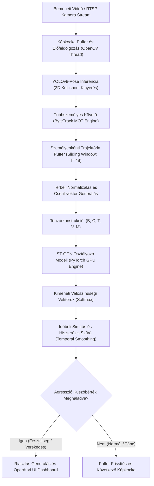

# Szakdolgozati Kutatási és Rendszer-megvalósítási Terv

**Intézmény:** Számítástechnikai és Információs Rendszerek Tanszék  
**Képzés:** Mérnökinformatikus / Programtervező Informatikus BSc  
**Dokumentum típusa:** Szakdolgozati Részletes Kutatási és Megvalósítási Terv (Research & Implementation Plan)  
**Téma címe:** Verekedés- és agresszió-megelőzés szórakozóhelyi környezetben váz-alapú viselkedéselemzéssel (YOLOv8-Pose, ST-GCN, PyTorch)  
**Angol cím:** Nightclub Violence Detection and Prevention via Skeleton-Based Human Action Recognition  
**Dátum:** 2026/2027. tanév  
**Kulcsszavak:** Számítógépes látás, Pózelőrejelzés, YOLOv8-Pose, ST-GCN, Tér-időbeli gráfkonvolúció, Viselkedéselemzés, Agresszió-detekció, Többszemélyes követés, Valós idejű rendszerek, Adatvédelem (GDPR).

---

## Vezetői összefoglaló és absztrakt

### Magyar nyelvű absztrakt
A szórakozóhelyek és éjszakai szórakoztató létesítmények kritikus biztonsági kihívása a fizikai agresszió, a verekedések és a rendbontások időben történő felismerése és megelőzése. A hagyományos, emberi operátorokra támaszkodó videomegfigyelő rendszerek hatékonyságát erősen korlátozza a vizuális fáradtság, a nagyszámú egyidejű kamerakép és a szórakozóhelyi terek sajátos jellege (szélsőséges fényviszonyok, stroboszkópeffektek, sűrű tömeg, takarások). Továbbá az érvényben lévő európai adatvédelmi szabályozás (GDPR) szigorú korlátokat szab a személyes adatok, különösen az arcvonások folyamatos rögzítésének és tárolásának.

Jelen szakdolgozati kutatási terv egy olyan valós idejű, váz-alapú (skeleton-based) számítógépes látórendszer kutatását, megtervezését és prototípusának kifejlesztését célozza, amely kizárólag az emberi test ízületi pontjainak 2D tér-időbeli dinamikáját elemzi. A feldolgozási lánc a legmodernebb egyfokozatú pózbecslő modellt (YOLOv8-Pose) kombinálja megbízható többszemélyes követéssel (ByteTrack / BoT-SORT), valamint Tér-Időbeli Gráfkonvolúciós Hálózattal (ST-GCN - Spatial Temporal Graph Convolutional Network). A kutatás kiemelt fókusza a szórakozóhelyi környezetből adódó egyedi anomáliák kezelése: különösen a ritmikus, heves táncmozdulatok ("hard negative" minták) elkülönítése a valós agressziótól, valamint a korai konfliktusfázisok (lökdösődés, fenyegető gesztusok) azonosítása az eszkaláció megelőzése érdekében. A tervezett rendszer szigorúan tiszteletben tartja a "Privacy by Design" alapelvet, mivel az RGB képkockák eldobása után kizárólag topológiai koordináta-sorozatokkal dolgozik, és döntéstámogató riasztásokkal segíti a biztonsági személyzet munkáját.

### English Abstract
A primary safety challenge in nightlife venues, clubs, and entertainment facilities is the timely detection and de-escalation of physical violence, brawls, and aggressive behavior. Traditional video surveillance relying on human operators suffers from cognitive fatigue, camera blind spots, and the complex domain characteristics of nightclubs (extreme low light, flashing strobes, dense crowd occlusion). Furthermore, stringent data privacy regulations (GDPR) impose severe constraints on continuous video recording and face biometric processing.

This thesis research and implementation plan presents the end-to-end design, investigation, and software implementation of a real-time, privacy-preserving, skeleton-based action recognition system. By extracting 2D topological body keypoints via state-of-the-art YOLOv8-Pose and maintaining temporal identity trajectories using ByteTrack / BoT-SORT, the system feeds spatiotemporal joint graphs into a Spatial Temporal Graph Convolutional Network (ST-GCN). The research specifically tackles domain-specific night club anomalies: distinguishing high-energy dancing movements (hard negative samples) from genuine violence, and identifying pre-escalation friction (shoving, pushing, aggressive posturing) before severe physical trauma occurs. Built upon a "Privacy-by-Design" architecture that discards raw pixel streams in favor of abstract skeletal coordinates, the resulting solution delivers high-throughput, low-latency actionable alerts to security personnel.

---

## 1. Bevezetés és a kutatás háttere

### 1.1 A biztonsági felügyelet gyakorlati kihívásai éjszakai szórakozóhelyeken
Az éjszakai szórakozóhelyek, táncklubok és zárt rendezvények biztonsági irányítása komplex, többváltozós feladat. A zárt terekben egyszerre több száz vagy több ezer ember tartózkodik, akiknek a viselkedése az alkohol- és egyéb szerfogyasztás, a magas decibelszintű zene és a szociális interakciók intenzitása miatt gyorsan és kiszámíthatatlanul eszkalálódhat. A statisztikák alapján a szórakozóhelyeken bekövetkező súlyos testi sértések döntő többsége nem azonnali, előzmény nélküli erőszakkal kezdődik, hanem jól körülhatárolható verbális és pre-fizikai fázisokon megy keresztül:
1. **Feszültségkeltési szakasz:** A felek közötti testközelség drasztikusan lecsökken, heves és aszimmetrikus gesztikuláció, fenyegető testtartás jelenik meg.
2. **Pre-agresszív fizikai kontaktus:** Első kontaktusok, mint mellkasnak feszülés, taszítás, megragadás, lökdösődés.
3. **Akut agresszió és verekedés:** Ütések, rúgások, földre vitel, fegyverhasználat (pl. pohártörés), tömeges összecsapás.

A szórakozóhelyeken működő biztonsági személyzet (rendészek, "kidobók") és a kameraszobában ülő operátorok munkáját alapvetően determinálják a humán kognitív korlátok:
* **Figyelem-fáradás (Vigilance decrement):** Számítógépes látási és ergonómiai tanulmányok igazolják, hogy egy megfigyelő 20 percnyi intenzív videomonitorozás után a kritikus események közel 45%-át nem veszi észre, 40 perc elteltével pedig a hibázási arány meghaladja a 75%-ot.
* **Többkamerás holtterek és figyelem-megosztás:** Egy közepes méretű klubban 16-64 biztonsági kamera képe fut be egyidejűleg. Egy emberi operátor képtelen 30-40 képkocka/másodperces dinamikával folyamatosan követni az összes helyiséget (tánctér, pultok előtere, folyosók, dohányzók).
* **Késedelmes beavatkozás:** Mire az emberi szem észleli a verekedést, a fizikai sérülések gyakran már bekövetkeztek, és a konfliktusba további felek avatkoztak be, megsokszorozva a beavatkozás kockázatát.

A probléma feloldásának egyetlen reális, skálázható módja az automatizált, gépi intelligenciával támogatott valós idejű viselkedéselemzés.

### 1.2 Az RGB-alapú és a váz-alapú megközelítés paradigmaváltása
Az automatikus erőszakfelismerés (Violence Detection) kezdeti korszaka szinte kizárólag nyers RGB videófolyamokra és optikai áramlásra (Optical Flow) épült. A 3D Konvolúciós Hálózatok (C3D, I3D, SlowFast) és a modern videótranszformerek (TimeSformer, Video Swin) kiváló pontosságot értek el laboratóriumi referencia-adatbázisokon. Ugyanakkor éles szórakozóhelyi környezetben az RGB-alapú rendszerek három kritikus akadályba ütköznek:

| Szempont | RGB-alapú megközelítés (3D CNN / Video Transformer) | Váz-alapú megközelítés (YOLO-Pose + ST-GCN) | Szórakozóhelyi következmény |
| :--- | :--- | :--- | :--- |
| **Számítási igény (Compute & Latency)** | Hatalmas lebegőpontos műveletigény (GFLOPs); több stream valós idejű futtatása drága adatközponti GPU-kat (pl. A100/H100) igényel. | Kétfokozatú, de rendkívül gyors: a 2D pózbecslés könnyűsúlyú, a gráfkonvolúció pedig mindössze 17 pont koordinátáit számolja (~1-2 GFLOPs). | Olcsó, lokális GPU-kon (pl. RTX 3060/4060 vagy Jetson) is képes több kamerát valós időben (30+ FPS) kiszolgálni. |
| **Környezeti robusztusság (Illumination invariance)** | Erősen függ a színektől, textúráktól és fényintenzitástól. Szórakozóhelyen a stroboszkóp, a sötétség és a színezett reflektorok tévesen aktiválják az optikai áramlást. | **Környezet-invariáns:** Az ízületi koordináták normalizáltak; a hálózatot nem zavarja a fény színe, a ruha mintázata vagy a háttér vibrálása. | Megbízható működés a tánctér pulzáló fényviszonyai között is. |
| **Adatvédelem és GDPR megfelelés** | A nyers videófolyamok arcokat, személyes azonosítókat tartalmaznak, amelyek rögzítése és elemzése szigorú engedélyhez kötött és jogi kockázatot hordoz. | **Privacy-by-Design:** Az RGB képkockák azonnal eldobásra kerülnek a kulcspontok kinyerése után; a rendszer kizárólag anonim topológiai koordinátákat tárol. | Teljes GDPR kompatibilitás; a vázadat nem alkalmas személyazonosításra. |
| **Túlilleszkedés (Overfitting)** | A modellek hajlamosak a háttérre asszociálni (pl. egy sötét sikátor hátterét automatikusan veszélyesnek ítélik). | A modell kizárólag a mozgás kinematikáját és a testek egymáshoz viszonyított interakcióját vizsgálja. | Kiváló általánosítás különböző helyszínek és berendezések között. |

### 1.3 A korai agresszió-detekció és megelőzés koncepciója
A szakirodalomban elérhető erőszakfelismerő modellek jelentős része bináris osztályozást végez: a jelenetet "Fight" vagy "Non-Fight" kategóriába sorolja. A gyakorlati biztonságvédelem szempontjából azonban a már javában zajló verekedés detektálása csupán kármentés, nem pedig megelőzés.

Jelen kutatás központi gondolata, hogy a felismerési időablakot előre kell tolni a **pre-eszkalációs fázisba**. Ha a rendszer képes megbízhatóan felismerni a lökdösődést (shoving), a heves rángatást és a fenyegető konfrontációt, a biztonsági szolgálat még azelőtt beavatkozhat a helyszínen, hogy súlyos testi sértés vagy tömegverekedés alakulna ki. Ehhez olyan többosztályos (Multi-class) architektúra és finomhangolt időablak-kezelés szükséges, amely képes elkülöníteni a hétköznapi interakciókat a feszült helyzetektől.

### 1.4 A kutatás határai és terjedelme (Scoping)
Annak érdekében, hogy a szakdolgozat a BSc keretek között szigorúan kivitelezhető, tudományosan megalapozott és határidőre befejezhető legyen, rögzítjük a kutatás határait:
* **A kutatás részét képezi:**
  1. Nyilvános videó-adathalmazok (RWF-2000, CCTV-Fights) feldolgozása, és azokból kulcspont-alapú mozgásadatbázis felépítése.
  2. Saját, szórakozóhelyi sajátosságokat szimuláló (tánc, lökdösődés, verekedés, tömeg) kontrollált tesztvideók készítése és annotálása.
  3. YOLOv8-Pose és többszemélyes követő (ByteTrack) pipeline-ba illesztése és konfigurálása.
  4. Összehasonlító alapszintű baseline modell (kinematikai ízületi szögek + Random Forest / XGBoost) megvalósítása.
  5. Tér-időbeli Gráfkonvolúciós Hálózat (ST-GCN) betanítása, hiperparaméter-optimalizálása és kiértékelése.
  6. Szórakozóhely-specifikus stressztesztek (tánc vs. verekedés hibaelemzés, stroboszkóphatás mérése, takarások kezelése).
  7. Egy valós idejű, kameraképet vagy videót fogadó demó prototípus implementálása operátori riasztási felülettel.
* **Tudatosan kizárva a hatókörből:**
  1. Arcfelismerés, biometrikus azonosítás és rendszámfelismerés (adatvédelmi okokból).
  2. Hanganalízis és mikrofon-alapú sikoly-/zajdetekció (a szórakozóhelyeken a zene decibelszintje miatt a hangcsatorna túltelített és használhatatlan).
  3. Saját, nulláról tanított 2D pózbecslő gerinchálózat fejlesztése (helyette az ipari standard Ultralytics YOLOv8-Pose előtanított súlyait használjuk transzfer tanulással).
  4. Éles, több hónapos ipari telepítés valós szórakozóhelyen (jogi, felelősségbiztosítási és GDPR korlátok miatt laboratóriumi és szimulált tesztekre korlátozódik).

---

## 2. Kutatási célkitűzések, kérdések és hipotézisek

### 2.1 Kutatási célkitűzések
A szakdolgozati projekt hármas célt tűz ki:
1. **Tudományos cél:** Feltárni a váz-alapú gráfkonvolúciós hálózatok diszkriminatív képességét kaotikus szórakozóhelyi mozgásformák között, különös tekintettel a dinamikus tánc és az erőszak szétválasztására.
2. **Mérnöki cél:** Olyan end-to-end adatfeldolgozási és követési láncot felépíteni, amely képes több személy egyidejű, valós idejű (>25 FPS) követésére és akcióosztályozására megfizethető hardvereszközökön.
3. **Alkalmazott biztonsági cél:** Kidolgozni egy olyan korai figyelmeztető mechanizmust, amely csökkenti a téves riasztások számát (False Positive Suppression) és minimalizálja az érzékelési időkésést.

### 2.2 Kutatási kérdések (Research Questions)
A kutatás során az alábbi konkrét kérdésekre keresünk számszerűsíthető válaszokat:

* **RQ1: Megbízhatóság és diszkrimináció a tánc tükrében:**  
  *Kérdés:* Milyen pontossággal (Accuracy, F1-score) és mekkora téves riasztási arány (False Positive Rate) mellett képes az ST-GCN modell megkülönböztetni a ritmikus, intenzív táncmozdulatokat a valós agressziótól és lökdösődéstől?  
  *Mérési mód:* Konfúziós mátrix analízise kifejezetten táncjeleneteket tartalmazó negatív teszthalmazon.

* **RQ2: Gráfkonvolúció vs. Hagyományos Gépi Tanulási Baseline:**  
  *Kérdés:* Mekkora statisztikailag szignifikáns teljesítménytöbbletet (F1-score és ROC-AUC) biztosít a topológiai tér-időbeli összefüggéseket modellező ST-GCN egy mérnökileg előállított, ízületi szögekből és sebességekből építkező klasszikus baseline modellel (pl. Random Forest / XGBoost) szemben?  
  *Mérési mód:* Keresztvalidációs összehasonlító mérések azonos adatbázison.

* **RQ3: Valós idejű feldolgozás és időkésés (Latency):**  
  *Kérdés:* Képes-e a teljes pipeline (YOLOv8-Pose + ByteTrack + Normalizálás + ST-GCN) elérni a valós idejű feldolgozási küszöböt ($\ge 25$ FPS) egyetlen középkategóriás GPU-n (pl. RTX 3060/4060), és mekkora a rendszer teljes end-to-end reakcióideje az agresszív mozdulat megkezdésétől a riasztás megjelenéséig?  
  *Mérési mód:* Profiling, képkockánkénti futásidő-mérés komponensenként lebontva.

* **RQ4: Korai jelzés és a pre-eszkaláció felismerhetősége:**  
  *Kérdés:* Lehetséges-e egy 3-osztályos modellben (Normál / Feszült helyzet-lökdösődés / Verekedés) megbízhatóan szeparálni a lökdösődést, és átlagosan hány másodperccel a súlyos testi erőszak bekövetkezése előtt képes a rendszer korai figyelmeztetést generálni?  
  *Mérési mód:* Időbeli szegmentációs metrikák, "Time-to-Violence" előrejelzési ablak vizsgálata temporálisan annotált videókon.

### 2.3 Kutatási hipotézisek (Hypotheses)
A szakirodalom előzetes tanulmányozása alapján az alábbi hipotéziseket állítjuk fel, amelyeket a kísérleti eredményekkel fogunk igazolni vagy cáfolni:

* **H1 Hipotézis:** Az ST-GCN modell a térbeli szomszédsági mátrixok és időbeli konvolúciók révén legalább **8-12 százalékponttal magasabb F1-értéket** ér el a komplex agresszió-osztályozásban, mint a statikus ízületi szögekre épülő Random Forest baseline modell, mivel az agresszió lényege a pontok relatív dinamikus interakciójában rejlik.
* **H2 Hipotézis:** A táncmozdulatok önmagukban magas mozgási energiát mutatnak, de kinetikai fázisaik periodikusak és szimmetrikusak; ezzel szemben az agresszió aszimmetrikus és hirtelen gyorsulásokkal terhelt. Ezért az időablak $T \ge 48$ képkockára (~1.6 másodperc) történő növelése **legalább 30%-kal csökkenti a táncból eredő téves riasztások arányát** a rövid ($T=16$) ablakokhoz képest.
* **H3 Hipotézis:** A YOLOv8-Pose által generált 17 kulcspontos COCO reprezentáció a láthatósági és konfidencia értékek ($conf_i$) súlyozásával képes fenntartani a felismerési pontosság legalább 80%-át még 20-30%-os részleges testtakarás (occlusion) esetén is.
* **H4 Hipotézis:** A teljes optimalizált követési és osztályozási lánc futási ideje egy modern fogyasztói GPU-n nem haladja meg a **35 ms/frame** értéket, biztosítva a folyamatos, akadásmentes valós idejű felügyeletet.

---

## 3. Szakirodalmi áttekintés és elméleti háttér

### 3.1 Számítógépes látás az erőszakfelismerésben: Az optikai áramlástól a gráfmodellekig
A videó-alapú akciófelismerés (Action Recognition) és ezen belül az erőszakdetekció története jól leképezi a mély tanulás fejlődési szakaszait:

1. **Hagyományos gépi látási korszak (2010-2015):**  
   A korai kutatások kézzel tervezett vizuális jellemzőkre (Handcrafted features) épültek. A legelterjedtebb módszerek a térbeli és időbeli származtatottakat, optikai áramlást (Optical Flow), valamint a Histogram of Oriented Gradients (HOG) és Histogram of Optical Flow (HOF) deskriptorokat alkalmazták Support Vector Machine (SVM) osztályozóval. A szórakozóhelyi környezetben ezek a rendszerek teljesen kudarcot vallottak, mert a villódzó fények drasztikus műtermékeket hoztak létre az optikai áramlási mezőben.

2. **2D CNN + RNN / LSTM korszak (2015-2018):**  
   A konvolúciós hálózatok (VGG, ResNet) képkockánként kinyerték a vizuális reprezentációt, majd egy Long Short-Term Memory (LSTM) vagy Gated Recurrent Unit (GRU) hálózat modellezte az időbeli változást. Bár a pontosság javult, a modellek érzékenyek maradtak a háttér és a ruházat színére.

3. **3D Konvolúciók és Kétáramú Hálózatok (2017-2022):**  
   A C3D, az I3D (Inflated 3D ConvNet) és a SlowFast (Feichtenhofer et al., 2019) architektúrák áttörést hoztak az akciófelismerésben. A SlowFast hálózat például két párhuzamos ágon dolgozik: egy alacsony képkockasebességű ágon a térbeli szemantikáért, és egy nagy képkockasebességű gyors ágon a mozgásdinamikáért. Bár kiváló pontosságot nyújtanak, a számítási kapacitásigényük extrém magas, és az RGB adatok kezelése miatt súlyos adatvédelmi kérdéseket vetnek fel.

4. **Váz-alapú gráfkonvolúciós korszak (2018-napjainkig):**  
   Yan et al. (2018) publikációja (ST-GCN) paradigmaváltást indított el. Rádöbbentette a kutatói közösséget, hogy az emberi cselekvések felismeréséhez a háttér és a pixelek 99%-a felesleges redundancia vagy zaj. Ha az emberi testet ízületek gráfjaként reprezentáljuk, a feladat mérete több nagyságrenddel csökken, miközben a modell robusztussága és általánosító képessége drámaian megnő.

### 3.2 2D Emberi Pózbecslés (Human Pose Estimation): YOLOv8-Pose
Az emberi pózbecslés célja a test anatómiai kulcspontjainak (ízületek, arcvonások) lokalizálása a 2D képsíkon. Két fő megközelítés létezik:
* **Top-down (Fentről-lefelé):** Először egy objektumdetektor megtalálja az embereket (Bounding Box), majd minden egyes kivágott dobozra külön lefut egy pózbecslő modell (pl. HRNet, AlphaPose). Előnye a nagy pontosság, hátránya, hogy futásideje a képen lévő emberek számával lineárisan skálázódik. Sűrű szórakozóhelyi tömegben ez elfogadhatatlan lassulást eredményez.
* **Bottom-up (Lentről-felfelé):** A hálózat egyszerre detektálja az összes kulcspontot a képen, majd gráf-illesztéssel vagy asszociációs mezőkkel (Part Affinity Fields) rendeli őket személyekhez (pl. OpenPose). Bár futásideje független a személyek számától, az asszociációs fázis számításigényes.

#### A YOLOv8-Pose előnyei és architektúrája
A Jocher et al. (Ultralytics, 2023) által bemutatott YOLOv8-Pose az úgynevezett **egymenetes, horgonypont-mentes (anchor-free, single-stage)** architektúrára épül. Nem igényel külön körbevágást, hanem a detekciós fejjel párhuzamosan közvetlenül prediktálja a kulcspontokat.

* **Gerinchálózat (Backbone):** Módosított CSPDarknet53, amely Cross-Stage Partial kapcsolatokkal biztosítja a gazdag többméretű jellemzőkinyerést alacsony számítási overhead mellett.
* **Nyak (Neck):** Path Aggregation Network (PANet), amely egyesíti a felülről-lefelé és alulról-felfelé haladó jellemzőpiramisokat, elősegítve a kisméretű és nagyméretű személyek egyidejű pontos detektálását.
* **Fej (Pose Head):** Szétválasztott (Decoupled) fej-architektúra, amely független konvolúciós ágakon számítja az osztályozási valószínűséget, a befoglaló téglalap koordinátáit, valamint a kulcspontok koordinátáit és láthatósági faktorait:
  $$\hat{K}_i = (x_i, y_i, conf_i), \quad i \in \{1, \dots, 17\}$$

#### Az Object Keypoint Similarity (OKS) Veszteségfüggvény
A pózbecslés tanítása a standard hiba helyett az OKS-re épülő veszteségfüggvénnyel történik. Az OKS az IoU (Intersection over Union) koncepcionális megfelelője kulcspontokra:
$$OKS = \frac{\sum_{i} \exp\left(-\frac{d_i^2}{2 s^2 \sigma_i^2}\right) \delta(v_i > 0)}{\sum_{i} \delta(v_i > 0)}$$
Ahol:
* $d_i$ a becsült és a valós kulcspont közötti euklideszi távolság a képsíkon.
* $s$ a személy skálaparamétere (a befoglaló téglalap területének négyzetgyöke: $s = \sqrt{w \cdot h}$).
* $\sigma_i$ az adott ízülettípusra jellemző szórási konstans (a COCO standard szerint pl. a szemre vagy orra kisebb tolerancia vonatkozik, mint a csípőre vagy vállra).
* $v_i$ a láthatósági jelző ($v_i=0$: nincs annotálva, $v_i=1$: takarásban van, $v_i=2$: tisztán látható).
* $\delta(\cdot)$ a Dirac-delta függvény (csak a létező pontokat veszi figyelembe).

#### A COCO-17 Topológia
A YOLOv8-Pose a standard COCO formátum 17 kulcspontját szolgáltatja:
* **Fej:** 0: Orr, 1: Bal szem, 2: Jobb szem, 3: Bal fül, 4: Jobb fül
* **Felsőtest:** 5: Bal váll, 6: Jobb váll, 7: Bal könyök, 8: Jobb könyök, 9: Bal csukló, 10: Jobb csukló
* **Alsótest:** 11: Bal csípő, 12: Jobb csípő, 13: Bal térd, 14: Jobb térd, 15: Bal boka, 16: Jobb boka

A verekedés és agresszió szempontjából a leginformatívabb pontok a felsőtesthez tartoznak (5-10: vállak, könyökök, csuklók) az ütések és lökések dinamikája miatt, valamint a csípőpontok (11-12) a test súlypontjának mozgása miatt.

### 3.3 Többszemélyes Objektumkövetés (Multi-Object Tracking - MOT)
Egy szórakozóhelyi jelenetben egyszerre sok személy mozog. Ahhoz, hogy egy személy mozgásmintázatát időben elemezni lehessen, a képkockák között folyamatosan fenn kell tartani a személyazonosságot (Tracklet). Erre a legkorszerűbb két követőt vizsgáljuk:

#### ByteTrack
A Zhang et al. (2022) által publikált ByteTrack alapvető innovációja, hogy nem dobja el az alacsony detekciós konfidenciájú dobozokat. A legtöbb követő csak a magas megbízhatóságú detekciókat ($conf > 0.6$) veszi figyelembe, így takarás vagy rossz fény esetén a pálya azonnal megszakad. A ByteTrack kétlépcsős asszociációt használ:
1. Első lépésben a magas konfidenciájú detekciókat rendeli a meglévő pályákhoz Kalman-szűrő és IoU távolság alapján a Magyar algoritmus (Hungarian algorithm) segítségével.
2. A párosítatlanul maradt pályákat megpróbálja hozzárendelni az **alacsony konfidenciájú** ($0.1 < conf < 0.6$) detekciókhoz. Mivel a szórakozóhelyen a takarások és a fényváltozások miatt az emberek detekciója gyakran beesik alacsony értékekre, a ByteTrack drasztikusan csökkenti a pálya-szétesések (ID Switches) számát.

#### BoT-SORT
Az Aharon et al. (2022) által bemutatott BoT-SORT (Boosted Track and Camera Motion Compensation) továbbfejleszti a ByteTrack-et:
* Kamera-mozgás kompenzáció (CMC): Globális mozgásbecslést végez képi jellemzők alapján, így ha a felügyeleti kamera remeg vagy pásztáz, a Kalman-szűrő belső állapota korrigálódik.
* Re-ID (Újra-azonosítási) vektorok integrálása: Mély jellemzővektorokat fűz az IoU távolsághoz, ami segít, ha két személy keresztezi egymás útját és a dobozaik teljesen átfedik egymást.

### 3.4 Tér-Időbeli Gráfkonvolúciós Hálózatok (ST-GCN)
A Yan et al. (2018) által bevezetett ST-GCN az emberi testet egy tér-időbeli irányítatlan gráfként modellezi:
$$G = (V, E)$$
Ahol a csúcsok halmaza $V = \{v_{ti} \mid t = 1, \dots, T; \, i = 1, \dots, N\}$ reprezentálja az összes ízületet az időablakban ($N=17$ ízület, $T$ időbeli lépés).
Az élek halmaza $E$ két részből áll:
1. **Térbeli élek ($E_S$):** Az emberi test anatómiai csontjai, amelyek összekötik a szomszédos ízületeket egy adott $t$ időpillanatban (pl. csukló-könyök, könyök-váll).
2. **Időbeli élek ($E_T$):** Ugyanazon ízületi pont egymást követő képkockák közötti összeköttetései: $(v_{ti}, v_{(t+1)i})$.

#### A Térbeli Gráfkonvolúció Matematikai Formulája
A klasszikus 2D képi konvolúcióban a konvolúciós maszk egy szabályos $3 \times 3$-as rácson operál. Egy tetszőleges gráfcsúcson azonban a szomszédok száma változó, és nincs természetes sorrendjük. A térbeli gráfkonvolúció az alábbi egyenlettel definiálható:
$$f_{out}(v_i) = \sum_{v_j \in B(v_i)} \frac{1}{Z_{ij}} f_{in}(v_j) \cdot W(l_i(v_j))$$
Ahol:
* $B(v_i) = \{v_j \mid d(v_i, v_j) \le 1\}$ a $v_i$ csúcs 1-távolságú szomszédsága (önmagát is beleértve).
* $f_{in}(v_j)$ a bemeneti jellemzővektor (pl. $x, y$ koordináták és $conf$ konfidencia).
* $W$ a tanulható súlymátrix.
* $l_i(v_j)$ a partíciós címkéző függvény, amely a szomszédokat véges számú csoportba osztja.
* $Z_{ij}$ a normalizáló faktor (az adott csoport elemszáma), amely megakadályozza a gradiens felrobbanását.

#### Partíciós Stratégiák
Az ST-GCN-ben a partíciós stratégia határozza meg, hogyan tanul a hálózat:
1. **Uni-label partitioning:** Minden szomszéd azonos súlyt kap ($K=1$). Túl egyszerű, nem tudja megtanulni az irányokat.
2. **Distance partitioning:** Két részre osztja a szomszédokat: maga a gyökércsúcs ($d=0$), és a szomszédos csúcsok ($d=1$).
3. **Spatial Configuration partitioning (Térbeli konfigurációs stratégia):** Három részre osztja a szomszédokat a test globális súlypontjához (Gravity Center) viszonyítva:
   * 1. csoport: Maga a gyökércsúcs.
   * 2. csoport (Centripetális): Azok a szomszédos ízületek, amelyek közelebb vannak a test súlypontjához, mint a gyökérpont.
   * 3. csoport (Centrifugális): Azok a szomszédos ízületek, amelyek távolabb vannak a test súlypontjától.
Ez a stratégia kiválóan modellezi a végtagok kinyúlását és összehúzódását, ami verekedésnél (ütés, rúgás) kulcsfontosságú.

Mátrixos formában a térbeli gráfkonvolúció a szomszédsági mátrix felbontásával valósul meg:
$$f_{out} = \sum_{k=1}^K \Lambda_k^{-\frac{1}{2}} A_k \Lambda_k^{-\frac{1}{2}} f_{in} W_k$$
Ahol $A_k$ a $k$-adik partíciós csoport szomszédsági mátrixa, $\Lambda_k^{ii} = \sum_j A_k^{ij} + \alpha$ pedig a normalizáló diagonális mátrix.

#### Időbeli Konvolúció (Temporal Convolution)
Miután a térbeli gráfkonvolúció minden egyes képkockán integrálta a test anatómiai összefüggéseit, az időbeli dimenzió mentén egy standard 1D konvolúció fut le $K_t \times 1$ méretű maszkkal (jellemzően $K_t = 9$). Ez közvetlenül a csúcsok időbeli trajektóriáját szűri.

#### Kétáramú (Two-Stream) ST-GCN Kiterjesztés
Shi et al. (2019) és Duan et al. (PYSKL, 2022) megmutatták, hogy a csontok (Bone Stream) közvetlen modellezése jelentősen javítja a pontosságot:
* **Ízületi ág (Joint Stream):** Bemenete az ízületek abszolút normalizált koordinátái: $v = (x, y)$.
* **Csont ág (Bone Stream):** Bemenete a két összekapcsolt ízület közötti irányvektor:
  $$e_{u, v} = v - u = (x_v - x_u, y_v - y_u)$$
A csont-vektor közvetlenül hordozza a végtagok hosszát és térbeli orientációját, ami szögelfordulás-invariánssá teszi a modellt. A két ág kimeneti softmax valószinűségeit súlyozottan összegezzük (Late Fusion).


## 4. Domain-specifikus szórakozóhelyi kihívások és kutatási válaszok

A szórakozóhelyi környezet az egyik legbonyolultabb operatív terület a számítógépes látás számára. A hagyományos felügyeleti környezetekhez (pl. üres irodafolyosók, utcai forgalomfigyelés) képest itt a környezeti és emberi változók szélsőséges értékeket vesznek fel. A kutatási terv az alábbi négy kritikus kihívást és a rájuk adott mérnöki-tudományos válaszokat specifikálja:

### 4.1 Tánc vs. Verekedés mint "Hard Negative" anomália
A szakirodalomban elérhető erőszakdetektorok leggyakoribb hibája a dinamikus tánc (breakdance, hip-hop, pogózás, ugrálás) téves riasztásként (False Positive) történő megjelölése. Ennek oka, hogy mind a tánc, mind a verekedés során:
* A végtagok sebessége és gyorsulása meghaladja a normál séta vagy állás értékeit.
* A testek szoros közelségbe kerülnek egymáshoz.
* A gesztusok kiterjedése nagy teret fog át.

#### Kinematikai és dinamikai különbségek
A kutatásunk hipotézise (H2), hogy a tánc és az erőszak mélyebb kinematikai tulajdonságaiban fundamentálisan különbözik:

| Kinematikai paraméter | Ritmikus tánc viselkedés | Valós agresszió / Verekedés | ST-GCN diszkriminációs mechanizmus |
| :--- | :--- | :--- | :--- |
| **Időbeli periodicitás (Fourier-spektrum)** | Erős periodikus harmonikus komponensek a zene ütemére (BPM szinkronizáció). | Aperiodikus, sztochasztikus, kaotikus impulzusok sorozata. | Az időbeli konvolúció (TCN) rétegek képesek felismerni az ismétlődő fázisokat. |
| **Térbeli szimmetria** | Jellemzően bilaterális szimmetria vagy szabályos testkoordináció (pl. mindkét kar vagy láb összehangolt ritmusa). | Aszimmetrikus kitérések: hirtelen védekező blokkolás, egyoldali ütések, egyensúlyvesztés. | A térbeli gráfkonvolúció szomszédsági mátrixa és a csont-vektorok aszimmetriája. |
| **Sebességprofil és rántás (Jerk)** | Folyamatos, sima ívű trajektóriák még gyors mozgásnál is (korlátos rántás). | Diszkontinuus, ütközéses sebességváltozások (hatalmas rántás a fizikai becsapódáskor). | A szomszédos képkockák közötti koordináta-különbségek ($\Delta x, \Delta y$) eloszlása. |
| **Résztvevők közötti korreláció** | Táncpartnereknél a mozgás gyakran komplementer vagy párhuzamosan tükrözött. | Az áldozat és a támadó mozgása antagonisztikus: az egyik előre tör, a másik hátrál vagy összeesik. | Kétszemélyes interakciós gráfok csatolása (Inter-person graph edges). |

A megoldási stratégia: A tanító adatbázisba szándékosan nagyszámú, energikus táncvideót illesztünk "kemény negatív" (Hard Negative) példaként, és az időablak hosszát minimum $T=48$ képkockára választjuk, hogy a periodikus ritmus kirajzolódhasson.

### 4.2 Sűrű tömeg és súlyos takarás (Occlusion Handling)
A szórakozóhelyeken az emberek rendkívül szorosan állnak vagy mozognak egymás mellett. Ennek következtében a kamera látószögéből a testrészek jelentős része (különösen a lábak és az alsótest) gyakran takarásba kerül.

#### Mérnöki megoldások:
1. **Láthatósági konfidencia integrálása a gráfba:**  
   A YOLOv8-Pose minden kulcsponthoz visszaad egy $conf_i \in [0, 1]$ értéket. Ahelyett, hogy csak a 2D koordinátákat táplálnánk be, a gráfcsúcs jellemzővektora háromdimenziós:
   $$v_{ti} = (x_{ti}, y_{ti}, conf_{ti})$$
   Ha egy ízület takarásban van ($conf_{ti} < 0.25$), a hálózat nem hamis koordinátaként, hanem alacsony súlyú információként kezeli.
2. **Időbeli lineáris és spline interpoláció:**  
   Rövid idejű takarások esetén (1-5 képkocka), ha az ízület eltűnik, de előtte és utána ismert a pozíciója, a rendszer lokális időbeli spline interpolációval kitölti a hiányzó koordinátákat.
3. **Felsőtest-prioritásos súlyozás:**  
   Mivel a lökdösődés és az ütések 90%-a a kéz, kar és törzs mozgásában jelenik meg, az osztályozó modell térbeli pooling rétegeiben nagyobb súlyt rendelünk a felsőtest ízületeihez (vállak, könyökök, csuklók, nyak/fej).

### 4.3 Extrém és dinamikus fényviszonyok (Stroboszkóp, félhomály)
A diszkókban és klubokban a fényviszonyok másodpercenként többször változnak:
* Félhomály és sötét zónák a tánctéren.
* Pulzáló, villogó stroboszkópeffektek (10-20 Hz frekvenciával).
* Erős színezett reflektorok (monokróm vörös, kék, zöld megvilágítás).

#### Miért elengedhetetlen a váz-alapú absztrakció?
Az RGB-alapú optikai áramlás (Optical Flow) algoritmusok a fényintenzitás állandóságának elvén (Brightness Constancy Assumption) alapulnak:
$$I(x, y, t) \approx I(x + \Delta x, y + \Delta y, t + \Delta t)$$
Amikor a stroboszkóp felvillan, a képpontok intenzitása pillanatszerűen 10-ről 255-re ugrik. Az optikai áramlás ezt hatalmas virtuális mozgásként érzékeli, ami katasztrofális téves riasztáshoz vezet.
Ezzel szemben a YOLOv8-Pose konvolúciós jellemzőtérképei a kontúrokra és strukturális gradientekre fókuszálnak. Miután a 17 kulcspont kinyerésre került, az ST-GCN kizárólag a normalizált $(x, y)$ koordinátákat látja. A modell számára a képkocka színe, fényereje teljesen láthatatlan, így a stroboszkóp jelenléte zéró közvetlen hatással van az ST-GCN osztályozási logikájára.

### 4.4 Nem standard kameraszögek és perspektivikus torzítás
A biztonsági kamerákat a szórakozóhelyeken szinte kivétel nélkül magasan (3-5 méter magasságban), a falak sarkára vagy a mennyezetre szerelik, és ferdén lefelé néznek (High-angle oblique view).
* **A ferde szög hatása:** A függőleges testméretek megrövidülnek (foreshortening), az emberi váz arányai torzulnak a képsíkon a talajhoz képest.
* **Perspektíva-invariáns normalizálás:**  
  A kutatás során kidolgozunk egy relatív koordináta-transzformációt. Minden detektált személynél az origót a két csípőpont felezőpontjába helyezzük át:
  $$x'_{ti} = \frac{x_{ti} - x_{hip\_center, t}}{S_t}, \quad y'_{ti} = \frac{y_{ti} - y_{hip\_center, t}}{S_t}$$
  Ahol a skálázási tényező $S_t$ a törzshossz (nyak/vállközép és csípőközép euklideszi távolsága). Ezáltal a modell a kamerától való távolságtól és a kamera magasságából adódó méretkülönbségektől függetlenül, egységnyi koordinátatérben látja a testeket.

---

## 5. Rendszerarchitektúra és feldolgozási folyamat (End-to-End Pipeline)

### 5.1 Rendszerkomponensek és folyamatábra
A tervezett biztonsági rendszer egy szigorúan moduláris, aszinkron adatfolyam-architektúrára épül. A folyamat lépéseit a következő Mermaid folyamatábra szemlélteti:



#### A modulok részletes funkciói:
1. **Videó Beolvasó és Képkocka Pufferelő Modul (Frame Grabber):**  
   Dedikált szálon (Thread) olvassa az IP kamera RTSP streamjét vagy a tesztvideókat. Feladata a dekódolási késleltetés kiküszöbölése és a legfrissebb képkocka átadása a feldolgozónak.
2. **Pózbecslő Motor (YOLOv8-Pose):**  
   Batch mérettel futtatja a képeket, és visszaadja az összes detektált ember 17 kulcspontját és bounding boxát.
3. **Követési Motor (ByteTrack Tracker):**  
   Minden észlelt személyhez stabil globális azonosítót (`track_id`) rendel a képkockák között, feloldva az átmeneti takarásokat.
4. **Normalizáló és Időablak Képző Modul:**  
   Személyenként egy $T$ hosszúságú körkörös puffert (Circular Buffer) tart fenn. Elvégzi a koordináta-transzlációt és skálázást.
5. **Osztályozó Motor (ST-GCN Deep Neural Network):**  
   Lefuttatja a gráfkonvolúciós hálózatot, és megadja a cselekvési osztályok valószínűségeit.
6. **Döntési és Hiszterézis Modul (Alert Logic):**  
   Kiküszöböli a pillanatnyi ingadozásokat (False Alarms) időbeli simítással, és szükség esetén riasztási eseményt küld az operátori felületre.

### 5.2 Bemeneti tenzorkonstrukció
Az ST-GCN modell egy standard 5-dimenziós tenzort fogad bemenetként:
$$\mathcal{X} \in \mathbb{R}^{B \times C \times T \times V \times M}$$
Ahol:
* $B$ = Batch méret (egy lépésben feldolgozott minták száma, inferenciánál jellemzően 1).
* $C$ = Csatornák száma. Alapesetben $C=3$ ($x$ koordináta, $y$ koordináta, $conf$ konfidencia). Kétáramú hálózatnál a csont-ágnál $C=3$ ($\Delta x, \Delta y, length$).
* $T$ = Időbeli képkockák száma az ablakban. Kísérleteinkben $T \in \{32, 48, 64\}$ értékeket tesztelünk. 30 FPS rögzítés mellett a $T=48$ ablak 1.6 másodperc valós időnek felel meg, ami optimális kompromisszum a gyors reakcióidő és a stabil mozgásminta-felismerés között.
* $V$ = Ízületi csúcsok száma a gráfban ($V=17$ a COCO topológia szerint).
* $M$ = Egyidejűleg elemzett személyek maximális száma az interakcióban ($M=2$ a közvetlen konfrontációhoz, de kiterjeszthető $M=4$-re csoportos konfliktusoknál). Ha csak egy személy van jelen, a második személy tenzorszelete nullákkal van kitöltve (Zero-padding).

### 5.3 Normalizálási transzformációk algoritmusa
A nyers pixelkoordináták közvetlen használata súlyos torzításokhoz vezetne (a kamera közelében álló személy koordinátái nagyságrendekkel nagyobbak lennének, mint a háttérben lévőké). A feldolgozási láncban az alábbi standardizálási algoritmust valósítjuk meg:

```python
def normalize_skeleton_window(joint_data):
    \"\"\"
    joint_data shape: (T, V, 3) -> [time, joints, (x, y, conf)]
    \"\"\"
    # 1. Csípő középpont meghatározása (bal csípő: index 11, jobb csípő: index 12)
    hip_center = (joint_data[:, 11, :2] + joint_data[:, 12, :2]) / 2.0  # shape: (T, 2)
    
    # 2. Váll középpont meghatározása (bal váll: index 5, jobb váll: index 6)
    shoulder_center = (joint_data[:, 5, :2] + joint_data[:, 6, :2]) / 2.0  # shape: (T, 2)
    
    # 3. Törzshossz mint skálázási tényező (euklideszi távolság)
    torso_length = np.linalg.norm(shoulder_center - hip_center, axis=-1, keepdims=True)  # shape: (T, 1)
    # Ha a törzshossz extrém kicsi (takarás), átlagos értékre állítjuk
    torso_length = np.where(torso_length < 1e-4, np.mean(torso_length) + 1e-4, torso_length)
    
    normalized_joints = np.zeros_like(joint_data)
    # 4. Transzláció a csípőközéppontba és skálázás a törzshosszal
    for t in range(joint_data.shape[0]):
        normalized_joints[t, :, :2] = (joint_data[t, :, :2] - hip_center[t]) / torso_length[t]
        normalized_joints[t, :, 2] = joint_data[t, :, 2]  # Konfidencia változatlan marad
        
    return normalized_joints
```

### 5.4 Döntési logika, hiszterézis és False Positive elnyomás
A neurális hálózat kimenetén kapott képkockánkénti predikciók zajosak lehetnek (pl. egy hirtelen fejrántás egyetlen képkockára magas erőszak-valószínűséget adhat). Ahhoz, hogy elkerüljük a biztonsági szolgálatot feleslegesen terhelő téves riasztásokat, **kétlépcsős hiszterézis- és simítási algoritmust** alkalmazunk:

1. **Mozgóablakos Valószínűség-simítás (Temporal Exponential Moving Average):**
   $$P_{smooth}(t) = \alpha \cdot P(t) + (1 - \alpha) \cdot P_{smooth}(t-1)$$
   Ahol $\alpha \in [0.2, 0.4]$ a simítási tényező.
2. **Kétküszöbös Hiszterézis (Dual-Threshold Hysteresis):**
   * **Aktiválási küszöb ($\theta_{high} = 0.75$):** A riasztás csak akkor kapcsol be, ha a simított valószínűség átlépi a magas küszöböt, és ott marad legalább $N_{consec} = 8$ egymást követő képkockán keresztül (~0.25 másodperc).
   * **Deaktiválási küszöb ($\theta_{low} = 0.40$):** A riasztás mindaddig aktív marad, amíg a valószínűség tartósan a legalacsonyabb küszöb alá nem esik.
3. **Kategória-prioritás:**
   Ha a "Lökdösődés" (Pre-violence) osztály detektálódik, a rendszer "Sárga figyelmeztetés" (Warning) állapotba lép, felhangosítja az operátori nézetet, és fókuszba helyezi az adott kamerát. Ha az "Akut verekedés" osztály aktiválódik, "Vörös riasztás" (Critical Alert) generálódik hangjelzéssel.

---

## 6. Adathalmazok és adatgyűjtési stratégia

### 6.1 Nyilvános referencia adathalmazok elemzése
A váz-alapú agressziófelismerés betanításához és objektív benchmarkingjához a kutatás során nemzetközileg elismert, nyilvános felügyeleti videó-adatbázisokat használunk:

| Adathalmaz neve | Videók száma | Forrás típusa | Megfigyelési perspektíva | Annotáció típusa | Alkalmazás a szakdolgozatban |
| :--- | :--- | :--- | :--- | :--- | :--- |
| **RWF-2000** (Cheng et al., 2020) | 2000 klip (5 mp/klip, 30 FPS) | Valós biztonsági kamerák (CCTV) | Változatos utcai és beltéri fix kamerák | Bináris címkék: 1000 Harc / 1000 Nem harc | **Fő tanító és validációs bázis.** A YOLOv8-Pose-zal kinyerjük a 17 kulcspontot, és ebből képezzük a vázadatbázist. |
| **CCTV-Fights** (Perez et al., 2019) | 1000 videó (összesen 8 óra) | Valós megfigyelő kamerák és mobilfelvételek | Valós utcai és zárt téri helyzetek | **Időbeli keret-szintű annotáció** (pontos kezdő- és végpontok) | **Pre-eszkaláció és reakcióidő mérése.** Kiválóan alkalmas az RQ4 vizsgálatára. |
| **UCF-Crime** (Sultani et al., 2018) | 1900 hosszú videó | CCTV megfigyelő kamerák | Magasan elhelyezett ipari kamerák | 13 anomália kategória (közte Fight és Assault) | Kiegészítő tesztkészlet a túlzsúfolt helyszínek és rossz minőségű képek tesztelésére. |
| **NTU RGB+D 120** (Liu et al., 2020) | 114 480 akcióvideó | Laboratóriumi Kinect rögzítés | 3 kameraállás, 32 előadó | 120 osztály (köztük lökdösődés, ütés, rúgás) | Referencia a tiszta vázkinyeréshez és a csont-gráf topológia optimalizálásához. |

### 6.2 Szórakozóhely-specifikus saját kísérleti adathalmaz (Staged Nightclub Dataset)
Mivel a nemzetközi adatbázisok szinte kizárólag utcai vagy nappali felvételeket tartalmaznak, a szórakozóhelyi sajátosságok méréséhez elengedhetetlen egy kontrollált saját adathalmaz létrehozása.

#### A kísérleti adatgyűjtés forgatókönyvei:
A felvételeket 6 önkéntes résztvevő bevonásával, különböző szcenáriók szerint rögzítjük:
1. **Szcenárió A - Normál klubélet (30 videó):** Beszélgetés, sétálás a teremben, italrendelés a pultnál, koccintás.
2. **Szcenárió B - Intenzív tánc és szórakozás (40 videó - Hard Negatives):** Gyors ritmusú tánc, fej- és karmozgás, ugrálás, pogózás szimulálása, baráti átkarolás.
3. **Szcenárió C - Feszült helyzet és lökdösődés (35 videó - Pre-escalation):** Két fél hevesen gesztikulálva vitázik, egymáshoz hajolnak, az egyik meglöki a másikat, visszalökés, szétválasztási kísérlet.
4. **Szcenárió D - Nyílt agresszió és verekedés (35 videó):** Ütés indítása, birkózás, földre vitel, többszemélyes összekapaszkodás.

#### Környezeti paraméterek szimulációja:
* **Megvilágítás:** Szabályozható stúdióreflektorok, színes RGB LED panelek, valamint stroboszkópeffektus (12 Hz villogás) alkalmazása.
* **Kameraállás:** Egy magas állványra (3.2 méter magasságban) rögzített széles látószögű kamera (45 fokos döntésszöggel), szimulálva a fali rögzítést.

#### Etikai és GDPR protokoll:
Minden felvétel kizárólag a résztvevők előzetes, írásos tájékoztatáson alapuló beleegyezésével készül. A videók személyes adatnak minősülnek, ezért jelszóval védett, titkosított meghajtón tároljuk őket. Miután a YOLOv8-Pose kinyerte a koordinátákat, a végső publikus kutatási csomagba kizárólag az anonimizált `.npy` formátumú vázadatok kerülnek be.

### 6.3 Adatbővítési (Data Augmentation) eljárások váz-gráfokon
A mély tanuló modellek hajlamosak a túlilleszkedésre, ha a vázadatok túl specifikus pozíciókból származnak. Mivel a képi transzformációk (pl. színátmenet, blur) a vázadatokon nem értelmezhetők, speciális **geometriai és időbeli gráf-augmentációs pipeline-t** valósítunk meg:

1. **Véletlenszerű térbeli rotáció (Spatial 2D Rotation):**  
   A vázat a súlypontja körül elforgatjuk egy véletlen $\theta \in [-15^{\circ}, +15^{\circ}]$ szöggel, szimulálva a ferde kameraállásokat:
   $$\begin{bmatrix} x' \\ y' \end{bmatrix} = \begin{bmatrix} \cos\theta & -\sin\theta \\ \sin\theta & \cos\theta \end{bmatrix} \begin{bmatrix} x \\ y \end{bmatrix}$$
2. **Horizontális tükrözés (Horizontal Flip):**  
   A vízszintes tengely mentén tükrözzük a koordinátákat ($x' = -x$). **Kritikus lépés:** az anatómiai konzisztencia megőrzése érdekében az ízületi indexeket fel kell cserélni (pl. bal váll $\leftrightarrow$ jobb váll, bal csukló $\leftrightarrow$ jobb csukló).
3. **Időbeli skálázás és mintavételezés (Temporal Resampling):**  
   A mozgás sebességének variálására az időablakot interpolációval összenyomjuk vagy megnyújtjuk $\pm 20\%$-kal (gyorsabb vagy lassabb ütések, mozdulatok szimulálása).
4. **Ízületi Gauss-zaj (Joint Coordinate Jittering):**  
   Kis mértékű fehérzajt adunk az ízületekhez: $x' = x + \epsilon$, ahol $\epsilon \sim \mathcal{N}(0, \sigma^2)$ ($\sigma = 0.01$). Ez felkészíti az ST-GCN-t a pózbecslő mérési hibáira.
5. **Kulcspont-kiesés szimulációja (Keypoint Dropout):**  
   Véletlenszerűen kiválasztunk 1-3 ízületet az ablakban, és koordinátáikat nullára, konfidenciájukat alacsony értékre állítjuk. Ez kényszeríti a modellt arra, hogy részleges takarás esetén is a megmaradt ízületekből vonjon le következtetést.


## 7. Kísérleti módszertan és modellfejlesztés

### 7.1 Osztályozási kategóriák és feladat-taxonómia
A kutatás során három fokozatban vizsgáljuk az agresszió-felismerési feladatot, lehetővé téve az elméleti és gyakorlati kompromisszumok pontos feltárását:

1. **Bináris Osztályozás (Baseline Task):**
   * Osztály 0: Nem erőszakos cselekvés (Séta, állás, beszélgetés, tánc).
   * Osztály 1: Erőszak / Verekedés (Ütés, rúgás, birkózás, lökés).
   * *Cél:* Közvetlen összehasonlíthatóság az RWF-2000 és CCTV-Fights szakirodalmi eredményeivel.
2. **Háromosztályos Korai Figyelmeztető Feladat (Main Proposed Task):**
   * Osztály 0: Nyugodt / Normál mozgás (Állás, séta, enyhe gesztusok, rendezett tánc).
   * Osztály 1: Feszültség / Pre-agresszió (Lökdösődés, heves mellkasnak feszülés, rángatás, fenyegető közeledés).
   * Osztály 2: Akut Verekedés (Aktív ütések, földharc, durva fizikai kontaktus).
   * *Cél:* A biztonsági beavatkozási időablak maximalizálása a lökdösődési fázis azonosításával.
3. **Négyosztályos Finomhangolt Taxonómia (Fine-Grained Extension):**
   * Osztály 0: Normál interakció.
   * Osztály 1: Intenzív / Ritmikus tánc (Hard Negative Class).
   * Osztály 2: Lökdösődés és konfliktus.
   * Osztály 3: Verekedés.
   * *Cél:* A tánc és verekedés közötti téves riasztások mélyreható statisztikai elemzése.

### 7.2 Baseline 1: Statisztikai ízületi szögek + Random Forest / XGBoost
Az ST-GCN hozzáadott értékének egzakt bizonyításához (RQ2) felépítünk egy klasszikus, szakirodalomban gyakran alkalmazott kinematikai baseline modellt (Aparicio Borjas et al., 2026 nyomán).

#### Jellemzőkinyerés a vázból (Feature Engineering):
Minden képkockán kiszámítjuk a biomechanikailag releváns ízületi szögeket három szomszédos pont között:
$$\theta = \arccos\left(\frac{\vec{u} \cdot \vec{v}}{\|\vec{u}\| \|\vec{v}\|}\right)$$
Kiemelt szögek:
* Könyökszögek (váll-könyök-csukló mindkét oldalon).
* Vállszögek (csípő-váll-könyök).
* Térdszögek (csípő-térd-boka).
* Törzshajlási szög (vállközép-csípőközép a vertikális tengelyhez képest).

Az időablakon belül ($T=48$) a szögekből és azok első/második deriváltjából (szögsebesség $\omega = \frac{\Delta\theta}{\Delta t}$, szöggyorsulás $\alpha = \frac{\Delta\omega}{\Delta t}$) leíró statisztikai mutatókat generálunk:
* Átlag, szórás, minimum, maximum, interkvartilis terjedelem (IQR).
* Végtagok közötti távolságok és relatív közeledési sebességek (pl. a két csukló távolsága, csuklók távolsága a másik személy fejétől).

Az így előálló ~120-dimenziós jellemzővektorra egy erősen regularizált Random Forest (500 döntési fa, max_depth=15) és egy XGBoost modellt illesztünk.

### 7.3 Baseline 2: Szekvenciális Recurrent Modell (Bi-LSTM / GRU)
Második összehasonlító alapként egy Bidirectional LSTM modellt valósítunk meg, amely közvetlenül a normalizált koordináták időbeli sorozatát dolgozza fel anélkül, hogy ismerné a test anatómiai gráftopológiáját. Ez megmutatja, hogy a tiszta szekvencia-modellezés mire képes a gráf-alapú térbeli kapcsolatok nélkül.

### 7.4 A javasolt modell: ST-GCN és Two-Stream ST-GCN
A kutatás gerincét képező ST-GCN architektúra felépítése:
* **Bemeneti réteg:** Batch normalizáció a $(C=3, T=48, V=17, M=2)$ tenzoron.
* **ST-GCN Blokkok:** 9 egymásra épülő tér-időbeli konvolúciós blokk.
  * Blokkok 1-3: 64 csatorna, stride=1 (alacsony szintű geometriai összefüggések).
  * Blokkok 4-6: 128 csatorna, időbeli stride=2 a 4. blokkban (időbeli aggregáció).
  * Blokkok 7-9: 256 csatorna, időbeli stride=2 a 7. blokkban (magas szintű szemantikai fúzió).
* Minden blokk tartalmaz egy Spatial Graph Convolution réteget (Spatial Configuration Partitioning, 3 partíciós maszkkal), egy Batch Normalization réteget, ReLU aktivációt, egy Temporal Convolution réteget ($9 \times 1$ kernellel), Dropout réteget ($p=0.5$), valamint reziduális (Residual / Skip) kapcsolatot.
* **Globális Pooling és Osztályozó Fej:** Tér-időbeli Global Average Pooling (GAP), amely a jellemzőket egyetlen 256-dimenziós vektorrá simítja, majd egy Fully Connected réteg és Softmax adja meg az osztályvalószínűségeket.

#### Kétáramú (Two-Stream) fúzió:
Párhuzamosan betanítunk egy második, azonos felépítésű hálózatot a csont-vektorokra (Bone Stream). A tesztelés során a két modell kimeneti logitjait súlyozott fúzióval egyesítjük:
$$P_{final} = \lambda \cdot P_{joint} + (1 - \lambda) \cdot P_{bone}, \quad \lambda = 0.6$$

### 7.5 Tanítási protokoll, veszteségfüggvény és hiperparaméterek
Az agresszió-adatbázisokban a normál viselkedés jóval gyakoribb, mint a verekedés (osztály-kiegyensúlyozatlanság). Ennek kezelésére standard Cross-Entropy helyett **Focal Loss**-t alkalmazunk:
$$\mathcal{L}_{focal} = -\alpha_t (1 - p_t)^\gamma \log(p_t)$$
Ahol $\gamma = 2.0$ a fókuszáló paraméter (amely lecsökkenti a könnyen osztályozható minták súlyát), $\alpha_t$ pedig az osztálysúly.

#### Optimalizálási konfiguráció:
* **Optimalizáló:** AdamW súlycsökkenéssel (Weight decay: $10^{-4}$).
* **Kezdeti tanulási ráta:** $\eta_0 = 10^{-3}$.
* **Ütemező (Scheduler):** Cosine Annealing Learning Rate ütemezés 50 korszakon (epoch) keresztül, minimum tanulási ráta $\eta_{min} = 10^{-6}$.
* **Batch méret:** 32 vagy 64 (hardverkapacitástól függően).
* **Early Stopping:** 10 korszak türelmi idő (Patience) a validációs loss alapján a túltanulás megakadályozására.
* **Keresztvalidáció:** Stratifikált 5-szörös keresztvalidáció (5-Fold Cross Validation), szigorúan figyelve arra, hogy ugyanannak a személynek vagy jelenetnek a részei ne kerülhessenek egyszerre a tanító és tesztelő halmazba (Subject-independent split).

---

## 8. Kiértékelési metrikák, tesztelési keretrendszer és benchmark

A rendszer minőségét nem csupán statikus gépi tanulási metrikákkal, hanem valós operatív biztonsági mutatókkal is értékeljük.

### 8.1 Klasszifikációs metrikák
* **Pontosság (Accuracy):**
  $$Acc = \frac{TP + TN}{TP + TN + FP + FN}$$
* **Precízió (Precision) és Szenzitivitás (Recall / True Positive Rate):**
  $$Precision = \frac{TP}{TP + FP}, \quad Recall = \frac{TP}{TP + FN}$$
* **F1-Score és Makro F1-Score:**
  $$F_1 = 2 \cdot \frac{Precision \cdot Recall}{Precision + Recall}$$
  Többosztályos környezetben a Makro F1 ($F1_{macro}$) biztosítja, hogy a kisebbségi erőszakos osztályok teljesítménye egyenrangúan jelenjen meg az értékelésben.
* **Konfúziós Mátrix (Confusion Matrix):**  
  Megmutatja az osztályok közötti tévesztéseket, különös fókusszal a [Tánc $\rightarrow$ Verekedés] hibákra.
* **ROC-AUC és PR-AUC Görbék:**  
  A Receiver Operating Characteristic és Precision-Recall görbék alatti terület, amely a döntési küszöbtől független szeparálhatóságot méri.

### 8.2 Valós idejű és operatív felügyeleti metrikák
A biztonsági személyzet szempontjából a statikus képi pontosságnál fontosabb a riasztások megbízhatósága:

* **Óránkénti Téves Riasztási Arány (False Positive Alarm Rate per Hour - FPAR/h):**
  $$FPAR = \frac{\text{Tévesen generált riasztások száma}}{\text{Megfigyelt órák száma}}$$
  Egy használható rendszerben a cél: $FPAR < 1.0$ riasztás/óra egy tipikus tánctéri kameránál.
* **Érzékelési Késleltetés (Detection Latency):**  
  Az az időkülönbség, amely a verekedés fizikai megindulása ($t_{fight\_start}$) és a riasztási küszöb átlépése ($t_{alert}$) között eltelik:
  $$\Delta t_{detect} = t_{alert} - t_{fight\_start}$$
  Célérték: $\Delta t_{detect} \le 1.2$ másodperc.
* **Korai Előrejelzési Horizont (Early Warning Horizon):**  
  Temporálisan annotált tesztvideókon mérve: a lökdösődés kezdetétől az első súlyos testi ütésig eltelő időintervallum, amely alatt a rendszer sárga riasztást küld a személyzetnek.

### 8.3 Számítási teljesítmény és erőforrás-kihasználtság
A hardveres megvalósíthatóság igazolására méréseket végzünk az alábbi paraméterekre:
* **FPS (Frames Per Second):** A feldolgozott képkockák száma másodpercenként.
* **Komponensenkénti Profilozás (Pipeline Latency Breakdown):**
  * Videó dekódolás és kép-előkészítés (OpenCV): cél $< 3$ ms.
  * YOLOv8-Pose pózbecslés (TensorRT / PyTorch FP16): cél $< 15$ ms.
  * ByteTrack asszociáció: cél $< 2$ ms.
  * Normalizálás és pufferelés: cél $< 1$ ms.
  * ST-GCN inferencia (PyTorch FP16): cél $< 5$ ms.
  * Döntési logika és megjelenítés: cél $< 4$ ms.
  * **Teljes futási időkeret:** $\approx 30$ ms $\rightarrow \ge 33$ FPS.
* **VRAM és Memória lábnyom:** A modell GPU memóriahasználata (cél: $< 3$ GB VRAM a könnyű elérhetőség érdekében).

---

## 9. Szoftverterv, architektúra és prototípus

### 9.1 Technológiai stack és függőségek
A szoftverprototípus az iparban és akadémiai szférában legstabilabbnak számító nyílt forráskódú komponensekre támaszkodik:
* **Programozási nyelv:** Python 3.11+ (stabil C-API integrációk és aszinkron támogatás).
* **Mélytanulási keretrendszer:** PyTorch 2.3+ (CUDA 12.x támogatással, TorchScript / TensorRT exportálási lehetőséggel).
* **Számítógépes látás és pózbecslés:** Ultralytics (YOLOv8-Pose `yolov8n-pose.pt` vagy `yolov8s-pose.pt`), OpenCV-Python (képfolyam-kezelés, videó renderelés).
* **Követés és Gráfmodellezés:** ByteTrack / BoT-SORT (Ultralytics beépített tracker), PYSKL / MMAction2 referencia-struktúrák adaptációja.
* **Numerikus számítások:** NumPy, SciPy, Scikit-learn (baseline modellek és metrikák).
* **Operátori felület (Dashboard):** Streamlit vagy beágyazott OpenCV GUI valós idejű telemetriával és riasztási overlay-jel.

### 9.2 Moduláris könyvtár- és kódstruktúra
A projekt professzionális, moduláris könyvtárszerkezetben kerül megvalósításra:

```
C:\uni_stuff\anti_thesis\
│
├── configs/                        # Konfigurációs fájlok (YAML)
│   ├── dataset_rwf2000.yaml        # Adatbázis elérési utak és hiperparaméterek
│   ├── model_stgcn.yaml            # ST-GCN réteg- és tanítási paraméterek
│   └── inference_pipeline.yaml     # Éles követési és riasztási küszöbértékek
│
├── data/                           # Adatkönyvtár
│   ├── raw_videos/                 # Nyers teszt- és referenciavideók
│   ├── skeletons_extracted/        # Kinyert kulcspontok (.npy és .pkl formátumban)
│   └── staged_nightclub/           # Saját rögzítésű szórakozóhelyi szcenáriók
│
├── src/                            # Forráskód könyvtár
│   ├── __init__.py
│   ├── capture/                    # Videó beolvasó és RTSP kliens (többszálú)
│   │   ├── stream_reader.py
│   │   └── frame_buffer.py
│   ├── pose/                       # Pózbecslő és követő modul
│   │   ├── yolo_pose_detector.py
│   │   └── tracker_wrapper.py
│   ├── graph/                      # Gráfreprezentáció és adat-előkészítés
│   │   ├── skeleton_normalizer.py
│   │   ├── graph_topology.py       # COCO-17 szomszédsági mátrixok generálása
│   │   └── augmentation.py         # Tér-időbeli adatbővítés
│   ├── models/                     # Gépi tanulási és mélytanulási modellek
│   │   ├── baseline_rf.py          # Random Forest baseline modell
│   │   ├── baseline_lstm.py        # LSTM szekvenciális modell
│   │   ├── stgcn_layers.py         # Gráfkonvolúciós és TCN rétegek
│   │   └── stgcn_network.py        # Teljes ST-GCN architektúra
│   ├── engine/                     # Tanítási és validálási motor
│   │   ├── trainer.py              # Loss, optimizer, checkpoint kezelés
│   │   └── evaluator.py            # Metrikaszámítás, konfúziós mátrix rajzolás
│   ├── pipeline/                   # Valós idejű feldolgozási lánc
│   │   ├── real_time_worker.py     # Pipeline koordinátor
│   │   └── alert_manager.py        # Hiszterézis és riasztáslogika
│   └── ui/                         # Felhasználói felület és vizualizáció
│       ├── skeleton_renderer.py    # Váz kirajzolása a videóra
│       └── dashboard_app.py        # Operátori riasztási felület
│
├── tests/                          # Egységtesztek és integrációs tesztek
├── notebooks/                      # Kutatási jegyzetfüzetek (EDA, vizualizáció)
├── requirements.txt                # Python függőségek listája
└── README.md                       # Telepítési és futtatási útmutató
```

### 9.3 Többszálú (Multi-Threaded) feldolgozási architektúra
A valós idejű működés biztosításához az I/O műveleteket és a GPU számítást szét kell választani. Ha a videó beolvasása, a dekódolás, a neurális hálózat futtatása és a képernyőre rajzolás egyetlen szálon történne, a rendszer az I/O blokkolások miatt másodpercenként több képkockát veszítene.

Három független szálat (Worker Threads) alkalmazunk Python `queue.Queue` pufferekkel összekötve:
1. **Thread 1 (Capture Worker):** Folyamatosan olvassa az RTSP adatfolyamot, és a legfrissebb képkockát egy 2 elemű FIFO sorba helyezi (Drop-on-overflow stratégiával, elkerülve a puffer-késleltetést).
2. **Thread 2 (Inference Worker):** Kiveszi a képkockát, meghívja a YOLOv8-Pose modellt, frissíti a ByteTrack-et, és futtatja az ST-GCN osztályozót. A predikciókat és a vázakat továbbadja a renderelőnek.
3. **Thread 3 (Display & Alert Worker):** Kirajzolja a vázakat (zöld: normál, sárga: figyelmeztetés, piros: verekedés), megjeleníti a telemetriai adatokat (FPS, személyenkénti osztályvalószínűség), és hangjelzést vagy hálózati webhook riasztást küld.

### 9.4 Az operátori kezelőfelület (Dashboard) működése
A rendszer egy egyszerű, könnyen áttekinthető kezelőfelületet biztosít a biztonsági operátor számára:
* **Fő videónézet:** A kamerakép, amelyen a személyek fölött azonosító címke és aktuális státusz jelenik meg. A vázak színe azonnal jelzi az állapotot:
  * Zöld: Normál mozgás / Tánc ($P < 0.40$).
  * Sárga villogás: Lökdösődés / Feszült pre-agresszió ($0.40 \le P < 0.75$).
  * Piros pulzálás + Képernyőkeret: Verekedés ($P \ge 0.75$).
* **Eseménynapló (Incident Log):** Táblázatos formában rögzíti az esemény időbélyegét, a kamera azonosítóját, az érintett személyek `track_id`-jét és a csúcs-valószínűséget.
* **Exportálás:** Gombnyomásra elmenti a kritikus esemény előtti és utáni 5 másodperc vázadatait és a videórészletet belső vizsgálathoz.


## 10. Részletes 14 hetes ütemterv, sprint-terv és mérföldkövek

A kutatás és megvalósítás egy szabványos egyetemi félév 14 hetes időtartamára van ütemezve, kéthetes sprintciklusokba szervezve:

### 10.1 Heti bontású munkaterv (Sprints & Tasks)

| Hét / Sprint | Fókuszterület | Konkrét technikai feladatok | Heti mérföldkő és kimenet |
| :---: | :--- | :--- | :--- |
| **1–2. hét**<br>(Sprint 1) | **Irodalomkutatás és környezet-előkészítés** | * ST-GCN, YOLOv8-Pose és az akciófelismerési alapcikkek részletes feldolgozása.<br>* Fejlesztői környezet kiépítése (Python 3.11, PyTorch CUDA, OpenCV, Ultralytics telepítés).<br>* Részletes kutatási terv véglegesítése a témavezetővel. | Működő GPU-s fejlesztői környezet, jóváhagyott témaleírás és irodalomjegyzék Zoteróban. |
| **3. hét**<br>(Sprint 2A) | **Pózbecslő és követő pipeline megvalósítása** | * Ultralytics YOLOv8-Pose tesztelése minta videókon.<br>* ByteTrack követő integrálása: személy-ID stabilitás tesztelése.<br>* Kinyerő szkript (`extract_skeletons.py`) megírása, amely videóból `.npy` fájlba menti a koordinátákat és konfidenciákat. | Működő, tesztelt vázkinyerő és követő programkód. |
| **4. hét**<br>(Sprint 2B) | **Referencia adatbázisok beszerzése és feldolgozása** | * RWF-2000 és CCTV-Fights adathalmazok letöltése, integritás-ellenőrzése.<br>* Kötegelt (Batch) vázkinyerés futtatása a letöltött videókon.<br>* Minőségellenőrzés: hibás, üres vagy elcsúszott vázak automatikus szűrése. | Strukturált váz-adathalmaz (train/val/test könyvtárakban, bináris formátumban). |
| **5. hét**<br>(Sprint 3A) | **Adat-előkészítés és PyTorch DataLoader** | * Normalizálási algoritmus (csípőközép origó, törzshossz skálázás) kódolása.<br>* Csúszóablak képző modul ($T=48$ képkocka, átfedések kezelése).<br>* PyTorch Dataset és DataLoader osztályok megírása adatbővítéssel (rotáció, tükrözés, jitter). | Hatékony, GPU-ra optimalizált PyTorch DataLoader pipeline. |
| **6. hét**<br>(Sprint 3B) | **Baseline modellek felépítése és mérése** | * Ízületi szögek és deriváltak (szögsebesség, szöggyorsulás) kiszámítása.<br>* Random Forest és XGBoost modellek betanítása és keresztvalidációja.<br>* Szekvenciális LSTM baseline megvalósítása és első metrikák (F1-score) rögzítése. | Dokumentált baseline eredmények összehasonlító táblázatban. |
| **7. hét**<br>(Sprint 4A) | **ST-GCN architektúra építése (PyTorch)** | * COCO-17 anatómiai szomszédsági mátrixok implementálása.<br>* Spatial Graph Convolution és Temporal Convolution rétegek megírása (vagy PYSKL adaptálása).<br>* Teljes 9-blokkos ST-GCN hálózat összeállítása, ellenőrzése mesterséges tenzorral. | Forduló és futtatható ST-GCN modell hálózati topológia. |
| **8. hét**<br>(Sprint 4B) | **ST-GCN tanítás és hiperparaméter-hangolás** | * Modell tanítása Focal Loss veszteségfüggvénnyel és Cosine Annealing ütemezővel.<br>* Kétáramú (Two-Stream: Joint + Bone) kiterjesztés betanítása.<br>* Tanulási görbék (Loss, F1) naplózása TensorBoardban, Early Stopping alkalmazása. | Betanított súlyfájlok (`best_stgcn_joint.pth`, `best_stgcn_bone.pth`). |
| **9. hét**<br>(Sprint 5A) | **Modell kiértékelés és benchmark elemzés** | * Teszthalmazos kiértékelés: Accuracy, Precision, Recall, Macro F1, ROC-AUC.<br>* Konfúziós mátrixok generálása az ST-GCN és a baseline modellek között (RQ1, RQ2 igazolása).<br>* Időablak-érzékenység ($T=16, 32, 48, 64$) vizsgálata. | Részletes kísérleti eredménytáblázatok és publikációs minőségű ábrák. |
| **10. hét**<br>(Sprint 5B) | **Saját szórakozóhelyi tesztek és hibaelemzés** | * Saját szimulált felvételek rögzítése (tánc, lökdösődés, verekedés, stroboszkóp).<br>* Stresszteszt: modell tesztelése a saját készleten; tánc vs. verekedés hibaelemzés.<br>* Takarások és gyenge fény hatásának számszerűsítése (H2, H3 vizsgálata). | Validált szórakozóhelyi teszteredmények, strukturált hibaelemzési fejezet. |
| **11. hét**<br>(Sprint 6A) | **Valós idejű prototípus és demó alkalmazás** | * Többszálú valós idejű feldolgozó motor (Real-time Worker) megírása.<br>* Hiszterézis és False Positive Suppression algoritmus integrálása.<br>* Operátori vizualizációs nézet (színes vázak, riasztási villogás, FPS számláló).<br>* Futásidő profilozás (RQ3, H4 igazolása). | Interaktív, futtatható demonstrációs szoftver (Webcam / RTSP / Videó bemenettel). |
| **12. hét**<br>(Sprint 6B) | **Eredmények szintetizálása és fejezetvázlatok** | * Összes mérési adat, táblázat és diagram véglegesítése.<br>* Szakdolgozati eredményfejezetek szövegezése, forráskód refaktorálás és GitHub repo rendszerezés. | Elkészült eredmény- és megvalósítási fejezetek, témavezetői előzetes áttekintés. |
| **13. hét**<br>(Sprint 7A) | **Szakdolgozat teljes szövegének megírása** | * Bevezetés, elméleti háttér, rendszerarchitektúra, mérések és konklúzió összefűzése.<br>* Formázás az egyetemi formai követelményeknek megfelelően.<br>* Hivatkozások és ábrajegyzék ellenőrzése. | A szakdolgozat teljes, összefüggő első piszkozata (Draft v1.0). |
| **14. hét**<br>(Sprint 7B) | **Lektorálás, finomhangolás és beadás** | * Témavezetői és konzultensi visszajelzések beépítése.<br>* Nyelvi, helyesírási és formai javítások, plágium-ellenőrzés előkészítése.<br>* Demó videó és prezentációs anyag elkészítése a védéshez. | Végleges, beadásra kész szakdolgozat (PDF és forráskód csomag). |

### 10.2 Fő mérföldkövek (Milestones) és átvételi kritériumok

1. **M1 Mérföldkő (3. hét) – Működő Kulcspont-kinyerés és Követés:**  
   *Kritérium:* A script tetszőleges videóból stabilan, személyenkénti azonosítókkal menti a 17 kulcspontot legalább 25 FPS feldolgozási sebességgel.
2. **M2 Mérföldkő (6. hét) – Validált Baseline Eredmények:**  
   *Kritérium:* A kinematikai jellemzőkre épülő Random Forest és LSTM modellek betanítva, F1-score és konfúziós mátrix rögzítve az RWF-2000 készleten.
3. **M3 Mérföldkő (8. hét) – Betanított és Konvergált ST-GCN Modell:**  
   *Kritérium:* A gráfkonvolúciós modell hibája konvergált, túltanulás kizárva (Early Stopping), és szignifikánsan felülmúlja a baseline modellek F1-értékét.
4. **M4 Mérföldkő (10. hét) – Szórakozóhelyi Stresszteszt és Adatbázis:**  
   *Kritérium:* A saját szimulált szórakozóhelyi videók rögzítve, vázak kinyerve, és a tánc vs. verekedés diszkriminációs pontosság számszerűsítve.
5. **M5 Mérföldkő (11. hét) – Valós Idejű Demonstrációs Prototípus:**  
   *Kritérium:* A rendszer élő videófolyamon vagy kamerán késleltetésmentesen fut, vizuálisan kirajzolja az állapotot, és hiszterézissel szűrt riasztást ad.
6. **M6 Mérföldkő (14. hét) – Végleges Szakdolgozat és Forráskód:**  
   *Kritérium:* Formailag és tartalmilag kifogástalan, egyetemi követelményeknek megfelelő dolgozat, reprodukálható GitHub repository-val.

---

## 11. Kockázatelemzés és mitigációs stratégia

A projekt sikeres és határidőre történő megvalósítása érdekében azonosítottuk a potenciális technikai, módszertani és időgazdálkodási kockázatokat:

| Kockázat leírása | Kategória | Valószínűség (1–5) | Hatás (1–5) | Kockázati Pont (V × H) | Megelőző és mitigációs intézkedés | Fallback / B-terv |
| :--- | :--- | :---: | :---: | :---: | :--- | :--- |
| **K1: Elégtelen szórakozóhelyi nyilvános adat** | Adat | 4 | 4 | **16 (Magas)** | Nyilvános felügyeleti adatok (RWF-2000, CCTV-Fights) használata gerincként, kiegészítve saját kontrollált megrendezett jelenetekkel. | Ha kevés a szórakozóhelyi adat, a dolgozat fókusza a felügyeleti kamerás erőszakdetekcióra helyeződik, a klubkörnyezet pedig dedikált tesztesetként szerepel. |
| **K2: Tánc miatti magas téves riasztás (False Positives)** | Módszertan | 4 | 4 | **16 (Magas)** | Táncvideók szándékos bevonása a tanító halmazba kemény negatívként; időablak növelése $T \ge 48$-ra; kétlépcsős hiszterézis szűrés. | Szükség esetén egy frekvencia-alapú Fourier előszűrő beépítése, amely detektálja a periodikus ritmust és letiltja a riasztást. |
| **K3: Zajos vázak sűrű tömegben (Occlusion)** | Technológia | 4 | 3 | **12 (Közepes)** | Láthatósági konfidencia ($conf_i$) súlyozása a gráfban; spline interpoláció; ByteTrack alacsony konfidenciájú párosításának kihasználása. | Alsótest kiesése esetén csak a felsőtest 11 ízületére szűkített gráfmodell használata. |
| **K4: Számítási késleltetés valós idejű üzemben** | Teljesítmény | 3 | 4 | **12 (Közepes)** | YOLOv8n (nano) modell használata, FP16 féllebegőpontos inferencia, többszálú képkocka-pufferelés. | Ha a GPU nem bírja, a képkockák ritkítása (Frame Skipping: minden 2. frame feldolgozása), ami felezi a számítási igényt. |
| **K5: Gráfkonvolúciós tanítás elhúzódása / GPU hiány** | Erőforrás | 2 | 4 | **8 (Közepes)** | Google Colab Pro és Kaggle ingyenes GPU-k bevonása; PYSKL referencia-architektúra átvétele saját scratch kód helyett. | Szükség esetén az előre tanított modell finomhangolása (Transfer Learning). |
| **K6: 3-osztályos feladat túl nehéznek bizonyul** | Módszertan | 3 | 2 | **6 (Alacsony)** | Pontos időbeli szegmentációs annotáció és fokozatos tanítás (először 2 osztály, majd finomhangolás 3 osztályra). | Visszalépés a 2-osztályos (Erőszak / Nem erőszak) architektúrára, ami a szakirodalomban teljesen elfogadott BSc szinten. |
| **K7: Személy-ID ugrálás (ID Switches)** | Követés | 3 | 3 | **9 (Közepes)** | BoT-SORT Re-ID vizuális beágyazásainak bekapcsolása a tiszta IoU helyett. | Rövid időablakos ($T=32$) helyi aggregáció, amely kevésbé érzékeny a hosszú távú ID stabilitásra. |
| **K8: Időgazdálkodási csúszás a félév során** | Projekt | 3 | 4 | **12 (Közepes)** | Kéthetes sprintek, szigorú heti mérföldkövek betartása, heti konzultáció a témavezetővel. | A kiegészítő feladatok (pl. 4-osztályos kiterjesztés, PyG saját gráfréteg) elhagyása, fókusz a fő vonalon. |

---

## 12. Adatvédelem, GDPR és etikai megfontolások

A mesterséges intelligenciával támogatott képi megfigyelés társadalmilag és jogilag az egyik legszenzitívebb terület. A szakdolgozat dedikált fejezetben tárgyalja a megoldás adatvédelmi megfelelőségét:

### 12.1 GDPR megfelelőség és a vázalapú feldolgozás személytelensége
Az Európai Unió Általános Adatvédelmi Rendelete (GDPR) 9. cikke értelmében a biometrikus adatok különleges kategóriájú személyes adatnak minősülnek, amelyek kezelése szigorú feltételekhez kötött:
* **Arcfelismerés tilalma a kutatásban:** A rendszer szándékosan és tervezetten nem tartalmaz semmilyen arcfelismerő vagy egyedi azonosításra (Face Recognition / Re-Identification) alkalmas biometrikus modult.
* **Anonimizálás a forrásnál (Privacy by Design):**  
  A feldolgozási láncban az RGB képpontok azonnal törlődnek a memóriából a 17 kulcspont koordinátáinak kinyerése után. A koordináták önmagukban csupán 2D számhármasok ($x, y, conf$), amelyekből az egyén személyazonossága, neme, etnikuma vagy vallási hovatartozása **matematikailag visszafejthetetlen**.
* **Adatminimalizálás elve:** Csak annyi és olyan adatot dolgozunk fel, amely a közvetlen fizikai veszélyhelyzet felismeréséhez elengedhetetlenül szükséges.

### 12.2 Ember-a-hurokban (Human-in-the-Loop) etikai alapelv
A rendszer alapvető tervezési filozófiája, hogy **nem hoz autonóm döntést**, és nem indít el automatizált szankciót:
* A rendszer egy **intelligens döntéstámogató asszisztens** a biztonsági operátor számára.
* Riasztás esetén felhívja az ember figyelmét a gyanús képernyőre, de a helyszíni beavatkozásról vagy a hatóságok értesítéséről kizárólag a képzett humán operátor dönt.
* Ez megvédi a vendégeket az esetleges téves riasztásokból adódó indokolatlan intézkedésektől.

---

## 13. A végleges szakdolgozat tervezett fejezeti felépítése

A végleges szakdolgozat terjedelme a tervek szerint ~65-75 oldal lesz, az alábbi struktúrában és oldalszám-allokációval:

* **Címlap, Tartalomjegyzék, Nyilatkozatok, Absztrakt (magyar/angol)** (~4 oldal)
* **1. Bevezetés és Problémafelvetés** (~6-8 oldal)
  * 1.1 A szórakozóhelyi biztonságvédelem kihívásai
  * 1.2 Az automatizált viselkedéselemzés szerepe
  * 1.3 Kutatási célkitűzések, kérdések és hipotézisek
  * 1.4 A dolgozat szerkezeti áttekintése
* **2. Szakirodalmi Áttekintés és Elméleti Háttér** (~14-16 oldal)
  * 2.1 Erőszakfelismerési módszerek fejlődése a számítógépes látásban
  * 2.2 Emberi pózbecslés: felülről-lefelé és alulról-felfelé építkező rendszerek
  * 2.3 A YOLOv8-Pose belső architektúrája és OKS veszteségfüggvénye
  * 2.4 Többszemélyes objektumkövetés (MOT: ByteTrack, BoT-SORT)
  * 2.5 Gráfkonvolúciós hálózatok és az ST-GCN matematikai formalizmusa
* **3. Rendszerterv és Szórakozóhely-specifikus Megoldások** (~12-14 oldal)
  * 3.1 A domain-specifikus kihívások elemzése (tánc, takarás, fény, kameraszög)
  * 3.2 A feldolgozási folyamat moduláris architektúrája
  * 3.3 Normalizálási transzformációk és tenzorkonstrukció
  * 3.4 Időbeli simítás, hiszterézis és téves riasztások elnyomása
  * 3.5 Adatbővítési stratégiák váz-gráfokon
* **4. Kísérleti Eredmények és Kiértékelés** (~16-18 oldal)
  * 4.1 A felhasznált adathalmazok (RWF-2000, CCTV-Fights, saját adatok)
  * 4.2 Baseline modellek eredményei (Random Forest, LSTM)
  * 4.3 Az ST-GCN modell tanítása és validációja (Ablation study, Two-Stream fúzió)
  * 4.4 Szórakozóhelyi stressztesztek (Tánc vs. Verekedés, stroboszkóphatás mérése)
  * 4.5 Korai előrejelzési ablak vizsgálata (RQ4 válaszadás)
  * 4.6 Számítási teljesítmény és késleltetési profilozás (RQ3 válaszadás)
* **5. Prototípus Implementáció és Demonstráció** (~8-10 oldal)
  * 5.1 Szoftvertechnológiai komponensek és architektúra
  * 5.2 Többszálú valós idejű feldolgozó motor működése
  * 5.3 Az operátori kezelőfelület (Dashboard) bemutatása esettanulmányokon
* **6. Adatvédelmi, Jogi és Etikai Megfontolások** (~4-5 oldal)
  * 6.1 GDPR megfelelőség és az arcmentes vázfeldolgozás
  * 6.2 Etikai normák és a Human-in-the-Loop paradigma
* **7. Összegzés és Továbbfejlesztési Lehetőségek** (~4-5 oldal)
  * 7.1 A kutatási hipotézisek kiértékelése
  * 7.2 Mérnöki és tudományos konklúziók
  * 7.3 Továbbfejlesztési irányok (3D vázak, Edge AI telepítés)
* **Irodalomjegyzék, Ábrajegyzék, Táblázatjegyzék, Függelék** (~6-8 oldal)

---

## 14. Kiterjedt tudományos hivatkozásjegyzék

1. Yan, S., Xiong, Y., & Lin, D. (2018). Spatial temporal graph convolutional networks for skeleton-based action recognition. *Proceedings of the AAAI Conference on Artificial Intelligence*, 32(1), 7444–7452. https://arxiv.org/abs/1801.07455
2. Jocher, G., Chaurasia, A., & Qiu, J. (2023). Ultralytics YOLOv8 (Version 8.0.0) [Computer software]. https://github.com/ultralytics/ultralytics
3. Maji, D., Nagori, S., Mathew, M., & Poddar, D. (2022). YOLO-Pose: Enhancing YOLO for multi-person pose estimation using object keypoint similarity loss. *Proceedings of the IEEE/CVF Conference on Computer Vision and Pattern Recognition (CVPR) Workshops*, 2637–2646. https://arxiv.org/abs/2204.06806
4. Zhang, Y., Sun, P., Dong, Y., Dong, H., Lu, W., Zhou, Z., Zhang, Z., & Luo, J. (2022). ByteTrack: Multi-object tracking by associating every detection box. *European Conference on Computer Vision (ECCV)*, 1–21. https://arxiv.org/abs/2110.06864
5. Aharon, N., Orfaig, R., & Bobrovsky, B. Z. (2022). BoT-SORT: Robust associations multi-pedestrian tracker. *arXiv preprint arXiv:2206.14651*.
6. Duan, H., Wang, J., Chen, K., & Lin, D. (2022). PYSKL: Towards good practices for skeleton action recognition. *Proceedings of the 30th ACM International Conference on Multimedia*, 7351–7354. https://arxiv.org/abs/2205.09443
7. Shi, L., Zhang, Y., Cheng, J., & Lu, H. (2019). Two-stream adaptive graph convolutional networks for skeleton-based action recognition. *Proceedings of the IEEE/CVF Conference on Computer Vision and Pattern Recognition (CVPR)*, 12026–12035.
8. Cheng, M., Cai, K., & Li, M. (2020). RWF-2000: An open large scale video database for violence detection. *25th International Conference on Pattern Recognition (ICPR)*, 4183–4190. https://arxiv.org/abs/1911.05913
9. Perez, M., Kot, A. C., & Rocha, A. (2019). Detection of real-world fights in surveillance videos. *IEEE International Conference on Acoustics, Speech and Signal Processing (ICASSP)*, 2662–2666.
10. Sultani, W., Chen, C., & Shah, M. (2018). Real-world anomaly detection in surveillance videos. *Proceedings of the IEEE Conference on Computer Vision and Pattern Recognition (CVPR)*, 6479–6488. https://arxiv.org/abs/1801.04264
11. Liu, J., Shahroudy, A., Perez, M., Wang, G., Duan, L. Y., & Kot, A. C. (2020). NTU RGB+D 120: A large-scale benchmark for 3D human activity analysis. *IEEE Transactions on Pattern Analysis and Machine Intelligence (TPAMI)*, 42(10), 2684–2701.
12. Yang, H., Ren, Z., Yuan, H., Wei, W., Zhang, Q., & Zhang, Z. (2022). Multi-scale and attention enhanced graph convolution network for skeleton-based violence action recognition. *Frontiers in Neurorobotics*, 16, 1091361. https://doi.org/10.3389/fnbot.2022.1091361
13. Aung, S. T. Y., Kusakunniran, W., & Hooi, Y. K. (2025). Leveraging fusion methods of human pose and motion dynamics for accurate violence detection in video surveillance. *IEEE Access*, 13, 14210–14225.
14. Aparicio Borjas, L. A., Nieto, V. E., Vasquez, J. I., Fernandez-Vazquez, A., & Alvarez Hernandez, G. A. (2026). Human activity recognition method for moderate violence detection. *arXiv preprint arXiv:2605.02659*.
15. San Miguel, J. C., & Garcia-Cobo, G. (2021). Human skeletons and change detection for efficient violence detection in surveillance videos. *Source Code Repository: github.com/atmguille/Violence-Detection-With-Human-Skeletons*.
16. Kipf, T. N., & Welling, M. (2017). Semi-supervised classification with graph convolutional networks. *International Conference on Learning Representations (ICLR)*. https://arxiv.org/abs/1609.02907
17. Lin, T. Y., Goyal, P., Girshick, R., He, K., & Dollár, P. (2017). Focal loss for dense object detection. *Proceedings of the IEEE International Conference on Computer Vision (ICCV)*, 2980–2988.
18. Feichtenhofer, C., Fan, H., Malik, J., & He, K. (2019). SlowFast networks for video recognition. *Proceedings of the IEEE/CVF International Conference on Computer Vision (ICCV)*, 6202–6211.
19. Carreira, J., & Zisserman, A. (2017). Quo vadis, action recognition? A new model and the kinetics dataset. *Proceedings of the IEEE Conference on Computer Vision and Pattern Recognition (CVPR)*, 6299–6308.
20. Cao, Z., Hidalgo, G., Simon, T., Wei, S. E., & Sheikh, Y. (2019). OpenPose: Realtime multi-person 2D pose estimation using part affinity fields. *IEEE Transactions on Pattern Analysis and Machine Intelligence (TPAMI)*, 43(1), 172–186.
