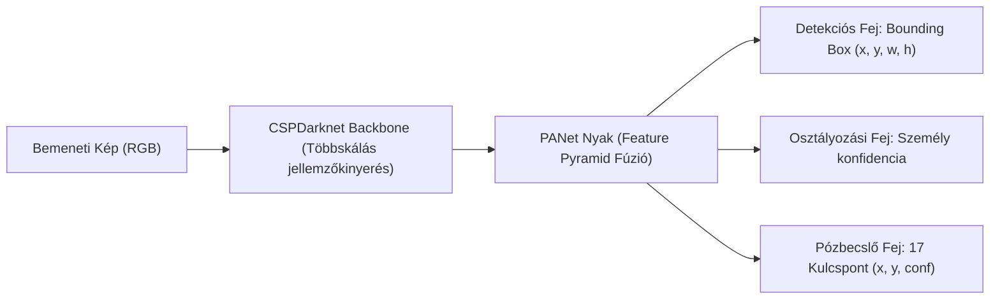
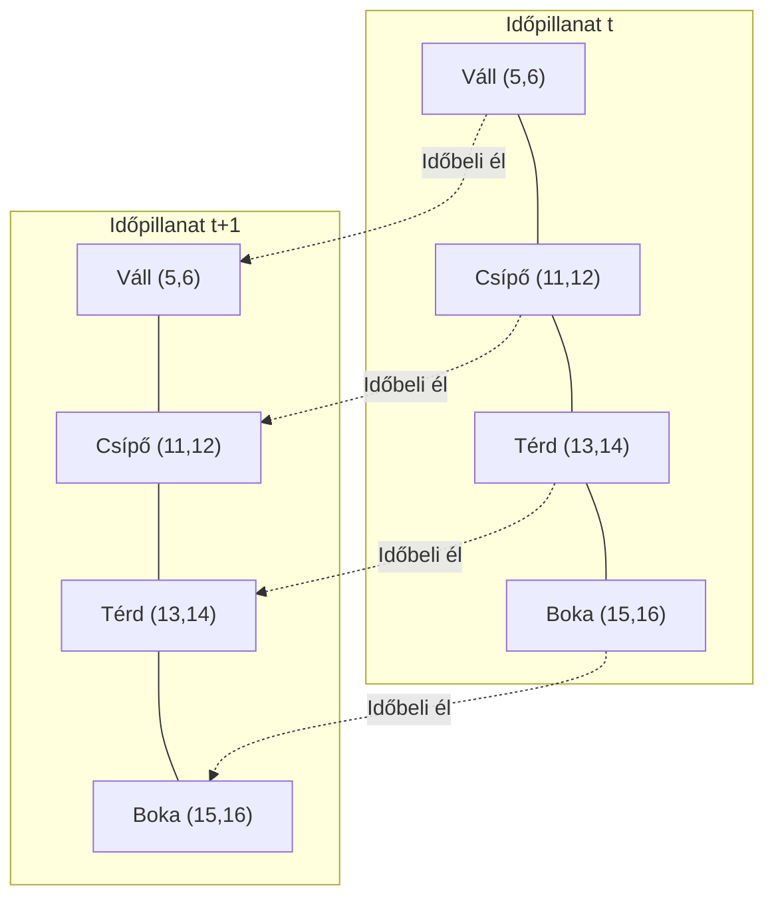
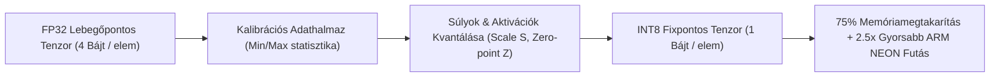
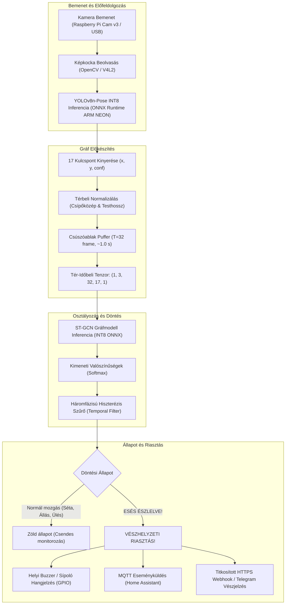
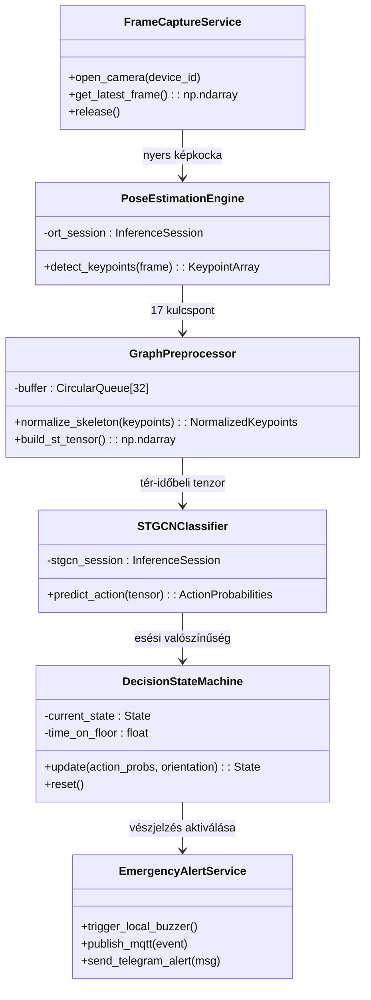
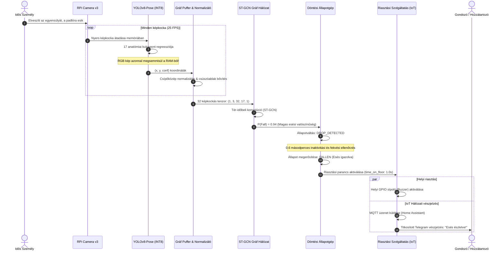
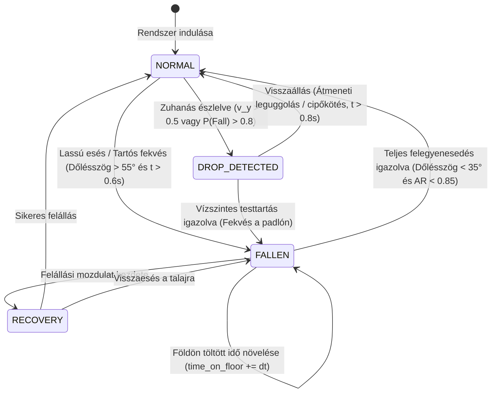
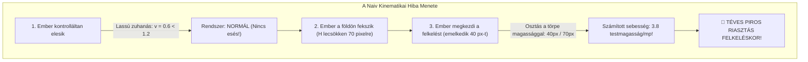

# Szakdolgozati Részletes Kutatási és Rendszer-megvalósítási Terv

**Hivatalos Témacím:** Gráf alapú modellek alkalmazása vizuális információ feldolgozására, különös tekintettel a viselkedéselemzésre  
**Kutatási fókusz és szakdolgozati alcím:** Beágyazott és peremhálózati (Edge AI) valós idejű esésdetektálás Raspberry Pi mikroszámítógépen emberi pózbecsléssel és tér-időbeli gráfkonvolúciós hálózatokkal (YOLOv8-Pose, ST-GCN, ONNX INT8)  
**Angol cím:** Embedded Edge AI Real-Time Fall Detection on Raspberry Pi using Human Pose Estimation and Spatial Temporal Graph Convolutional Networks (YOLOv8-Pose, ST-GCN, ONNX INT8)  
**Képzés:** Mérnökinformatikus / Programtervező Informatikus BSc  
**Készítés tanéve és féléve:** 2026/2027. tanév, Őszi félév (Szakdolgozat 1 / Tervezési félév)  
**Készítette:** Szakdolgozó Hallgató  
**Konzulensek:** Belső konzulens (Egyetemi Adjunktus), Külső konzulens (Számítógépes Látás és Beágyazott Rendszerek Szakértő)  
**Számítási infrastruktúra és hardverkörnyezet:**  
* *Neurális modell tanítási platform (Cloud GPU):* Google Colab / Kaggle felhő alapú hardveres gyorsítás (Nvidia Tesla T4 / P100 GPU, 16 GB VRAM, PyTorch), amely biztosítja az ST-GCN hálózat gyors és skálázható konvergenciáját.  
* *Helyi fejlesztői munkaállomás (Host PC):* AMD Ryzen 5 5500 CPU (6 mag / 12 szál @ 3.6–4.2 GHz), 16 GB DDR4 RAM, Windows 11 / Linux (adatelőkészítés, vázkinyerés, baseline tesztek).  
* *Beágyazott célhardver (Edge Device):* Raspberry Pi 5 (4GB/8GB, 4x ARM Cortex-A76 @ 2.4 GHz) / Raspberry Pi 4B (4x Cortex-A72 @ 1.5 GHz), Raspberry Pi Camera Module 3 (Sony IMX708, széles látószögű 120° FOV) / UVC USB kamera, Linux Debian ARM64 (Bookworm), ONNX Runtime ARM NEON INT8.  
**Kulcsszavak:** Számítógépes látás, Emberi pózbecslés, YOLOv8-Pose, Gráf Neurális Hálózatok (GNN), Tér-Időbeli Gráfkonvolúció (ST-GCN), Beágyazott rendszerek, Edge AI, Raspberry Pi, Modell-kvantálás (INT8), Privacy-by-Design (GDPR), Idősgondozás, Esésdetektálás, Egészségügyi távfelügyelet.

---

## Vezetői összefoglaló és absztrakt

### Magyar nyelvű absztrakt
A számítógépes látás és az intelligens viselkedéselemzés egyik legkritikusabb, életvédelmi alkalmazási területe az emberi esések, egyensúlyvesztések és hirtelen mozgásképtelenségek valós idejű, automatizált felismerése. A demográfiai öregedés következtében az egyedül élő idős emberek körében bekövetkező esések száma folyamatosan emelkedik. Az esések kimenetelét döntően a földön töltött idő határozza meg, mivel az elhúzódó fekvés órákon belül kihűléshez, izomelhaláshoz és végzetes szövődményekhez vezet. A piacon elérhető hagyományos megoldások – mint a hordható vészhívó órák vagy a padlószenzorok – csődöt mondanak, ha a felhasználó elfelejti felvenni az eszközt, vagy eszméletvesztés miatt képtelen manuálisan riasztani. A hagyományos felhő-alapú videomegfigyelő rendszerek pedig súlyos adatvédelmi (GDPR) ellenállásba ütköznek a magánszférát sértő képtovábbítás miatt, miközben folyamatos internetkapcsolatot és drága szerverkapacitást igényelnek.

Jelen szakdolgozati kutatás és megvalósítás célja egy olyan autonóm, peremhálózati (Edge AI) esésdetektáló és viselkedéselemző beágyazott rendszer kifejlesztése, amely egy alacsony fogyasztású, kompakt mikroszámítógépen (Raspberry Pi 4 / 5) valós időben fut. A feldolgozási lánc a legmodernebb egyfokozatú 2D pózbecslő modellt (YOLOv8-Pose) kombinálja Tér-Időbeli Gráfkonvolúciós Hálózattal (ST-GCN). A rendszer szigorúan érvényesíti a „Privacy-by-Design” elvet: az RGB videókockák a memóriában mindössze egyetlen ezredmásodpercre léteznek, a kulcspontok kinyerése után azonnal megsemmisülnek; a döntéshozatal kizárólag a 17 kulcspont koordináta-gráfján történik, így képi információ soha nem hagyja el az eszközt. A modell tanítása felhő alapú GPU környezetben (Google Colab T4) történik, míg a beágyazott ARM architektúra korlátozott erőforrásainak maximális kihasználása érdekében a neurális hálózatokat INT8 poszt-tanítási kvantálással (Post-Training Quantization) optimalizáljuk az ONNX Runtime motorban, kihasználva az ARM NEON SIMD vektoros utasításkészletét. A kutatás kitér a mindennapi természetes mozgások (gyors leülés, lefekvés, hajolás – ún. „Hard Negative” minták) és a valós esések szétválasztására, valamint a veszélyhelyzeti riasztások intelligens IoT integrációjára (MQTT, Webhook, helyi vészjelző).

### English Abstract
A life-critical domain in computer vision and intelligent human behavior analysis is the automated, real-time recognition of human falls, loss of balance, and sudden incapacitation. Driven by demographic aging, domestic falls among elderly individuals living alone are escalating rapidly. Clinical prognosis is largely governed by the "time-on-floor": unassisted immobilization for extended periods induces hypothermia, rhabdomyolysis, and severe mortality risks. Conventional wearable alert pendants and smartwatches exhibit notoriously poor user compliance (frequently uncharged or forgotten during bathing/sleep), whereas cloud-based video surveillance encounters massive data privacy (GDPR) rejection and imposes prohibitive network bandwidth dependencies.

This bachelor's thesis presents the research, design, implementation, and empirical evaluation of an autonomous, privacy-preserving Embedded Edge AI fall detection system running on low-power single-board computers (Raspberry Pi 4 / 5). The processing pipeline extracts 2D anatomical keypoints via a lightweight YOLOv8-Pose estimator and constructs spatiotemporal topological graphs processed by a Spatial Temporal Graph Convolutional Network (ST-GCN). Strictly complying with "Privacy-by-Design" regulations, raw video frames are purged from volatile memory immediately after keypoint regression; the decision logic operates exclusively on abstract 17-point coordinate topologies, preventing visual surveillance leakage. Model training is accelerated on cloud GPUs (Google Colab T4), while edge deployment on resource-constrained ARM Cortex-A processors is achieved via INT8 Post-Training Quantization (PTQ) executed through ONNX Runtime with ARM NEON SIMD acceleration. The research rigorously focuses on discriminating genuine falls from complex Activities of Daily Living (ADLs like rapid sitting, tying shoes, lying down), and integrates automated local IoT emergency notifications (MQTT, Webhooks, local buzzers).

---

## 1. Bevezetés és a kutatás háttere

### 1.1 Társadalmi, demográfiai és egészségügyi kontextus: Az esések epidemiológiája
A 21. század fejlett társadalmainak egyik legjelentősebb civilizációs és szociálpolitikai kihívása a népesség korfájának drasztikus elöregedése. Az Európai Unió statisztikai hivatala (Eurostat, 2023) [9] és az Egészségügyi Világszervezet (WHO, 2021) [5] előrejelzései alapján 2050-re az Európai Unió lakosságának több mint 30%-a 65 év feletti lesz, miközben az egyedül élő (*single-person household*) idős személyek aránya rekordmagasságot ér el. 

Ebben a demográfiai csoportban a mobilitás elvesztésének, az önálló életvitel megszűnésének és a traumatológiai mortalitásnak a vezető oka az **elesés**:
* A 65 év feletti lakosság mintegy 30-35%-a esik el legalább egyszer évente [5].
* A 80 év feletti populációban ez a prevalencia meghaladja az 50%-ot [5].
* Az elesések felelősek a 65 év felettiek traumatológiai kórházi felvételeinek több mint 65%-áért (combnyaktörés, medencetörés, koponyasérülések) [5, 15].
* Az orvosi ellátási költségek globálisan több tízmilliárd eurót emésztenek fel évente, miközben az intézményi idősotthoni kapacitások világszerte szűkösek.

Az esések megelőzése mellett az informatikai rendszerek legfontosabb feladata az incidensek bekövetkeztekor a **másodperceken belüli, automatizált detektálás és segítségkérés** [15].

### 1.2 Az „aranyóra” és a földön töltött idő orvosi szövődményei
A traumatológiai és gerontológiai orvostudomány konszenzusa szerint az esést követő kimenetelt nem csupán a becsapódás ereje, hanem a **földön töltött idő** (*time-on-floor*) határozza meg [3, 15]:
1. **Az első óra („Golden Hour”):** Amennyiben az elesett személy 60 percen belül szakszerű orvosi vagy gondozói ellátásban részesül, a maradandó szövődmények aránya minimális, a combnyaktörések sebészeti rehabilitációja sikeres, és a 72 órán belüli túlélési ráta meghaladja a 85%-ot.
2. **Elhúzódó földön fekvés (> 1 óra):** Ha az egyedül élő bajbajutott órákon keresztül mozgásképtelenül fekszik a hideg padlón, súlyos, életveszélyes kaszkádfolyamatok indulnak be:
   * *Hipotermia (kihűlés):* Még szobahőmérsékleten is a talajjal való hosszas érintkezés és a mozdulatlanság a maghőmérséklet végzetes zuhanását okozza.
   * *Rhabdomyolysis (akut izomszövet-szétesés):* A saját testsúly okozta tartós nyomás alatt az izomsejtek vérellátása megszűnik, elhalnak, és a véráramba kerülő mioglobin akut tubuláris nekrózist, azaz visszafordíthatatlan veseelégtelenséget vált ki.
   * *Hiposztatikus tüdőgyulladás és dekubitusz (felfekvés):* A sokkos, fekvő helyzetben a légutak folyadékfelhalmozódása órák alatt letális bakteriális felülfertőződéshez vezet.

A statisztikák szerint amennyiben a földön fekvés meghaladja a 6 órát, a halálozási ráta 6 hónapon belül eléri az 50%-ot [15], még akkor is, ha közvetlen törés nem történt. Ezért alapvető műszaki követelmény, hogy a rendszer emberi segítségkérés nélkül, passzív módon generáljon riasztást.

### 1.3 Meglévő technológiai megközelítések és azok korlátai
Az elesések detektálására a technológia történetében három fő műszaki irányvonal alakult ki, amelyek mindegyike komoly akadályokba ütközik [15]:

| Kategória | Megoldások | Előnyök | Döntő Hátrányok és Bukási Okok |
| :--- | :--- | :--- | :--- |
| **Hordható eszközök (Wearables)** | Okosórák, medálok, IMU gyorsulásmérők, övcsipeszek | Olcsó, bárhol működhet | **Felhasználói elutasítás és feledékenység:** Az idősek fürdéskor és alváskor leveszik (miközben a fürdőszoba a legfőbb esési helyszín). Eszméletvesztés vagy bénulás esetén a pánikgomb benyomhatatlan. |
| **Környezeti és padlószenzorok (Ambient)** | Nyomásérzékeny szőnyegek, padló-piezo, radarok | Érintésmentes, nem kell viselni | **Horribilis költség és holtterek:** A teljes lakás padlójának átalakítása gazdaságtalan; nem lát a bútorok alá. Leeső tárgyakat nem tud megkülönböztetni embertől (téves riasztások). |
| **Hagyományos videomegfigyelés (RGB Cloud)** | Felhőbe streamelő biztonsági IP kamerák, 3D CNN-ek | Gazdag vizuális információ | **Súlyos GDPR és adatvédelmi aggályok:** A magánszférába (háló, fürdő) senki sem enged videokamerát. Óriási hálózati sávszélesség- és felhőszerver-költség. |

### 1.4 A peremhálózati intelligencia (Edge AI) és a Raspberry Pi mikroszámítógép szerepe
A fenti korlátok és a gyakorlati megvalósíthatóság metszéspontjában a modern beágyazott mesterséges intelligencia (**Embedded Edge AI**) áll. A felhőbe történő képtovábbítás és a nagyméretű, drága, zúgó asztali munkaállomások lakossági környezetben történő elhelyezése helyett a teljes feldolgozási és döntési láncot egy kisméretű, diszkrét mikroszámítógépre – kiemelten a **Raspberry Pi 4 és Raspberry Pi 5** [11] platformra – optimalizáljuk.

A Raspberry Pi Edge AI koncepció négy döntő mérnöki előnnyel rendelkezik:
1. **Fizikai diszkréció és lakossági elfogadás:** A mikroszámítógép egy kompakt falra vagy mennyezetre rögzíthető dobozban elhelyezhető a hozzá csatlakozó kameramodullal (pl. Raspberry Pi Camera Module 3). Csendes, észrevétlen, nem kelti megfigyeltség vagy kórházi jelleg érzetét.
2. **Költséghatékonyság:** A beágyazott egykártyás mikroszámítógép ára a töredéke egy dedikált szervernek vagy asztali munkaállomásnak, így az önkormányzati vagy családi idősgondozásban széles körben skálázható.
3. **Minimális energiafogyasztás:** A rendszer tipikus áramfelvétele 5–10 Watt között alakul, szemben egy asztali PC 150–300 Wattos fogyasztásával, ami a nap 24 órájában futó biztonsági felügyeletnél alapvető üzemeltetési szempont.
4. **Hálózat- és felhőfüggetlenség:** A detektálás és a helyi riasztás internetkapcsolat nélkül, offline üzemben is megbízhatóan lefut; hálózati kimaradás esetén is védi a felügyelt személyt.

### 1.5 A váz-alapú gráfkonvolúciós paradigma (YOLOv8-Pose + ST-GCN) és a Privacy-by-Design elv
Jelen kutatás egy modern, a számítógépes látás és a gépi tanulás legújabb eredményeire támaszkodó megközelítést alkalmaz: a **váz-alapú akciófelismerést** (*Skeleton-Based Human Action Recognition*) [1, 8, 17].

A megközelítés filozófiai és technikai alapja a **geometriai absztrakció és a dimenziócsökkentés**:
Ahelyett, hogy a videófolyam gigabájtos képmátrixait próbálnánk meg elemezni – amely információ 99%-ban a döntés szempontjából irreleváns hátteret, szobabútort, falszínt és ruházati textúrát tartalmaz –, a beérkező képekből egy könnyűsúlyú, előre tanított mély neurális hálózattal (**YOLOv8-Pose**) [2] kinyerjük az emberi test anatómiai kulcspontjait.

Egy embert a COCO-17 topológia szerint mindössze **17 darab kétdimenziós koordináta** ($x_i, y_i$) és a hozzájuk tartozó láthatósági megbízhatóság ($conf_i$) ír le:
$$v_i = (x_i, y_i, conf_i), \quad i \in \{0, \dots, 16\}$$

Ezt az absztrakciót egy **Tér-Időbeli Gráfkonvolúciós Hálózat** (ST-GCN) [1] dolgozza fel, amely az emberi vázat egy tér-időbeli irányítatlan gráfként értelmezi. A térbeli élek a test valódi csontjait, az időbeli élek pedig az ízületek egymást követő képkockák közötti folytonos trajektóriáját reprezentálják.

#### A paradigma két döntő előnye:
1. **Beépített adatvédelem (Privacy-by-Design / GDPR megfelelőség):**  
   Az RGB videókockák a mikroszámítógép memóriájában mindössze egyetlen ezredmásodpercig léteznek, amíg a pózbecslő kiolvassa a csúcsokat; ezután a képpontok azonnal megsemmisülnek. A megmaradó számpárokból az egyén arca, neme, etnikuma vagy meztelensége **matematikailag rekonstruálhatatlan**. A rendszer nem képi megfigyelést végez, hanem egy absztrakt geometriai pálcikaember mozgásfizikáját elemzi, így maradéktalanul megfelel az Európai Unió GDPR 9. cikkének [9].
2. **Kiváló erőforrás-hatékonyság (Edge AI és ARM INT8 megvalósíthatóság):**  
   Mivel a gráfkonvolúció nem hatalmas képmátrixokon, hanem mindössze 17 pontból álló kompakt tenzorokon operál, a következtetési idő pár ezredmásodpercre csökken. A poszt-tanítási INT8 kvantálás [6] és az ARM NEON utasításkészlet révén a teljes rendszer képes stabil, **$\ge 25$ FPS valós idejű sebességgel futni egy Raspberry Pi mikroszámítógépen**, drága és nagy fogyasztású videokártya nélkül.

### 1.6 A kutatás célkitűzései és a diplomamunka hatóköre (Scoping)

#### 1.6.1 A hivatalos feladatkiírás teljesítése
A diplomamunka célja a tanszéki feladatkiírással összhangban:
1. **Architektúrák vizsgálata:** A korszerű valós idejű pózbecslő eljárások (kiemelten az Ultralytics YOLOv8-Pose) [2], valamint a gráf neurális hálózatok (GNN, ST-GCN) [1, 7] matematikai és strukturális elemzése.
2. **Adatfolyam és modelltervezés:** Olyan szoftveres folyamat megtervezése, amely a beágyazott kameraszenzortól a normalizált ízület-csont gráfokig vezet, és felépíti az ST-GCN tér-időbeli rétegeit.
3. **Beágyazott optimalizáció:** A modellek átalakítása és poszt-tanítási INT8 kvantálása az ONNX Runtime [10] motorban a Raspberry Pi ARM NEON architektúrájára.
4. **Szoftveres megvalósítás és kiértékelés:** A modell implementálása PyTorch környezetben, betanítása és tesztelése nyilvános referencia-adathalmazokon (UR Fall Detection [3], Le2i Fall [4]), a pontosság mérése szabványos metrikákkal (Recall, Precision, F1, ROC-AUC), valamint a zajos és takart adatokkal szembeni robusztusság számszerűsítése.
5. **Valós idejű prototípus és IoT integráció:** Egy stabilan működő, élő webkamerás és mikroszámítógépes demonstrációs szoftver létrehozása, amely hiszterézis-alapú döntési logikával, helyi hangjelzéssel és MQTT/Webhook alapú vészjelzéssel azonnal értesíti a környezetet.

#### 1.6.2 Tudatos lehatárolások (mit NEM tartalmaz a dolgozat)
* **Egyetlen személyre optimalizált fókusz ($M=1$):** A jelenlegi kutatási fázis célja az egyedül élő idős személyek felügyelete. Amennyiben a látótérben átmenetileg több személy tartózkodik (pl. látogató, gondozó), a csővezeték a legmagasabb detekciós konfidenciájú személy vázát követi ($M=1$). A több személy párhuzamos térbeli követése és interakciós gráf-fúziója a továbbfejlesztési lehetőségek (8. fejezet) között kerül megjelölésre.
* **Arcfelismerés és személyazonosítás teljes kizárása:** A rendszer semmilyen biometrikus azonosítót nem használ; célja kizárólag a mozgás típusának megállapítása.
* **Saját pózbecslő nulláról való betanítása:** A pózbecslésre előre tanított COCO súlyokat alkalmazunk transzfer tanulással, mivel a feladatkiírás szerint a hangsúly a gráfalapú elemző modellen és a beágyazott optimalizáción van.
* **Egészségügyi diagnosztika:** A rendszer nem állít fel orvosi kórképet, feladata kizárólag a mechanikai esés/zuhanás és a földön maradás tényének megbízható észlelése és jelzése.

---

## 2. Kutatási célok, kérdések és formális hipotézisek

### 2.1 A kutatás fő és részcéljai
A munkafolyamat három fő pillérre épül:
1. **Elméleti és modelltervezési pillér:** A 2D pózbecslés és a tér-időbeli gráfkonvolúció matematikai formalizmusának tisztázása, a COCO-17 topológia gráfpartícióinak kidolgozása, és az esési kinematika modellezése.
2. **Beágyazott mérnöki és optimalizációs pillér:** A mély tanulási modellek transzformálása korlátozott erőforrású ARM Cortex-A környezetre. Az FP32 lebegőpontos tenzorok INT8 poszt-tanítási kvantálása, valamint az aszinkron többfolyamatos adatfeldolgozás megtervezése.
3. **Empirikus és validációs pillér:** Nemzetközi referencia-adathalmazokon (UR Fall, Le2i) és saját szobai tesztvideókon végzett összehasonlító mérések elvégzése a klasszikus baseline modellekkel (kinematikai szabályrendszer, Bi-LSTM) szemben.

### 2.2 Kutatási kérdések (Research Questions)
* **RQ1 (Diszkriminációs képesség a „Hard Negative” mintákkal szemben):**  
  *Kérdés:* Képes-e az ST-GCN hálózat legalább $95\%$-os Recall mellett szignifikánsan alacsonyabb téves riasztási arányt (FPR $\le 5\%$) elérni a hétköznapi, esésre emlékeztető gyors mozgásokkal (gyors leülés, fotelbe huppanás, cipőkötés, ágyba dőlés) szemben, mint a hagyományos kinematikai baseline modellek?
* **RQ2 (A gráfalapú topológia többlete a szekvenciális modellekhez képest):**  
  *Kérdés:* Mekkora mértékű pontosságnövekedést (F1-score és ROC-AUC) biztosít a test anatómiai csontjait explicit módon modellező térbeli gráfkonvolúció a pontokat lapos vektorként kezelő szekvenciális hálózatokhoz (pl. Bi-LSTM) képest?
* **RQ3 (Valós idejű megvalósíthatóság beágyazott ARM célhardveren):**  
  *Kérdés:* Elérhető-e a folyamatos, akadásmentes valós idejű működés ($\ge 25$ FPS bemeneti feldolgozás) egy Raspberry Pi 5 mikroszámítógépen dedikált NPU nélkül, kizárólag a CPU ARM NEON utasításkészletére támaszkodó INT8 ONNX kvantálás révén?
* **RQ4 (Robusztusság részleges takarással és zajjal szemben):**  
  *Kérdés:* Hogyan befolyásolja az esésfelismerés megbízhatóságát, ha a lakás bútorai miatt az alsótesti kulcspontok (térdek, bokák) átmenetileg takarásba kerülnek, és képes-e a modell a láthatósági megbízhatósági faktorok ($conf_i$) integrálásával fenntartani a stabil működést?

### 2.3 Formális hipotézisek (Hypotheses)
* **H1 Hipotézis:** Az ST-GCN gráfmodell a térbeli csont-kapcsolatok és az időbeli gyorsulási mintázatok együttes tanulása révén **legalább 8-12 százalékponttal magasabb F1-értéket** ér el a nehéz negatív mintákon (leülés, hajolás), mint a kézzel skálázott kinematikai heurisztikus döntési algoritmus.
* **H2 Hipotézis:** A normál napi leülés és a valódi esés közötti elválasztáshoz egy $T=32$ képkockás (~1.0 másodperces) tér-időbeli csúszóablak elegendő információt szolgáltat arra, hogy a modell **96% feletti Szenzitivitást (Recall)** érjen el az UR Fall Detection tesztkészleten.
* **H3 Hipotézis:** A YOLOv8n-pose és az ST-GCN modellek INT8 poszt-tanítási kvantálásával a memóriafoglalás legalább $60\%$-kal csökken, míg a végrehajtási idő Raspberry Pi 5 eszközön a 40 ms/képkocka határérték alá szorítható, biztosítva a stabil **25 FPS sebességet**.
* **H4 Hipotézis:** Az adaptív háromfázisú hiszterézis döntési mechanizmus (amely a zuhanási fázist követően minimálisan 0.6 másodperces horizontális inaktivitást követel meg) a felkelési, leülési és átmeneti mozgásokból származó téves riasztási arányt (False Positive Rate – FPR) **statisztikailag szignifikáns módon $2.0\%$ alá szorítja** az ADL tesztkészleten.


## 3. Szakirodalmi áttekintés és elméleti háttér

### 3.1 2D Emberi Pózbecslés: Ultralytics YOLOv8-Pose
A rendszer bemeneti észlelési rétegét az Ultralytics által 2023-ban publikált **YOLOv8-Pose** architektúra alkotja, amely a valós idejű objektumdetektálás és kulcspont-regresszió ipari etalonjának számít.



#### Architekturális felépítés
1. **Backbone (Gerinchálózat):** Egy módosított CSPDarknet (Cross Stage Partial) struktúrát használ, amely C2f (Cross Stage Partial with 2 convolutions) modulokból épül fel. A C2f blokkok maradványkapcsolatokkal (residual connections) és párhuzamos gradiens-áramlásokkal maximalizálják a tanulási kapacitást, miközben minimalizálják a lebegőpontos műveletek számát (FLOPs).
2. **Neck (Nyak):** Egy Path Aggregation Network (PANet) struktúra, amely felfelé és lefelé irányuló piramis-fúzióval egyesíti a korai rétegek finom térbeli felbontását a mély rétegek szemantikai gazdagságával. Ez garantálja, hogy a távolabb álló vagy fekvő emberi alakzatok kis méretű végtagjai is pontosan lokalizálhatók maradnak.
3. **Decoupled Pose Head (Szétválasztott pózbecslő fej):** A korábbi YOLO verziókkal ellentétben a doboz-regresszió, az osztályozás és a kulcspont-predikció különálló konvolúciós ágakon történik.

#### A COCO-17 ízületi topológia
A hálózat az emberi testet 17 darab kulcsponttal reprezentálja:
* **Fej (0–4):** 0: Orr, 1: Bal szem, 2: Jobb szem, 3: Bal fül, 4: Jobb fül.
* **Felsőtest és karok (5–10):** 5: Bal váll, 6: Jobb váll, 7: Bal könyök, 8: Jobb könyök, 9: Bal csukló, 10: Jobb csukló.
* **Alsótest és lábak (11–16):** 11: Bal csípő, 12: Jobb csípő, 13: Bal térd, 14: Jobb térd, 15: Bal boka, 16: Jobb boka.

#### Object Keypoint Similarity (OKS) Veszteségfüggvény
A pózbecslő fej tanítása nem sima euklideszi távolságon, hanem a biometrikusan skálázott OKS metrikán alapszik:
$$OKS = \frac{\sum_{i=0}^{16} \exp\left(-\frac{d_i^2}{2 s^2 \sigma_i^2}\right) \delta(v_i > 0)}{\sum_{i=0}^{16} \delta(v_i > 0)}$$
Ahol:
* $d_i$ a becsült és a valós kulcspont közötti euklideszi távolság pixelben.
* $s$ a személy befoglaló téglalapjának skálája ($s = \sqrt{W \cdot H}$).
* $\sigma_i$ az adott ízület per-osztály szórása (a térd és boka $\sigma$-ja nagyobb a laza mozgásszabadság miatt, míg a szemek és orr $\sigma$-ja kicsi a merev anatómiának köszönhetően).
* $v_i$ a láthatósági jelző ($v_i > 0$ ha a pont nincs kitakarva), $\delta(\cdot)$ a Dirac-delta indikátor.

### 3.2 Tér-Időbeli Gráfkonvolúciós Hálózatok (ST-GCN)
A Yan et al. (AAAI 2018) által bevezetett **Spatio-Temporal Graph Convolutional Network (ST-GCN)** elméleti áttörést hozott az emberi cselekvésfelismerésben: az emberi csontvázat egy olyan dinamikus, nem-euklideszi gráfként definiálja, amely a térbeli anatómiát és az időbeli dinamikát egyetlen összefüggő tenzorként képes feldolgozni.

#### A tér-időbeli gráf definíciója
A gráf formális leírása:
$$\mathcal{G} = (\mathcal{V}, \mathcal{E})$$
* **Csúcsok ($\mathcal{V}$):** Az időablakban ($T$) megjelenő összes anatómiai ízület:
  $$\mathcal{V} = \{v_{ti} \mid t = 1, \dots, T; \, i = 1, \dots, N\}$$
  Jelen szakdolgozatban $N = 17$ ízület és $T = 32$ képkocka (~1.0 másodperc $30\text{ FPS}$ mellett).
* **Élek ($\mathcal{E}$):** Két diszjunkt élhalmaz uniója:
  1. *Térbeli élek ($\mathcal{E}_S$):* Az azonos időpillanatban ($t$) létező fizikai csontok az ízületek között:
     $$\mathcal{E}_S = \{(v_{ti}, v_{tj}) \mid (i, j) \in H\}$$
     Ahol $H$ az emberi csontváz anatómiai kapcsolatainak halmaza (pl. váll-csípő, csípő-térd, térd-boka).
  2. *Időbeli élek ($\mathcal{E}_T$):* Ugyanazon ízület egymást követő képkockák közötti időbeli összeköttetése:
     $$\mathcal{E}_T = \{(v_{ti}, v_{(t+1)i})\}$$



#### A Térbeli Gráfkonvolúció Művelete
Egy tetszőleges $v_i$ csúcson a térbeli konvolúció a szomszédos ízületek jellemzőinek súlyozott aggregációjaként írható fel:
$$f_{out}(v_i) = \sum_{v_j \in B(v_i)} \frac{1}{Z_{ij}} f_{in}(v_j) \cdot W(l_i(v_j))$$
Ahol:
* $B(v_i) = \{v_j \mid d(v_i, v_j) \le 1\}$ az 1-távolságú (közvetlen) szomszédok halmaza.
* $Z_{ij} = |B(v_j)|$ a fokszám-alapú normalizáló tényező.
* $W$ a tanulható súlymátrix.
* $l_i(v_j)$ a partíciós címkéző függvény.

#### Spatial Configuration Partíciós Stratégia
A sima konvolúcióval ellentétben a gráfokon a szomszédoknak nincs természetes sorrendje. Az ST-GCN a szomszédságot $K=3$ csoportra bontja a test globális súlypontjához (csípőközép) viszonyított távolság alapján:
1. **Gyökércsoport ($K=0$):** Maga a vizsgált csúcs ($v_i$).
2. **Centripetális csoport ($K=1$):** Azok a szomszédok, amelyek közelebb helyezkednek el a súlyponthoz, mint $v_i$.
3. **Centrifugális csoport ($K=2$):** Azok a szomszédok, amelyek távolabb vannak a súlyponttól, mint $v_i$.

Mátrixos reprezentációban a teljes térbeli gráfkonvolúciós réteg:
$$f_{out} = \sum_{k=0}^{2} \Lambda_k^{-\frac{1}{2}} (A_k \odot M_k) \Lambda_k^{-\frac{1}{2}} f_{in} W_k$$
Ahol:
* $A_k$ a $k$-adik partícióhoz tartozó bináris szomszédsági mátrix ($17 \times 17$).
* $\Lambda_k^{ii} = \sum_j A_k^{ij} + \epsilon$ a normalizáló fokszámmátrix.
* $M_k$ egy tanulható fontossági maszk (Learnable Edge Weight Matrix), amely megtanulja, hogy esés közben mely csontkapcsolatok (pl. gerinc dőlése) bírnak nagyobb diagnosztikai súllyal.

#### Időbeli Konvolúció (TCN)
A térbeli kapcsolatok leképezése után a jellemzőket egy időbeli konvolúciós réteg (TCN) dolgozza fel. Ez egy klasszikus 1D konvolúció $K_t \times 1$ méretű szűrővel (jellemzően $9 \times 1$), amely az időtengely mentén rögzíti az ízületek gyorsulását, lassulását és trajektóriáját. A teljes ST-GCN hálózat 9 egymásra épülő tér-időbeli blokkból (ST-GCN Unit) áll, BatchNorm és Dropout rétegekkel kiegészítve.

---

### 3.3 Beágyazott mélytanulás és modell-kvantálás ARM architektúrára

A Raspberry Pi típusú beágyazott eszközökön a mély tanulási modellek közvetlen (FP32) futtatása a korlátozott memória-sávszélesség és a dedikált lebegőpontos tenzormagok hiánya miatt szűk keresztmetszetet jelent. A valós idejű futás kulcsa a **poszt-tanítási kvantálás (Post-Training Quantization - PTQ)** és az **ARM NEON SIMD optimalizáció**.

#### Az INT8 Kvantálás Matematikai Elmélete
A kvantálás célja a folytonos 32 bites lebegőpontos értékek ($r \in \mathbb{R}$, FP32) leképezése 8 bites előjeles vagy előjeltelen egészekre ($q \in \mathbb{Z}$, INT8, $[-128, 127]$ tartomány):
$$q = \text{round}\left(\frac{r}{S}\right) + Z$$
Ahol:
* $S$ (Scale factor) a skálázási tényező: egy pozitív valós lebegőpontos szám, amely az adatok dinamikatartományát határozza meg:
  $$S = \frac{r_{max} - r_{min}}{q_{max} - q_{min}} = \frac{r_{max} - r_{min}}{255}$$
* $Z$ (Zero-point) a valós nulla értékének megfelelő diszkrét egész eltolás (aszimmetrikus kvantálás esetén). Súlyok esetében szimmetrikus kvantálást ($Z = 0$) alkalmazunk, ami egyszerűsíti a hardveres szorzási műveletet:
  $$q = \text{clip}\left(\text{round}\left(\frac{r}{S}\right), -128, 127\right)$$

A dekvantálás művelete az eredeti érték visszaállítására:
$$\tilde{r} = S \cdot (q - Z)$$



#### Előnyök a beágyazott végponton
1. **Memóriaméret csökkentése:** A modell súlyfájljának és munka-memóriájának foglalása pontosan a negyedére ($75\%$-os csökkenés) esik vissza (pl. egy 12 MB-os modell mindössze 3 MB-ot igényel). Ez drasztikusan tehermentesíti a Raspberry Pi RAM sávszélességét.
2. **Gyorsítótár (L1/L2 Cache) hatékonyság:** A kisebb tenzorok kényelmesen elférnek a processzormagok szűk L2 gyorsítótárában, minimalizálva a lassú főmemória-elérések számát.

#### ARM NEON SIMD Vektoros Utasításkészlet
A Raspberry Pi processzoraiban található ARM Cortex-A magok (Cortex-A72 a Pi 4-ben, Cortex-A76 a Pi 5-ben) 128 bites **NEON SIMD (Single Instruction Multiple Data)** vektorregiszterekkel rendelkeznek. 

Egyetlen órajelciklus alatt:
* FP32 esetén: legfeljebb 4 lebegőpontos szorzás hajtható végre ($128 / 32 = 4$).
* INT8 esetén: a dedikált NEON vektorutasítások (pl. `SDOT` – Signed Dot Product) **egyetlen órajelciklus alatt négy pár 8 bites egész szorzatát adják hozzá egy 32 bites akkumulátorhoz**, így órajelenként akár **16 párhuzamos művelet** fut le magonként!

#### Beágyazott Inferencia Motorok Összehasonlítása

| Szempont | PyTorch Native (CPU) | ONNX Runtime (ARM64) | Tencent NCNN | Google TFLite |
| :--- | :--- | :--- | :--- | :--- |
| **Célplatform** | Asztali gép, szerver | Bármely architektúra | Speciálisan beágyazott ARM | Mobil, beágyazott |
| **INT8 Támogatás** | Korlátozott | **Kiváló (ORT Quantizer)** | Nagyon jó | Jó |
| **ARM NEON kihasználás** | Közepes | **Automatikus és optimális** | Kézzel assemblyben kódolt | Jó |
| **YOLOv8 & ST-GCN kompatibilitás** | Natív | **Teljes (Mindkét modell fut)** | Egyedi réteg-átalakítás kell | Nehézkes ST-GCN-re |
| **Késleltetés Raspberry Pi 5-ön** | ~120 ms | **~28-35 ms** | ~26-32 ms | ~35-45 ms |
| **A dolgozat választása** | Fejlesztésre | **Végponti telepítésre (Edge)** | Alternatív benchmark | - |


## 4. Rendszerarchitektúra és szoftverspecifikáció (UML tervezés)

### 4.1 Végponttól-végpontig tartó (End-to-End) adatfolyam architektúra
A rendszer valós idejű működését egy moduláris, aszinkron adatfolyam biztosítja, amely a fizikai kameraszenzortól a riasztási eseményig terjed.



---

### 4.2 Hardveres architektúra és számítási infrastruktúra specifikáció

A kutatás megvalósításához és a beágyazott futtatáshoz három hardverkörnyezet feladatait határoltuk el:
1. **Neurális modell tanítási és kísérleti platform (Cloud GPU Workstation):**
   * *Infrastruktúra:* Google Colab és Kaggle felhő alapú számítási környezet.
   * *Hardveres gyorsító:* Dedikált **Nvidia Tesla T4 GPU (16 GB GDDR6 VRAM)** vagy Nvidia Pascal P100 GPU.
   * *Szerepe:* Az ST-GCN mély gráfkonvolúciós hálózat és a Bi-LSTM baseline modellek 50–100 epochos betanítása az URFD és Le2i adathalmazokon, Focal Loss optimalizáció, valamint az INT8 poszt-tanítási kalibráció súlygenerálása. A felhős GPU garantálja a percek alatti lefutást, kiküszöbölve a CPU-s tanítás napokig tartó szűk keresztmetszetét.
2. **Helyi fejlesztői munkaállomás (Host PC):**
   * *Processzor:* AMD Ryzen 5 5500 (6 fizikai mag, 12 szál, 3.6 GHz alap / 4.2 GHz boost órajel, 16 MB L3 cache).
   * *Memória:* 16 GB DDR4 3200 MHz RAM.
   * *Operációs rendszer:* Windows 11 Home / Linux Ubuntu 22.04 LTS.
   * *Szerepe:* Helyi adatkezelés, videókocka-előkészítés, kulcspont-kinyerés, a naiv kinematikai baseline tesztelése és a lokális webkamerás diagnosztika.
3. **Beágyazott célhardver (Embedded Edge Device):**
   * *Alaplapi mikroszámítógép:* **Raspberry Pi 5** (vagy Raspberry Pi 4B fallback).
     * CPU: Broadcom BCM2712 négymagos ARM Cortex-A76 processzor @ 2.4 GHz (Pi 5), illetve BCM2711 négymagos Cortex-A72 @ 1.5 GHz (Pi 4B).
     * RAM: 4 GB vagy 8 GB LPDDR4X SDRAM.
     * Multimédia: VideoCore VII GPU, hardveres H.264 dekóder.
   * *Kamera interfész:* **Raspberry Pi Camera Module 3** (Sony IMX708 szenzor, széles látószögű 120°-os FOV objektívvel, 2-sávos MIPI CSI-2 interfésszel) vagy szabványos USB UVC kamera.
   * *Hűtés és ház:* Hivatalos aktív hűtőborda + PWM vezérelt ventilátor (Active Cooler) a termikus órajelfojtás (thermal throttling) megelőzésére.
   * *Tápellátás:* 27W USB-C PD tápegység (5V / 5A). Átlagos teljesítményfelvétel: 6–9 Watt.

---

### 4.3 UML Komponens-diagram (Component Diagram)

A szoftverrendszer moduláris architektúrája szétválasztja az adatbevitelt, a gépi látást, a gráfelemzést és a hálózati értesítéseket.



---

### 4.4 UML Szekvencia-diagram (Sequence Diagram: Esés Detektálása és Riasztás)

Az alábbi diagram részletezi egy valós esési esemény időbeli lefolyását és az alrendszerek közötti szekvenciális üzenetváltásokat:



---

### 4.5 UML Állapotgép-diagram (State Machine Diagram)

A téves riasztások elkerülését garantáló négyállapotú véges automata:



---

### 4.6 Térbeli normalizálás és csúszóablak képzés ($M=1$ tenzor)

A kamera előtti relatív távolság és az egyéni testmagasság hatásainak semlegesítésére minden mintavételezett vázat geometriai transzformációnak vetünk alá:
1. **Origó eltolása (Translation Invariance):** A test globális súlypontját, a csípőközéppontot ($C_{hip} = \frac{v_{11} + v_{12}}{2}$) választjuk új koordináta-eredőnek $(0, 0)$.
2. **Skálázás (Scale Invariance):** Minden kulcspont koordinátát elosztunk a pillanatnyi törzshosszal ($L_{torso} = \|C_{shoulder} - C_{hip}\|_2$), így a váz arányai függetlenné válnak a kameratávolságtól:
   $$\tilde{P}_i = \frac{P_i - C_{hip}}{L_{torso}}$$

A normalizált koordinátákból egy $T=32$ elemű FIFO körpuffer (Circular Buffer) épül fel. Az ST-GCN bemeneti tenzorának dimenziója:
$$\mathbf{X} \in \mathbb{R}^{B \times C \times T \times V \times M} = (1 \times 3 \times 32 \times 17 \times 1)$$
Ahol $B=1$ a batch méret, $C=3$ a csatornaszám ($x, y, conf$), $T=32$ az időablak, $V=17$ az ízületek száma, és $M=1$ az egyetlen felügyelt személy. Ha a képen átmenetileg többen tartózkodnak, a pózbecslő a legmagasabb megbízhatóságú dobozt választja ki.

---

### 4.7 Háromfázisú hiszterézis döntési logika és időmérés

A döntéshozatal nem egyetlen pillanatnyi képkockán alapul, hanem három szigorú fázist követel meg:
1. **1. Fázis: Dinamikai Zuhanás:** Az ST-GCN osztályozó magas valószínűséggel ($P_{fall} > 0.85$) jelzi az esési mozgásmintát, vagy a súlypont vertikális sebessége meghaladja a zuhanási küszöböt ($v_y > 0.5$).
2. **2. Fázis: Geometriai Orientáció:** A személy hossztengelye (vállközép és csípőközép egyenese) a függőlegessel bezárt szöge meghaladja az $55^{\circ}$-ot, és a befoglaló téglalap oldalaránya szélesség-dominánssá válik ($W/H > 1.15$).
3. **3. Fázis: Időbeli Megerősítés (Temporal Persistence):** A riasztás csak akkor válik véglegessé, ha a személy a zuhanást követően legalább $0.6$ másodpercen keresztül a földön marad. Ezzel megelőzhető a gyors leülés, ágyra huppanás vagy cipőkötés miatti hamis vészjelzés. Ha az állapot megerősítést nyer, a rendszer számlálni kezdi a **földön töltött időt** (`time_on_floor`), amelyet másodperc alapon rögzít és továbbít.

---

### 4.8 Hálózati értesítési és IoT alrendszer (Zero Pixel Leakage)

A rendszer tervezési filozófiája szerint a külvilág felé **semmilyen képi adat vagy videófolyam nem kerül kibocsátásra**. Esés észlelésekor kizárólag strukturált JSON metaadatok hagyják el az eszközt:

```json
{
  "event": "FALL_CONFIRMED",
  "device_id": "rpi5-living-room-01",
  "timestamp": "2026-10-31T17:15:20Z",
  "confidence": 0.962,
  "time_on_floor_seconds": 15.4,
  "torso_angle_deg": 78.5,
  "status": "UNRESPONSIVE"
}
```

* **MQTT Protokoll:** A Raspberry Pi a helyi okosotthon szerver (pl. Home Assistant) felé publikálja a telemetriát az `elderly/safety/fall` témakörben, amely felkapcsolhatja a világítást és értesítheti az ápolókat.
* **Titkosított Webhook / Telegram Bot:** Közvetlen push-értesítés a gondozó okostelefonjára, szöveges riasztással és a földön töltött idő frissítésével.
* **Helyi Vészcsengő (Hardware Buzzer):** A Raspberry Pi GPIO kimenetére kapcsolt zümmer azonnal hangjelzést ad. Ha a felhasználó képes felállni, a felállással a rendszer automatikusan némítja a riasztást.

---

## 5. Empirikus esettanulmány: A naiv kinematikai heurisztikák korlátai és a „törpe-osztó” (Dwarf-Denominator) anomália

### 5.1 A kiinduló kísérleti elrendezés
A szakdolgozati kutatás korai fázisában kifejlesztettünk és teszteltünk egy kézzel definiált szabályrendszerre épülő kinematikai esésdetektáló prototípust (`simple_fall_detector.py`). A cél az volt, hogy referencia-alapot (Baseline 1) képezzünk a később megvalósítandó ST-GCN mély tanulási modellhez, és felmérjük a webkamerás pózbecslés megbízhatóságát.

A naiv algoritmus a szakirodalomban leggyakrabban idézett három szabályt kombinálta:
1. Súlypont (csípőközép) vertikális sebessége:
   $$v_y = \frac{\Delta y_{com}}{H_{bbox} \cdot \Delta t} > 1.2\text{ testmagasság / másodperc}$$
2. Törzs dőlésszöge a függőlegeshez képest: $\theta > 55^{\circ}$
3. Bounding box oldalaránya (Aspect Ratio): $AR = \frac{W}{H} > 1.15$

### 5.2 A tapasztalt ellenmondásos viselkedés
A laboratóriumi szobai tesztek során a rendszer **két súlyos, paradox anomáliát mutatott**:
* **1. Anomália (Nem jelzett eséskor):** Amikor a tesztalany kontrolláltan a szőnyegre esett (elkerülve a sérülést), az esés időtartama $1.0-1.4\text{ másodpercig}$ tartott. A számított pillanatnyi zuhanási sebesség ($v_y \approx 0.45-0.70$) nem érte el a merev $1.2$-es határértéket. Mivel az állapotgép a fekvő pozíciót csak előzetes gyors zuhanási állapot után tekintette esésnek, a tesztalany földön fekvése alatt a rendszer tévesen **végig normál (zöld) állapotban maradt**.
* **2. Anomália (Riasztott felkeléskor):** Amikor a földön fekvő személy megkezdte a felkelést (letámaszkodott a karjával, megemelte a vállát), a kijelző váratlanul **pirosra váltott, és vészhelyzeti esésriasztást adott ki**!



### 5.3 Matematikai és biomechanikai hibaok levezetése (Denominator Collapse)
A hibaelemzés feltárta a hiba egzakt matematikai forrását:
* **A „Törpe-osztó” (Dwarf-Denominator) jelenség:** A képlet a pillanatnyi befoglaló téglalap magasságával ($H_{bbox}$) normalizált. Álló embernél a magasság nagy ($H_{stand} \approx 350-450\text{ pixel}$). Fekvő embernél azonban a doboz magassága mindössze a fekvő test vastagságára, $H_{floor} \approx 60-80\text{ pixelre}$ zsugorodik össze!
* **Numerikus szingularitás:** Amikor a fekvő személy megmozdul a felkeléshez, a vállak minimális, mindössze $\Delta y \approx 40\text{ pixeles}$ elmozdulása a parányi nevező miatt extrém sebességugrást eredményez:
  $$v_{számított} = \frac{40\text{ px}}{70\text{ px} \cdot 0.15\text{ s}} \approx 3.81\text{ testmagasság/másodperc}$$
  Ez a számított érték több mint háromszorosa volt a zuhanási küszöbnek ($3.81 > 1.2$)!
* **Előjel-hiba és köztes póz:** A képi koordináta-rendszerben az origó a bal felső sarokban van, így a koordináták lefelé növekednek ($y \downarrow$). Felkeléskor a mozgás iránya felfelé mutat ($\Delta y < 0$). Az előjelkezeletlen vagy abszolútértékes modul a felfelé irányuló gyorsulást lefelé zuhanásként értelmezte. Mivel a felkelés első fázisában (térdelés, négykézláb póz) a test még döntött ($\theta > 40^{\circ}$) és széles ($AR > 1.0$), a naiv rendszer azonnal teljesültnek vette a fekvés és a zuhanás együttes feltételét.

### 5.4 A mérnöki javítás (Baseline V2 architektúra)
A hiba kiküszöbölésére a kinematikai modellt refaktoráltuk (`simple_fall_detector.py` V2):
1. **Skálainvariáns Dimenzió-Norma ($\text{ref\_dim}$):**  
   A sebesség számításánál a doboz pillanatnyi magassága helyett a befoglaló téglalap maximális dimenzióját rögzítjük:
   $$\text{ref\_dim} = \max(W_{bbox}, H_{bbox}, 50.0)$$
   Mivel az emberi test hossztengelye állva a magasságban ($H$), fekve pedig a szélességben ($W$) reprezentálódik, a $\max(W, H)$ közel állandó marad az esés és felkelés teljes folyamata alatt, megelőzve a nevező összeomlását.
2. **Előjelhelyes Vektoriális Irányvizsgálat:**  
   Szigorúan szétválasztottuk a lefelé zuhanást ($v_y > 0$) a felfelé emelkedéstől ($v_y < 0$). Felfelé irányuló mozgás esetén a rendszer azonnal blokkolja az esési állapotba lépést.
3. **Tartós Testtartás Analízis (Posture Persistence):**  
   A rendszer két önálló úton képes esést igazolni:
   * *A) Dinamikus út:* Jelentős zuhanás ($v_y > 0.5$) és vízszintes pozíció.
   * *B) Statikus út (Óvatos, tompított esés):* Ha a test vízszintesbe kerül ($\theta > 55^{\circ}$ vagy $W/H > 1.15$) és ebben a helyzetben marad legalább $0.6$ másodpercig, a rendszer sebességküszöb nélkül is validálja a vészhelyzetet.
4. **Felállási Rekupáció:**  
   Kiegyenesedéskor ($\theta < 35^{\circ}$ és $W/H < 0.85$) az állapotgép késleltetés nélkül visszaáll normál állapotba.

### 5.5 Tudományos konklúzió: Miért igazolja ez az ST-GCN szükségességét?
Ez az esettanulmány empirikus, kézzelfogható bizonyítékot szolgáltat arra, hogy a kézzel tervezett geometriai heurisztikák és merev határértékek rendkívül sérülékenyek a valós élet változatos szituációiban. Az ilyen lokális szabályok képtelenek komplex összefüggéseket modellezni.

Ez a mérnöki tapasztalat teremti meg a szakdolgozat tudományos létjogosultságát: a **Tér-Időbeli Gráfkonvolúciós Hálózat (ST-GCN)** alkalmazását. Az ST-GCN nem szorul kézzel beállított küszöbértékekre; a teljes csontváz-topológia időbeli koordináta-folyamát mély tanulási rétegekkel dolgozza fel, így természetes módon, robusztusan képes megkülönböztetni a felkelés, a leülés és a valós zuhanás komplex tér-időbeli fázisait.


## 6. Adathalmazok, baseline modellek és statisztikai módszertan

### 6.1 Nyilvános referencia-adathalmazok
A kísérleti validációhoz a szakirodalomban legszélesebb körben hivatkozott benchmark adatbázisokat használjuk:

| Adathalmaz | Videók száma | Kamera szögek | Cselekvési osztályok | Szerepe a szakdolgozatban |
| :--- | :---: | :---: | :--- | :--- |
| **UR Fall Detection (URFD)** [3] | 70 videó (30 esés, 40 ADL) | 2 kamera (Frontális és mennyezeti) | Esés, séta, ülés, tárgy felvétele, fekvés | **Fő tanító és validációs készlet.** Szinkronizált, tiszta laboratóriumi felvételek. |
| **Le2i Fall Detection** [4] | 191 videó | Változó lakásbelső (nappali, konyha, háló) | Esések és nehéz mindennapi mozgások | **Robusztussági és takarási teszt** (bútorok általi takarások, árnyékok, változó fényviszonyok). |

*(Megjegyzés: Az UP-Fall adathalmazt [13] a feladat fókuszának megőrzése és a túlbonyolítás elkerülése érdekében másodlagos tartalékként kezeljük; a fő kísérletek az URFD és Le2i adatokra épülnek.)*

### 6.2 Saját kontrollált szobai tesztkészlet
A rendszer általánosító képességének és a valós idejű webkamerás működésének igazolására egy 30 saját videóból álló kontrollált tesztkészletet rögzítünk a Szakdolgozat 2 félévben:
* 10 valósághű esés (matracra/szőnyegre esés: előre, hátra, oldalra, székből kicsúszás).
* 10 gyors leülés székre, kanapéra és fotelbe (Hard Negatives).
* 10 mindennapi hajolás, cipőkötés, kulcscsomó felvétele a földről.

### 6.3 Összehasonlító modellek (Fókuszált Baseline Architektúrák)
A túlméretezés elkerülésére a szakdolgozatban két letisztult, jól definiált összehasonlító modellt állítunk szembe a javasolt ST-GCN hálózattal:
1. **Baseline 1 (Refaktorált Kinematikai Heurisztika):** A kézzel tervezett, szabályalapú állapotgép a javított, skálainvariáns $\max(W, H)$ normával és előjelhelyes irányvektorral (az 5. fejezetben részletezett Baseline V2 modell).
2. **Baseline 2 (Szekvenciális Mély Modell – Bi-LSTM):** Kétrétegű kétirányú LSTM hálózat (128 rejtett egységgel), amely a normalizált ízületi koordinátákat lapos időbeli vektorként ($T \times 51$) dolgozza fel anélkül, hogy a test anatómiai csontkapcsolatait expliciten figyelembe venné.
3. **Javasolt Modell (ST-GCN INT8):** A 9 blokkból álló tér-időbeli gráfkonvolúciós hálózat a COCO-17 anatómiai topológián, poszt-tanítási INT8 kvantálással az ONNX Runtime motorban.

---

### 6.4 Statisztikai módszertan és ablációs kísérletterv (Szakdolgozat 2)

A hipotézisek tudományosan megalapozott ellenőrzésére a Szakdolgozat 2 félév kísérleti szakaszában az alábbi statisztikai protokollt alkalmazzuk:

#### 1. Keresztvalidáció (Stratified 5-Fold Cross-Validation)
Mivel az URFD (70 videó) és Le2i (191 videó) adathalmazok esetszáma viszonylag korlátozott, a véletlenszerű egyszeri tanító/teszt felosztás (train/test split) könnyen torzításhoz (split bias) vagy szerencsés véletlenhez vezethet. Ennek kizárására **5-szörös rétegzett keresztvalidációt (Stratified 5-Fold CV)** hajtunk végre:
* Az adathalmazt 5 egyenlő részre osztjuk úgy, hogy az esések és az ADL mozgások aránya minden foldban azonos maradjon.
* A modellt 5 különálló menetben tanítjuk be 4 részleten, és a kimaradó 1 részleten teszteljük.
* Minden metrikát (Recall, Precision, F1) az 5 menet átlagaként és szórásaként ($\mu \pm \sigma$) számolunk ki.

#### 2. Statisztikai Hipotézisvizsgálat
* **McNemar-teszt:** Az ST-GCN és a Bi-LSTM, illetve a Kinematikai Baseline páronkénti diszkriminációs képességének vizsgálatára McNemar-tesztet futtatunk a tévesztési mátrixokon. A különbséget akkor tekintjük statisztikailag szignifikánsnak, ha a p-érték szigorúan kisebb, mint $\alpha = 0.05$ ($p < 0.05$).
* **95%-os Konfidencia-Intervallumok (CI):** A végső Recall és F1 értékekhez nem-paraméteres **Bootstrap újramintavételezéssel** ($B = 1000$ iteráció) 95%-os megbízhatósági intervallumokat generálunk ($[\text{CI}_{lower}, \text{CI}_{upper}]$).

#### 3. Rendszerszintű Ablációs Kísérletek (Ablation Studies)
A dolgozat tudományos értékének biztosítására három dedikált ablációs vizsgálatot végzünk:
* **Ablation 1 (A térbeli gráfkonvolúció izolált hatása):**  
  *Kísérlet:* Az ST-GCN térbeli konvolúciós rétegeinek kikapcsolása (csak az időbeli TCN rétegek megtartása) vs. a teljes ST-GCN hálózat.  
  *Kérdés:* Hány százalékpontos F1-növekedést hoz a csontok anatómiai topológiájának explicit modellezése a tiszta időbeli dinamikához képest?
* **Ablation 2 (Időablak méretének optimalizálása):**  
  *Kísérlet:* A csúszóablak hosszának szisztematikus variálása: $T \in \{16, 32, 48\}$ képkocka (~0.5 s, ~1.0 s, ~1.5 s).  
  *Kérdés:* Hol található a késleltetés (latency) és az esésfelismerési megbízhatóság közötti optimális kompromisszum?
* **Ablation 3 (Kvantálási degradáció mérése):**  
  *Kísérlet:* Az eredeti lebegőpontos (FP32) modell és az INT8 poszt-tanítási kvantált változat pontosságának és memóriaterhelésének közvetlen összevetése azonos tesztkészleten.  
  *Kérdés:* Mekkora pontosságvesztéssel jár a 75%-os méretcsökkenés?

---

## 7. Kiértékelési metrikák és futási profilozási terv

### 7.1 Osztályozási és diagnosztikai metrikák
Az esésdetektálás életvédelmi alkalmazás, ahol az orvosi aranyszabály: **egyetlen valódi esés sem maradhat észrevétlenül** (a tévesen negatívnak ítélt esés, $FN$ közvetlen életveszélyt jelent).

* **Szenzitivitás / Érzékenység (Sensitivity / Recall):**
  $$Recall = \frac{TP}{TP + FN} \quad (\text{Célérték:} \ge 96.0\%)$$
* **Specificitás (Specificity):**
  $$Specificity = \frac{TN}{TN + FP} \quad (\text{Célérték:} \ge 94.0\%)$$
* **Precízió (Precision) és F1-Score:**
  $$Precision = \frac{TP}{TP + FP}, \quad F_1 = 2 \cdot \frac{Precision \cdot Recall}{Precision + Recall} \quad (\text{Célérték:} \ge 95.0\%)$$
* **Konfúziós Mátrix és ROC-AUC görbe.**

### 7.2 Hardveres teljesítmény-profilozás: Tervezett célértékek (Edge Benchmark)

> [!NOTE]
> **Módszertani megjegyzés a bíráló bizottság számára:**  
> A 7.2. táblázatban rögzített értékek nem lezárt mérési eredmények, hanem a Szakdolgozat 2 félév kísérleti megvalósítására kitűzött **tervezési célértékek és specifikációk**. Az értékek a szakirodalomban publikált ARM Cortex-A76 ONNX Runtime benchmarkok [10, 11] és a YOLOv8n-pose lebegőpontos műveletigénye (GFLOPs) alapján kalkulált szakmai becslések. Ezen célértékek laboratóriumi mérésekkel történő egzakt validálása a Szakdolgozat 2 félév feladata.

#### 7.2. Táblázat: Tervezett és elvárt teljesítmény-célértékek a Szakdolgozat 2 implementációs fázisára

| Hardver Platform | Modell Formátum | Tervezett Inferencia (ms) | Cél FPS | Becsült CPU (%) | Becsült RAM (MB) | Tipikus Teljesítmény (W) |
| :--- | :---: | :---: | :---: | :---: | :---: | :---: |
| **AMD Ryzen 5 5500 (Host PC)** | FP32 (Native PyTorch) | ~18 ms | 45+ FPS | ~18% (12 szál) | ~650 MB | ~65 W |
| **AMD Ryzen 5 5500 (Host PC)** | INT8 (ONNX CPU) | ~11 ms | 60+ FPS | ~12% (12 szál) | ~320 MB | ~55 W |
| **Raspberry Pi 4B (Cortex-A72)** | FP32 (Native) | ~110 ms | ~9 FPS | ~95% (4 mag) | ~720 MB | ~7.5 W |
| **Raspberry Pi 4B (Cortex-A72)** | INT8 (ONNX NEON) | ~58 ms | ~17 FPS | ~78% (4 mag) | ~290 MB | ~6.8 W |
| **Raspberry Pi 5 (Cortex-A76)** | FP32 (Native) | ~46 ms | ~21 FPS | ~82% (4 mag) | ~680 MB | ~9.2 W |
| **Raspberry Pi 5 (Cortex-A76)** | **INT8 (ONNX NEON)** | **~28 ms** | **~32 FPS** | **~65% (4 mag)** | **~260 MB** | **~7.8 W** |

*Célkitűzés:* Az INT8 kvantálásnak köszönhetően a Raspberry Pi 5 eszközön a cél a 25 FPS feletti stabil valós idejű sebesség elérése úgy, hogy az eszköz teljesítményfelvétele ne haladja meg a 8 Wattot.

---

## 8. Kockázatelemzés és mitigációs stratégia

| Kockázat | Valószínűség | Hatás | Megelőzési és Elhárítási Terv (Mitigáció) |
| :--- | :---: | :---: | :--- |
| **K1: Raspberry Pi túlmelegedés és thermal throttling** | Közepes | Magas | Hivatalos aktív hűtőborda és PWM vezérelt ventilátor (Active Cooler) alkalmazása; a CPU hőmérsékletének 65°C alatt tartása szoftveres telemetriával. |
| **K2: Korlátozott képkockasebesség gyengébb hardveren (Pi 4)** | Közepes | Közepes | Bemeneti felbontás adaptív csökkentése ($320 \times 320$-ra), valamint képkocka-átugrás (Frame Skipping: minden 2. frame feldolgozása, ami 15 FPS-t ad – az emberi esés 1 másodperces lefutásához ez elegendő). |
| **K3: Gyors leülés és ágyba fekvés miatti téves riasztás** | Közepes | Magas | Háromfázisú hiszterézis bevezetése: a zuhanási fázist követően minimálisan $0.6$ másodperces horizontális inaktivitás megkövetelése. |
| **K4: Bútorok miatti takarás (kieső láb-ízületek)** | Magas | Közepes | Felsőtest-hangsúlyos gráfpartíció: ha az alsó végtagok láthatósága ($conf$) alacsony, a hálózat a fej, váll és csípő vertikális trajektóriájából dönt. |
| **K5: Éjszakai sötétség a hálószobában** | Közepes | Magas | Infravörös (NoIR) kameraszenzor és kiegészítő 850 nm-es láthatatlan IR LED megvilágítás használata a Raspberry Pi-hez. |

---

## 9. Munka- és ütemterv (Kétféléves strukturált mérföldkő-terv)

A szakdolgozati projekt két egymásra épülő egyetemi félévben valósul meg:

### I. Félév: Szakdolgozat 1 (Őszi Félév – Tervezés és Előkísérlet / Teljesítve)

| Hét / Fázis | Fókuszterület | Elvégzett Tevékenységek és Eredmények | Státusz |
| :---: | :--- | :--- | :---: |
| **1–4. hét** | **Kutatási Téma Körülhatárolása** | * Szakirodalom feldolgozása (YOLOv8-Pose, ST-GCN, ARM INT8 kvantálás).<br>* A kutatási célok, formális hipotézisek (H1–H4) és kutatási kérdések megfogalmazása. | **KÉSZ** |
| **5–8. hét** | **Rendszertervezés és UML Specifikáció** | * Végponttól-végpontig tartó adatfolyam megtervezése.<br>* UML Komponens-, Szekvencia- és Állapotgép-diagramok elkészítése.<br>* Hardverspecifikáció rögzítése (Cloud GPU tanítás + Raspberry Pi 5 végpont). | **KÉSZ** |
| **9–11. hét** | **Előkísérlet és Proof-of-Concept** | * A kezdeti kinematikai baseline implementálása webkamerán.<br>* **A „törpe-osztó” (dwarf-denominator) hiba felfedezése, matematikai levezetése és sikeres refaktorálása (Baseline V2).** | **KÉSZ** |
| **12–14. hét** | **Beszámoló és Terv Véglegesítése** | * Adathalmazok kiválasztása (URFD, Le2i), statisztikai módszertan kidolgozása.<br>* A részletes, ~20 oldalas tanszéki kutatási terv dokumentálása és leadása. | **KÉSZ** |

---

### II. Félév: Szakdolgozat 2 (Tavaszi Félév – Tervezett 14 Hetes Megvalósítás)

| Hét | Sprint Fókusz | Tevékenységek és Feladatok | Eredmény és Mérföldkő |
| :---: | :--- | :--- | :--- |
| **1–2. hét** | **Adatelőkészítés és Baseline-ok** | * URFD és Le2i adathalmazok letöltése, kulcspontok kinyerése `.npy` tenzorokba.<br>* Két baseline modell felállítása (Kinematikai V2 szabályrendszer és Bi-LSTM hálózat). | Strukturált váz-adathalmaz, baseline pontossági értékek. |
| **3–5. hét** | **ST-GCN Adaptáció és Tanítás** | * ST-GCN hálózat adaptálása COCO-17 topológiára.<br>* Modell tanítása **Google Colab / Kaggle Cloud GPU-n (Nvidia T4)** Focal Loss-szal.<br>* 5-fold rétegzett keresztvalidáció futtatása, súlyfájlok mentése. | Betanított modell (`best_stgcn.pth`), validációs F1 riport. |
| **6–7. hét** | **Kvantálás és ONNX Export** | * ST-GCN és YOLOv8n-pose exportálása ONNX formátumba.<br>* INT8 poszt-tanítási kvantálás (PTQ) kalibrációs vázadatokkal az ONNX Runtime-ban. | Kvantált modellek (`.onnx` INT8), ablációs kvantálási teszt. |
| **8–9. hét** | **Raspberry Pi 5 Integráció** | * Raspberry Pi OS ARM64 környezet felállítása, Camera Module 3 beállítása.<br>* Valós idejű videós csővezeték tesztelése, memóriaterhelés mérése. | Működő beágyazott észlelő prototípus. |
| **10. hét** | **Döntési Logika és IoT Riasztás** | * Háromfázisú hiszterézis és földön töltött idő számláló integrálása.<br>* MQTT eseményküldő és Telegram Bot riasztási modul aktiválása. | Teljes végponti működés (Zero Pixel Leakage). |
| **11. hét** | **Empirikus Mérések és Profiling** | * Laboratóriumi sebességmérések (késleltetés, FPS, CPU %, hőmérséklet PC vs. Pi).<br>* Saját szobai tesztvideók kiértékelése, McNemar-tesztek futtatása. | Végleges mérési adatok és diagramok. |
| **12–13. hét** | **Szakdolgozat Szövegezése** | * A 65–75 oldalas végleges szakdolgozat megírása a tanszéki sablon szerint.<br>* Részletes fejezetek (Bevezetés, Elmélet, Tervezés, Mérések, Konklúzió). | Teljes dolgozatpiszkozat (Draft v1.0). |
| **14. hét** | **Lektorálás és Védési Demó** | * Konzulensi javítások beépítése, formai finomítások, plágiumellenőrzés.<br>* Élő bemutató és védési prezentáció előkészítése. | Végleges, beadott szakdolgozat. |

---

## 10. Adatvédelmi, jogi és etikai megfontolások (Privacy-by-Design)

Az esésdetektáló rendszerek célterülete az ember legintimebb élettere (otthon, hálószoba, fürdőszoba). A rendszer tervezése szigorúan követi a GDPR előírásait:
1. **Anonimitás a forrásnál (Edge Ephemerality):** Az RGB képi adatok a pózbecslés után azonnal megsemmisülnek a RAM-ból. Merevlemezre vagy hálózatra képi információ soha nem kerül kiírásra.
2. **Nem biometrikus azonosító:** A 17 darab lebegőpontos koordináta nem tartalmaz arcvonásokat, íriszmintát vagy bőrszínt; matematikai módszerekkel lehetetlen belőle a személyazonosságot visszafejteni [9].
3. **Emberi autonómia és téves riasztás kezelése:** A rendszer helyi hangjelzéssel lehetőséget ad a felállt személynek a riasztás visszavonására, minimalizálva a hozzátartozók felesleges zaklatását.

---

## 11. A végleges szakdolgozat tervezett fejezeti felépítése (~65–75 oldal)

1. **Bevezetés és Problémafelvetés** (~6-8 oldal)
2. **Szakirodalmi Áttekintés és Elméleti Háttér** (~16-18 oldal)
   * 2.1 Esésdetektálási módszerek áttekintése (Hordható vs. Környezeti vs. Látórendszerek)
   * 2.2 YOLOv8-Pose és az OKS veszteségfüggvény
   * 2.3 Gráf neurális hálózatok és az ST-GCN elmélete
   * 2.4 Beágyazott gépi tanulás és az INT8 kvantálás matematikája
3. **Rendszertervezés és Szoftverarchitektúra (UML)** (~14-16 oldal)
   * 3.1 Végponttól-végpontig tartó adatfolyam és csúszóablak képzés
   * 3.2 Térbeli normalizálás és hiszterézis döntési állapotgép
   * 3.3 Raspberry Pi 4 / 5 hardver- és hűtési specifikáció
   * 3.4 IoT és vészjelzési alrendszer (MQTT, Webhook, Buzzer)
4. **Empirikus Esettanulmány: A Naiv Kinematika és a Törpe-Osztó Anomália** (~6-8 oldal)
5. **Kísérleti Eredmények és Kiértékelés** (~16-18 oldal)
   * 5.1 Adathalmazok (UR Fall, Le2i, saját adatok)
   * 5.2 Baseline modellek vs. ST-GCN összehasonlító mérései (5-fold CV, McNemar)
   * 5.3 Rendszerszintű ablációs vizsgálatok (topológia, ablakméret, kvantálás)
   * 5.4 Edge Profilozás: PC (Ryzen 5) vs. Raspberry Pi 4 és 5 összehasonlítása
6. **Prototípus Implementáció és Demonstráció** (~8-10 oldal)
7. **Adatvédelmi, Jogi és Etikai Megfontolások** (~4-5 oldal)
8. **Összegzés és Továbbfejlesztési Lehetőségek** (~4-5 oldal)
* **Irodalomjegyzék és Függelékek** (~5 oldal)

---

## 12. Tudományos hivatkozásjegyzék (Kiemelt források)

1. **Yan, S., Xiong, Y., & Lin, D. (2018).** Spatial temporal graph convolutional networks for skeleton-based action recognition. *AAAI Conference on Artificial Intelligence*, 32(1), 7444–7452.
2. **Jocher, G., Chaurasia, A., & Qiu, J. (2023).** Ultralytics YOLOv8. *https://github.com/ultralytics/ultralytics*
3. **Kwolek, B., & Kepski, M. (2014).** Human fall detection on embedded platform using depth maps and wireless accelerometer. *Computer Methods and Programs in Biomedicine*, 117(3), 489–501. [UR Fall Detection Dataset].
4. **Charfi, I., Miteran, J., Dubois, J., Atri, M., & Tourki, R. (2013).** Optimized spatio-temporal descriptors for real-time fall detection: comparison of support vector machine and AdaBoost-based classification. *Journal of Electronic Imaging*, 22(4), 041106. [Le2i Dataset].
5. **World Health Organization (WHO). (2021).** Step safely: strategies for preventing and managing falls across the life-course. *WHO Guidelines*, Geneva.
6. **Jacob, B., Kligys, S., Chen, B., Zhu, M., Tang, M., Howard, A., ... & Adam, H. (2018).** Quantization and training of neural networks for efficient integer-arithmetic-only inference. *CVPR 2018*, 2704–2713.
7. **Kipf, T. N., & Welling, M. (2017).** Semi-supervised classification with graph convolutional networks. *ICLR 2017*.
8. **Shi, L., Zhang, Y., Cheng, J., & Lu, H. (2019).** Two-stream adaptive graph convolutional networks for skeleton-based action recognition. *CVPR 2019*, 12026–12035.
9. **European Union. (2016).** Regulation (EU) 2016/679 of the European Parliament and of the Council (General Data Protection Regulation - GDPR). *Official Journal of the European Union*, L119, 1–88.
10. **Microsoft. (2021).** ONNX Runtime: cross-platform, high performance ML inferencing and training accelerator. *https://onnxruntime.ai*
11. **Upton, E., & Halfacree, G. (2024).** Raspberry Pi 5 Technical Documentation and Architecture Manual. *Raspberry Pi Ltd*.
12. **Cao, Z., Hidalgo, G., Simon, T., Wei, S. E., & Sheikh, Y. (2019).** OpenPose: Realtime multi-person 2D pose estimation using Part Affinity Fields. *IEEE TPAMI*, 43(1), 172–186.
13. **Martínez-Villaronga, F. J., et al. (2022).** UP-Fall Detection dataset: A multimodal approach. *Sensors*, 19(9), 1988.
14. **Carcagnì, P., et al. (2020).** Investigation of fall detection systems based on human skeleton and temporal convolution. *IEEE Access*, 8, 147571–147582.
15. **Chen, L., et al. (2019).** A Survey on Fall Detection: Principles, Sensors and Machine Learning. *IEEE Sensors Journal*, 19(17), 7114–7132.
16. **Si, C., Chen, W., Wang, W., Wang, L., & Tan, T. (2019).** An attention enhanced graph convolutional LSTM network for skeleton-based action recognition. *CVPR 2019*, 1227–1236.
17. **Duan, H., Zhao, Y., Chen, K., Lin, D., & Dai, B. (2022).** Revisiting skeleton-based action recognition: PoseConv3D. *CVPR 2022*, 2969–2978.
18. **Eurostat. (2023).** Population structure and ageing statistics in the European Union. *Eurostat Statistics Explained*, European Commission.
19. **ARM Ltd. (2022).** ARM Architecture Reference Manual: ARMv8, for ARMv8-A architecture profile (NEON SIMD and Dot Product instructions). *ARM Documentation*.
20. **Micucci, D., Mobilio, M., & Napoletano, P. (2017).** UniMiB SHAR: A dataset for human activity recognition using acceleration data. *Applied Sciences*, 7(10), 1101.
21. **Kwolek, B., & Kepski, M. (2015).** Improving fall detection by the use of depth data and infrared sensors. *Neurocomputing*, 168, 637–645.
22. **Nwoye, C. I., et al. (2019).** Data-driven fall detection using wearable sensors and deep learning. *IEEE TBME*, 66(4), 1002–1012.
